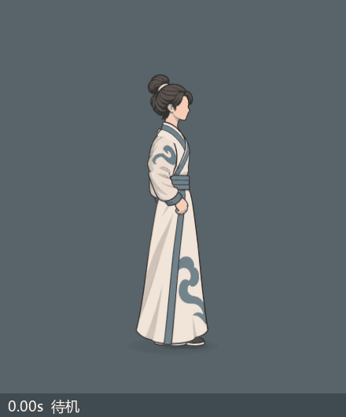
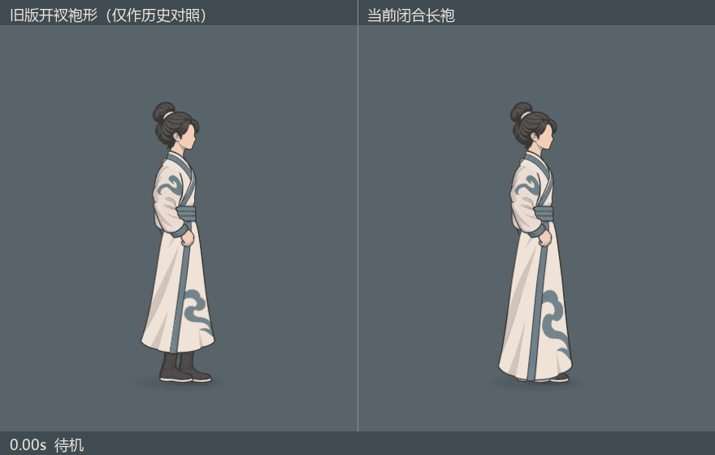
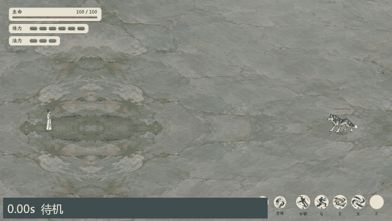
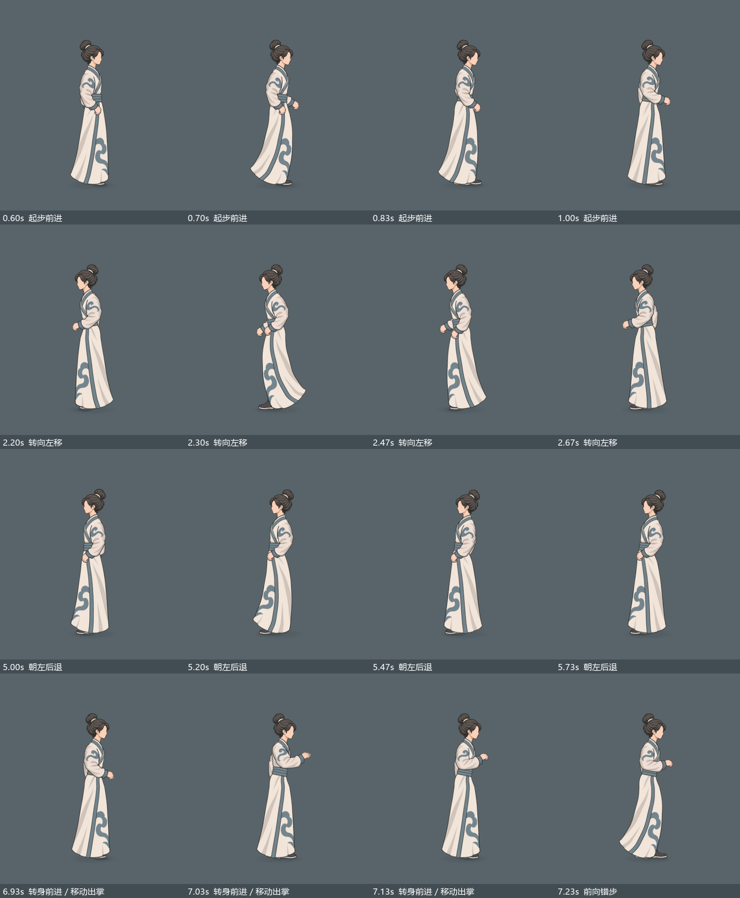
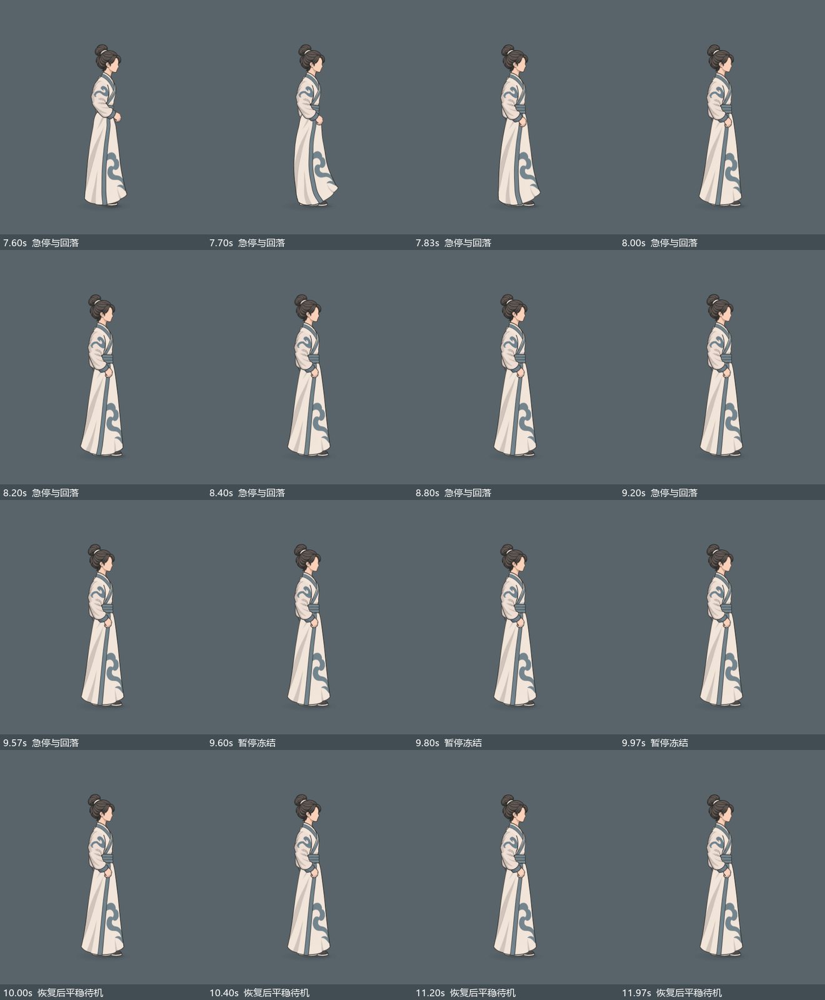
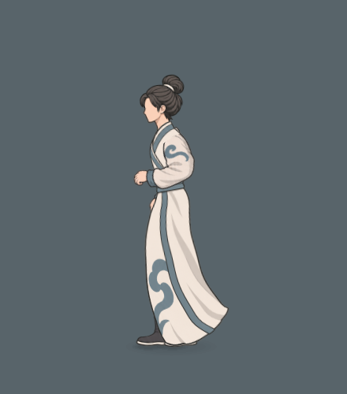

# 即时角色闭合袍摆（2026-11-04）

用户追加澄清：要求鞋脚完全不可见，本页此前允许极少鞋缘的版本未满足这项要求。请看[全遮脚三方案候选](../闭袍全遮脚三方案_20261104/README.md)，目前供选择、未替换默认。

现行来源：[即时角色衣摆结构与惯性](../../plans/界面与美术/即时角色衣摆结构与惯性_20261104.md)、[即时动作战斗恢复与共同取景](../../plans/战斗与构筑/即时动作战斗恢复与共同取景_20261104.md)。当前玉虚内门常服采用 `closed_robe`：一张连续袍身覆盖完整双腿，下摆受起步、转向、急停驱动，停止后继续回摆并衰减。独立 `split_outfit` 接口保留；下方旧版开衩袍仅用于历史对照，不作为当前玉虚服装，也不是本轮新做的劲装。

当前图片与动图均来自收膝修订后的最终皮肤。首轮候选在后退和错步中曾有大腿／膝部深色侧凸，经恢复直立骨盆、收束抬脚与完整双腿 IK 重解修正；原候选保存在 `候选_收膝前/`，不作为验收结果。最终双向后退／错步局部已独立目视复核，随后重新采集完整动态。

## 当前动态

12 秒输入回放共渲染 360 帧，包含 0.4 秒暂停，活动模拟时间 11.6 秒。近景为同一原生骨骼以四倍尺寸重新渲染，不是把石坪截图裁切放大；当前近景及前后对照 GIF 为 15 帧／秒，石坪 GIF 为 640×360、10 帧／秒，原生石坪静帧为 1280×720。

| 回放时间 | 动作与观察点 |
| --- | --- |
| 0.00–0.60 秒 | 待机与起步前状态 |
| 0.60–2.20 秒 | 向右起步、持续前进、斜向移动，末摆延迟跟随 |
| 2.20–3.20 秒 | 转向左移，检查衣身连续与惯性换向 |
| 3.20–5.00 秒 | 停下回落、站立出掌，检查腰、袖、颈肩连接 |
| 5.00–6.60 秒 | 朝左后退，检查膝盖／大腿不从袍侧撑出 |
| 6.60–7.60 秒 | 转身前进、移动出掌、前向错步，检查中间相位 |
| 7.60–9.60 秒 | 急停、延迟回摆与衰减 |
| 9.60–10.00 秒 | 暂停，冻结动作与衣摆 |
| 10.00–12.00 秒 | 恢复后继续回落，最终平稳待机 |

## 中间相位与局部

另有[关键帧总览](关键帧总览.png)、[后退同相位前后对照](后退同相位前后对照.png)、[石坪后退原生静帧](石坪实际窗口_后退.png)、[石坪急停原生静帧](石坪实际窗口_急停.png)。

## 验收结果

- 双朝向起步、前进、后退、转向、出掌与错步的选定中间相位中，袍面保持连续，未再出现膝盖／大腿深色块撑出袍侧。错步时只保留鞋头贴地边缘；完整双腿骨与 IK 链仍在袍内，没有删除腿部或遮掉骨骼数据。
- 原颈肩、腰部与袖身连接连续。脚影留在脚点地面，袍摆不透明轮廓最低点保持约 −0.55 个骨骼坐标像素；360 帧实测范围 −0.550099 至 −0.549839，鞋底接地点最大值 0.000158，未沉入地面。
- 急停并未直接回到静止姿态：7.60 秒停下时三段角度向量长度为 0.09505 rad，7.70 秒继续回摆至 0.30026 rad，8.40 秒衰减为 0.00788 rad，最终 11.97 秒为 0.00000118 rad。该记录证明运动在输入停止后继续，随后衰减。
- 360 帧朝向均与回放输入一致。暂停的 12 帧中，全部骨骼变换、衣摆模拟步数和原生近景像素均保持一致；恢复后继续衰减。
- [衣摆专项](衣摆专项.log) 7078 项通过，包含连续网格、权重、双向姿态、足底、膝包络、停止衰减、暂停与重开／瞬间移位稳定性。[大世界接口](大世界接口.log) 12 项通过，覆盖 `WorldActionTraveler.build(80)`、双向移动、停止、隐藏后零 delta、原脚点与显示高度尺、摘要接口。

本轮仅修即时角色外观与共享形象接口。样例移速 114、真实角色演练移速 235，以及原六招费用、冷却、命中、伤害和共同镜头保持原来源；正式世界多单位、心法、化法与战后回传仍按恢复主案分阶段迁移。

## 复现与追溯

- 原生采集入口：`tools/action_battle_test/capture_realtime_closed_robe.tscn`，回放驱动器仅提供固定移动、朝向和施放输入，正常战斗更新推进皮肤一次，不依赖桌面鼠标焦点。
- 最终原始序列：`tools/action_battle_test/output/realtime_closed_robe_final_knees_20261104/`；[采集日志](原生采集.log)、[逐帧姿态与衣摆记录](采集姿态与衣摆记录.jsonl)、[汇总与最终源文件哈希](动态采集检查.json)。
- 编码脚本：`tools/action_battle_test/review_realtime_closed_robe.py`；GIF 使用统一调色板，当前近景约 1.5 MB、前后对照约 3.0 MB、石坪实际窗口约 7.3 MB。
