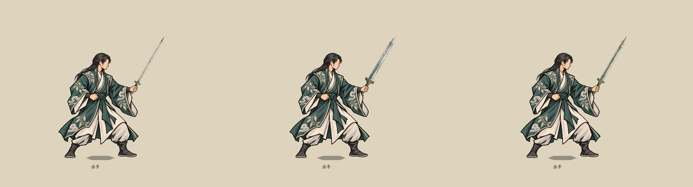

# 可换剑图的持剑待机

当前待机已更新为[持剑／御剑双待机](../持剑与御剑待机_20261023/README.md)，使用前景手指轮廓遮挡；下文早期高位握姿保留为历史记录。

2026-10-23更新：现行测试入口与成器展示已替换为[炼器剑图标重绘](../炼器剑图标重绘_20261023/README.md)中的三张新图及定位参数。下文旧剑图和实录保留为首版记录。

状态：2026-10-22，男修“碧岚云叶袍”样片已制作，接入原水墨特效实验室。只增加人物待机姿势和独立剑图显示接口，不修改武器、卡牌、战斗伤害、装备规则或存档。

## 当前效果

右向无五官侧脸、轻微Q版比例，保持现有墨线、衣装颜色和云叶纹。前手合指握剑，剑尖斜上，后手收在腰间。人物图只画握姿，不包含剑、剑柄或剑鞘；剑图独立位于人物图下方，由前手手指遮住握柄，避免换剑后出现旧剑残影。

复用项目现有三张透明剑图：

| 显示名 | 剑图 | 握点UV | 剑尖UV |
| --- | --- | --- | --- |
| 细剑 | `textures/ui/forging_20261021/slender_sword_ink_v2.png` | (0.900, 0.517) | (0.018, 0.517) |
| 阔剑 | `textures/ui/forging_20261021/broad_sword_ink_v2.png` | (0.865, 0.510) | (0.010, 0.510) |
| 脊剑 | `textures/ui/forging_20261021/spined_sword_ink_v2.png` | (0.865, 0.505) | (0.015, 0.505) |

这三项是外观展示名和定位参数，不新增装备类型或属性。换图时只更新剑图、图内握点和剑尖方向，不重新居中人物或改变脚底站位。人物及武器围绕统一地面原点整体镜像。

## 查看与替换

启动菜单 → **水墨特效实验室** → **动作·持剑待机**。上方“手持剑”下拉框切换三种剑图，“切换交手方向”查看左右朝向。当前先覆盖一套男修衣装，因此该样片不显示男女切换按钮；其他效果保留原按钮。

运行时接口为`BattlePaperDoll.show_sword_idle(icon, gripUv, tipUv, gripToTip, bladeDegrees)`。传入另一张透明剑图及其握点／剑尖位置即可替换，不依赖上述三张文件名；不同留白和画布尺寸通过UV定位。新剑图仍需标定其真实握点与剑尖，不能直接拿整张图中心当握点。现有显示数据尚未与正式装备自动选择绑定。

## 素材和锚点

- [人物透明图](../../../textures/characters/side_ink_sword_idle_20261022_v1/male_idle.png)：2048×2048 RGBA，参考高度1375，地面原点(1024,1900)。
- 握柄中心位于人物画布(1466,994)。剑图绕此点旋转、缩放；本轮握点至剑尖为780原图单位、剑尖方向右上60度。
- 人物与武器分别显示，剑图在人物图下、脚底影子上；手部遮挡随同一人物图生效。
- [内置图像编辑提示词与参考](../../../textures/characters/side_ink_sword_idle_20261022_v1/generation_prompts.json)、[画布与透明统计](../../../textures/characters/side_ink_sword_idle_20261022_v1/asset_manifest.json)；原始生成图保留在该素材目录的`source/`。
- [阔剑左向实录](mirrored_broad.png)、[三剑组合对照](sword_comparison.png)。

## 代码范围

`BattlePaperDoll.SwordIdle.cs`负责人物握姿与独立武器注册；`BattlePaperDoll.SideInk.cs`只在启用持剑待机时选用新待机图。播放其他姿势时隐藏独立剑图，回待机时恢复；清除模式或切换人物后回到原待机。

`InkVfxShowcase.SwordIdle.cs`提供现有实验室中的持剑入口和换图下拉框。当前未制作持剑攻击关键帧，也未把剑图自动挂到所有战斗人物身上；后续可由装备外观映射显式调用该接口。

已编译并录制三种剑图及阔剑镜像的实际画面，握点与脚底保持一致；本轮未新增自动化测试。画风与握姿供用户评审。
