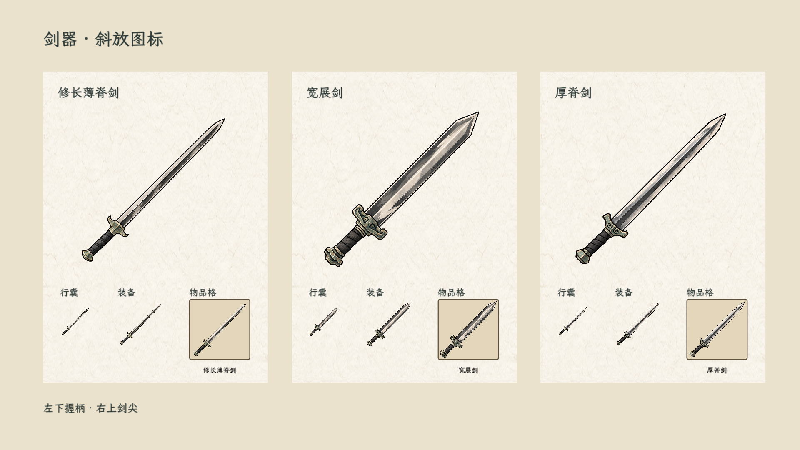
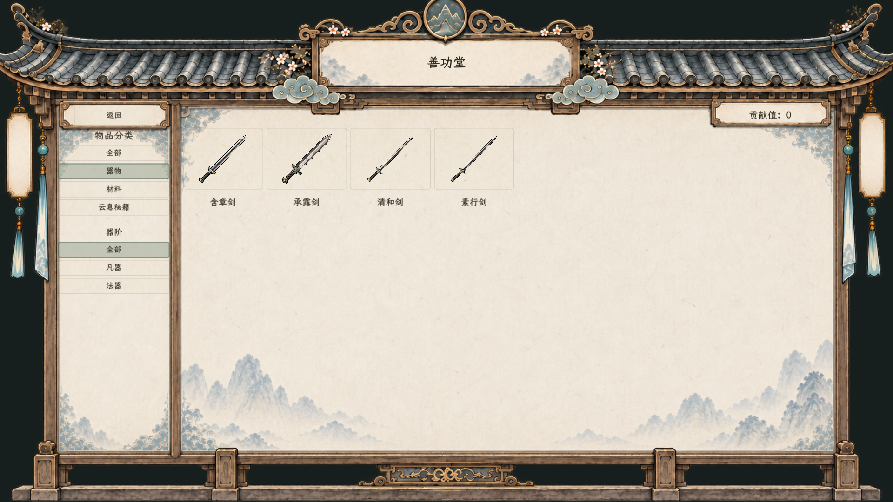

# 器物斜放图标

2026-10-25。用户要求重设计现有器物图标，采用斜放构图。当前剑器修长、宽展、厚脊三种外观使用正方形透明图，剑柄左下、剑尖右上；保留墨线、象牙白刃口、墨灰刃面和低饱和青铜护手。由内置图像生成工具以三张既有横向剑图为编辑参考分别生成，不重写器物属性或外观选择规则。

## 接入

- 素材位于 `textures/ui/forged_swords_icons_20261025_v1/`，三个文件名仍为 `slender_sword.png`、`broad_sword.png`、`spined_sword.png`。
- `ForgedArtifactPresentation.IconPath` 用于方形物品图标；`BodySpritePath` 保留旧横向战斗道具图和握点，战斗持剑改读该接口。水墨实验室旧横向道具不变。
- 行囊格、行囊详情、领取页与角色装备页通过快照派生最新图标路径；旧存档仍带旧form图标路径时无需重新获得器物，不修改已存属性或实例。
- 成器册、共用悬停与新生成器物技能图标沿共用展示接口使用新图。
- 本轮覆盖生成剑器的三类外观；未重绘旧制式装备资源或其他尚未制作的器物大类。

## 验证

编译0警告0错误。Godot原生审阅场景显示三种图标的大图、64/96小图与真实StorageItemSlot，核对旧实例派生路径及战斗道具分离，输出`FORGED_SWORD_ICONS_OK`。已查看最终截图，日志见运行.log；非完整战斗流程验收。

## 生成提示词

每个变体分别调用内置图像生成工具，编辑参考为旧同名横图，共用以下提示词，并按修长窄刃/宽展阔刃/厚脊中央深色剑脊补充形态说明：

Use case: precise-object-edit. Edit target is the supplied horizontal sword image. Create a production SQUARE inventory icon of the SAME sword in Chinese hand-painted ink wash style, with true transparent alpha background. Recompose the entire sword diagonally: pommel near BOTTOM LEFT (13%,87%), blade tip near TOP RIGHT (88%,12%). Exactly one complete straight sword, orthographic flat front view, 45 degree diagonal orientation. Enlarge to fill square canvas with a modest 8% safety margin, do not clip blade tip or hilt. Preserve design identity, charcoal outlines, ivory silver blade edges, ink-grey steel planes, desaturated antique bronze and teal guard, black wrapped grip. Improve readable bold silhouette at 64px. Restrained hand-painted brush texture, no microscopic clutter. No scene, NO cast shadow, NO halo, NO glow, NO floor, NO opaque black or paper background, NO vignette, NO border, NO words, NO pedestal, NO scabbard. The background must be completely transparent, including all surrounding space; no diffuse grey haze. 

## 宗门兑换漏接修正

用户截图指出善功堂仍是横向细线。上次仅改生成器物展示接口，漏改宗门制式凡器及法器商品资源。现已将素行、承露、含章、清和四份目录资源改读新斜放图；兑换商品卡的剑器图标由58×70改为112×112，购买确认及常规凡器行囊/装备随同使用新资源。清和剑过时测试/器蕴未接入描述同步清理，价格和数值不变。

已直接实例化实际YuxuSectExchangePanel，选择器物分类查看并截图，编译通过；宗门兑换回归日志另存。运行存在旧技能UID回退警告，与本轮图标无关。已打开游戏需重新启动以重新读取缓存资源。

