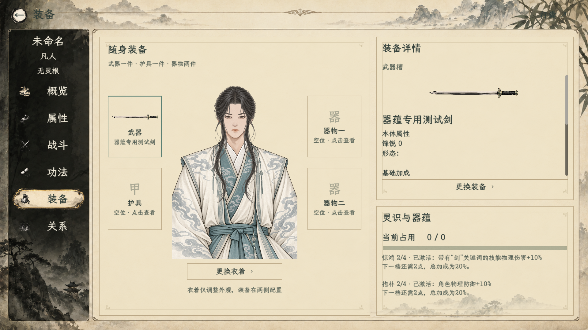

# 器蕴接入验收

[当前规则](../../plans/物品与装备/器蕴运行与生成接入_20261024.md)。

- [器蕴28项](ArtifactBondSmoke.log)：累计、实际结算、预算、快照与存取。
- [剑器51项回归](ForgedSwordAdapterSmoke.log)。
- [宗门兑换回归](SectEquipmentSmoke.log)。
- [界面运行29项](界面.log)：含正式装备分页截图。

截图为隔离人物专用测试剑，明确设置惊鸿2/抱朴2用于验证激活和物防10→11，不是配方产物；四套真实样方生成情况另记在日志。没有改玩家存档。

