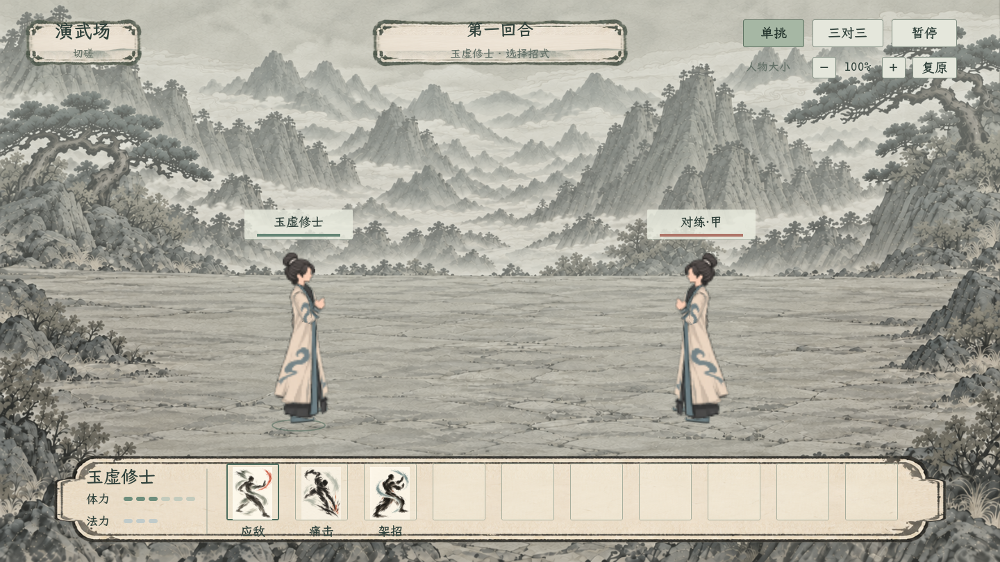
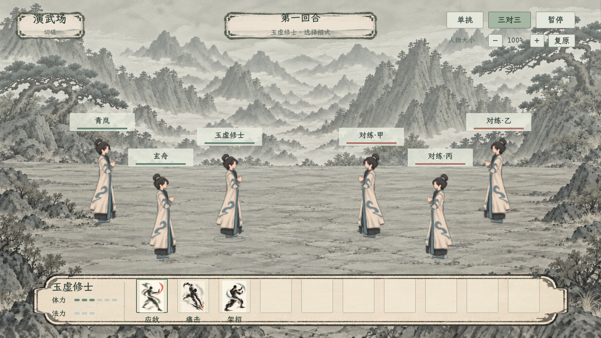

# 回合制战场构图预览：同套人物的单挑与三对三

2026-11-06：预览窗口已更新为[男女首套人物](../男女首套回合制人物_20261106/README.md)，男款保留，女款按现有清簪半束发型制作，现已按性别接入正式回合制战场。下方11月5日截图保留原全男构图，当前窗口和最新男女截图以新记录为准。

2026-11-05，构图审阅稿。用户本轮明确战斗已改为回合制，授权先以同一套人物制作单挑与三对三预览，比较人物大小和整体效果。本目录记录本轮最新呈现方向；既有即时动作试玩保留其实现记录，本轮不从其镜头、移动和命中规则推导回合制玩法。

正式规则及入口以[恢复原回合制战斗与面板](../../plans/战斗与构筑/恢复原回合制战斗与面板_20261105.md)和其引用的原队列战斗主案为准。本预览沿用该主案允许复用既有美术资源的边界，专门审阅人物显示与构图。

## 本轮可查看内容

双击 [打开回合制战场预览](../../../tools/打开回合制战场预览.cmd)，打开独立预览窗口。

- 右上「单挑」「三对三」切换构图；键盘 `1`、`3` 同样可切换。
- 「人物大小」的减、加按钮调整整体人物尺寸，范围为默认的 80%–115%，每次 5%；「复原」恢复本构图默认尺寸。键盘减号、加号、`0` 对应同一操作。
- 「暂停」或空格冻结／恢复待机；Esc 关闭预览。
- 两种构图都使用同一套当前白青常服、自有朴素束发髻和原规格骨骼。人物沿用现有素材分辨率，未重绘或上采样；本轮主要审阅比例、站位和界面留白。

## 默认比例与站位

| 项目 | 单挑 | 三对三 |
| --- | --- | --- |
| 设计画布 | 1440×810 | 1440×810 |
| 人物目标高度 | 248，约占整屏高度30.6% | 204，约占整屏高度25.2% |
| 1280×720窗口的等比目标高度 | 约220.4 | 约181.3 |
| 我方脚点 | (430,610) | (550,570)、(245,535)、(385,620) |
| 敌方脚点 | (1010,610) | 按画布水平中心镜像我方脚点 |
| 人物方向 | 双方面敌 | 双方面敌，浅纵深错排 |

以上是用于审阅的显示参数，人物可见轮廓随原待机有轻微变化；不是角色属性、距离、阵型加成或位移规则。前后排保持统一人物尺度，以脚点与遮挡次序形成纵深。

## 单挑

[1280×720版本](单挑_1280x720.png)

## 三对三

[1280×720版本](三对三_1280x720.png)

## 复用来源与展示边界

- 人物读取 [`guigu_native_first_runtime.gd`](../../../tools/action_battle_test/guigu_native_first_runtime.gd)，保留7个身体网格、原动作求值、衣摆物理及鞋底接触影。人物规格见[鬼谷原规格首套人物](../鬼谷原规格首套人物_20261105/README.md)。两种构图均为同一套白青人物，没有根据姓名另换衣服、头发或素材。
- 背景复用 `textures/battle/ink_terrace_multiteam_20261009_v2.png`，仅在本预览的材质里降低饱和、增加远景与战斗中心的淡色洗染。原PNG保持。
- 界面复用既有纸墨图集、浅宣纸技能栏与应敌／痛击／架招图标。两种构图保留同样的十槽占位，便于比较人物与界面争用的空间。头顶姓名、满血色条、第一回合、资源豆和技能栏为构图样例，不读取或计算角色战斗结果。
- 此场景使用骨骼待机，无出招或回合结算；不加载根项目的世界、存档和战斗自动加载项。没有改动技能费用、目标、伤害、资源或正式战斗入口。

## 实现与核对

- 场景：[`turn_based_stage_preview_20261105.tscn`](../../../tools/action_battle_test/turn_based_stage_preview_20261105.tscn)。
- 实现：[`turn_based_stage_preview_20261105.gd`](../../../tools/action_battle_test/turn_based_stage_preview_20261105.gd)。
- 运行环境：Godot 4.7.2，Compatibility / OpenGL，沿用 `tools/action_battle_test` 的独立工程。
- 已由实际渲染窗口采集两种构图、两种尺寸共4张截图。检查人数2／6、同套素材加载、实际截图尺寸、姓名条边界及互不重叠、尺寸调节和暂停／恢复，结果见[预览检查](预览检查.json)。
- 已目视检查完整截图的角色朝向、鞋底地影、姓名／血条和技能栏间距。日志见 [`turn_based_stage_preview_20261105.log`](../../../output/turn_based_stage_preview_20261105.log)。本预览结果不代表回合制技能、AI或战后回传的实装验收。
