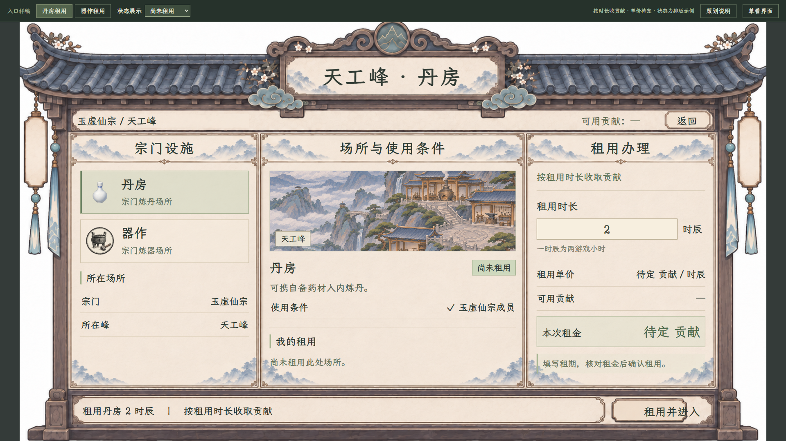
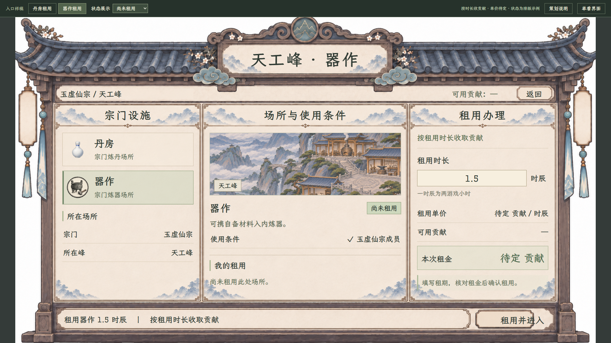
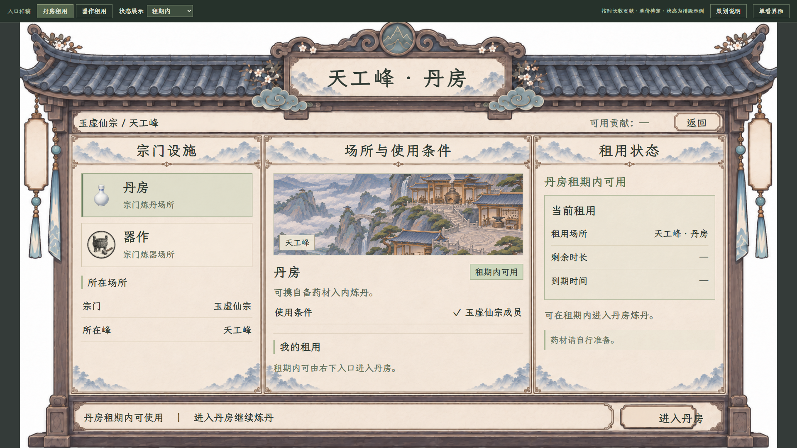

# 天工峰丹房与器作：租用入口样稿

> 历史 v1，用户已否定其照搬善功堂的构图。[请查看当前独立构图 v2](README.md)。下文截图仅留档；本稿原47项检查见[旧检查](交互与布局验收_v1.json)，素材见[旧来源](素材来源_v1.json)。

2026-11-07。当前任务入口。用户已澄清需要进入现有炼丹、炼器界面之前的宗门设施页，并确认**按租用时长收贡献**。本轮先做两页独立交互样稿，未接真实收费。

[打开两页可切换样稿](index.html) · [丹房租用](index.html#alchemy) · [器作租用](index.html#forging) · [现行专题与待定项](../../plans/剧情与宗门/天工峰丹房与器作租用入口_20261107.md)

## 丹房租用

查看当前场所、使用资格，填写租用时长，核对贡献单价、可用贡献与本次租金，再选择“租用并进入”。确认弹窗继续展示场所、时长及费用；单价待定，确认支付保持禁用。

## 器作租用

与丹房共用租用办理结构，两页独立记住时长草稿。没有投料、份数、火源选择、阴阳轴或成器预告；进入操作对接的目标仍是原有炼器页面。

## 已租用与确认

租期内显示剩余时长、到期时间与“进入丹房／进入器作”。尚未绑定角色租约的值留“—”；点击进入只在独立样稿栏回显去向，不重做或打开此前操作页样稿。

[器作租期内](器作_租期内_1920.png) · [1280 租用确认](租用确认_1280.png)

## 可操作内容与状态

- 丹房／器作切换，各自保留租期输入；刷新恢复空白。
- 填写正数时长、检查无效输入、打开确认、返回修改或按 Esc 收起。
- 样稿栏可查看尚未租用、租期内、租期结束、贡献不足及非宗门成员五种状态；这些是排版示例，不是实际角色判定。
- “单看界面”收起审阅工具，Esc 恢复。策划说明独立放在右侧说明页。

时辰是现有时间单位的显示候选，不是已确认的计费粒度。截图中的 2 时辰、1.5 时辰为验证时手工输入，用于查看表单，不是预设套餐、默认租期或起租门槛。实际界面初始为空白。

## 已确认与待定

已确认：宗门设施租用页、按租用时长收宗门贡献、进入后沿用现有炼丹／炼器界面。本轮没有改动善功堂或现有炼制页面。

两种设施的单价、计价单位、取整、最短／最长租期、离开计时、续租、退款、租期不足或炼制途中到期的处理仍待定。样稿明确显示“待定贡献”，不预设收费数字、折扣、火源等级、房间数量或额外收益。

原先的免费直达是当前游戏代码事实。用户本轮的新租用方向已记录到[正式专题](../../plans/剧情与宗门/天工峰丹房与器作租用入口_20261107.md)，旧接入文中的“不追加租炉费”已补充新方向说明；真实贡献扣除、时钟、租约与存档尚未实施。

## 风格与来源

沿现有善功堂的纸木材质、灰蓝和楷体做入口样稿，只复用风格。三栏分别放设施、用途与资格、租用办理，不改善功堂自身布局。

- 外框：复用此前生成的三栏无字框架，另存为[共用入口框架](共用入口框架.png)，没有修改原善功堂素材。
- 场景：复用当前正式天工峰背景，作为所在场所示意，不宣称新建了丹房或器作室内场景。
- 设施图标及字体：复用项目现有瓷瓶、百工图标与 `LXGWZhenKaiSlabGB-Regular.ttf`。
- [旧素材来源](素材来源_v1.json)，框架原生成提示词与记录沿来源保存，本轮没有重新生成图片。

旧的[四页操作／档案样稿](../百工与天工峰界面样稿_20261107/README.md)已标为历史理解稿，不再作为本任务入口。

## 验证

实际 Edge 浏览器 47 项检查通过：包含租期输入与独立草稿、未知费用阻止支付、五种入口状态、身份／贡献不足展示、进入去向、返回、确认与 Esc，以及 1920×1080、1280×720 两档窗口的全部状态。正文三栏完整可见、图片与楷体加载正常，没有网络写入或浏览器持久存储。[旧版完整检查](交互与布局验收_v1.json)。

[1280 丹房入口](丹房_租用入口_1280.png) · [1280 器作入口](器作_租用入口_1280.png)

截图来自独立浏览器样稿，不是 Godot 实机。没有改动游戏脚本、角色、库存或玩家存档；本轮未运行游戏编译或场景测试。
