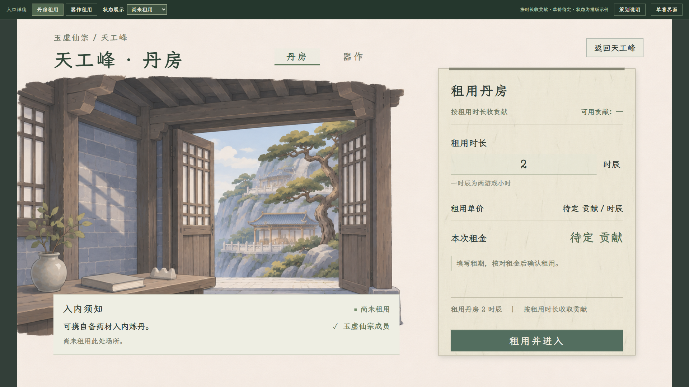
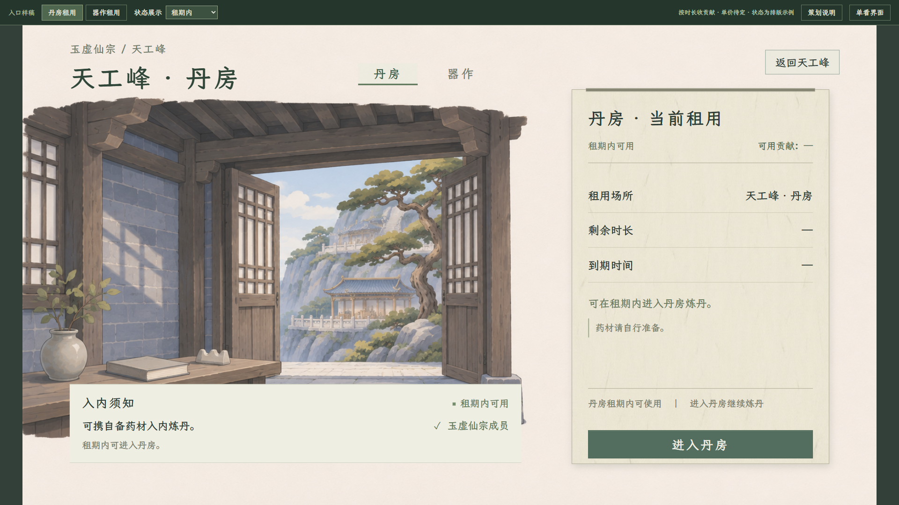

# 天工峰丹房与器作：租用入口样稿

> **2026-11-08：先定全局风格。**用户认为 v2 完成度不足，并要求先统一人物、静室等各面板。[全局规范与母板](../全局界面风格母板_20261108/README.md)是当前任务入口；本目录暂停细化、留作待改进历史样稿，不作为已认可风格。租用方向与未定收费参数保持。

2026-11-07。当前任务入口。用户已澄清需要进入现有炼丹、炼器界面之前的宗门设施页，并确认**按租用时长收贡献**。本轮先做两页独立交互样稿，未接真实收费。

**当前为独立构图 v2。**用户指出“同一风格，不要一模一样”；新版撤下善功堂式屋檐外框、三栏目录和通栏底座。页顶切换场所，左侧是接待入口概念画与简短须知，右侧是一张独立租用纸页，时长、费用与操作集中在纸页里。旧三栏稿已被否定，见文末历史。

[打开两页可切换样稿](index.html) · [丹房租用](index.html#alchemy) · [器作租用](index.html#forging) · [现行专题与待定项](../../plans/剧情与宗门/天工峰丹房与器作租用入口_20261107.md)

## 丹房租用

查看当前场所、使用资格，填写租用时长，核对贡献单价、可用贡献与本次租金，再选择“租用并进入”。确认弹窗继续展示场所、时长及费用；单价待定，确认支付保持禁用。

## 器作租用

与丹房共用租用办理结构，两页独立记住时长草稿。没有投料、份数、火源选择、阴阳轴或成器预告；进入操作对接的目标仍是原有炼器页面。

## 已租用与确认

租期内显示剩余时长、到期时间与“进入丹房／进入器作”。尚未绑定角色租约的值留“—”；点击进入只在独立样稿栏回显去向，不重做或打开此前操作页样稿。

[器作租期内](器作_租期内_v2_1920.png) · [1280 租用确认](租用确认_v2_1280.png)

## 可操作内容与状态

- 丹房／器作切换，各自保留租期输入；刷新恢复空白。
- 填写正数时长、检查无效输入、打开确认、返回修改或按 Esc 收起。
- 样稿栏可查看尚未租用、租期内、租期结束、贡献不足及非宗门成员五种状态；这些是排版示例，不是实际角色判定。
- “单看界面”收起审阅工具，Esc 恢复。策划说明独立放在右侧说明页。

时辰是现有时间单位的显示候选，不是已确认的计费粒度。截图中的 2 时辰、1.5 时辰为验证时手工输入，用于查看表单，不是预设套餐、默认租期或起租门槛。实际界面初始为空白。

## 已确认与待定

已确认：宗门设施租用页、按租用时长收宗门贡献、进入后沿用现有炼丹／炼器界面。本轮没有改动善功堂或现有炼制页面。

两种设施的单价、计价单位、取整、最短／最长租期、离开计时、续租、退款、租期不足或炼制途中到期的处理仍待定。样稿明确显示“待定贡献”，不预设收费数字、折扣、火源等级、房间数量或额外收益。

原先的免费直达是当前游戏代码事实。用户本轮的新租用方向已记录到[正式专题](../../plans/剧情与宗门/天工峰丹房与器作租用入口_20261107.md)，旧接入文中的“不追加租炉费”已补充新方向说明；真实贡献扣除、时钟、租约与存档尚未实施。

## 风格与来源

只参考现有界面的纸墨、灰青、哑光木石与楷体。新版按设施租用重新安排构图：普通页顶标题与场所切换、左侧接待场景和小段须知、右侧独立纸页。没有商品目录、屋檐牌匾、三栏柜架或通栏兑换底栏。

- [场所接待底图 v2](租用入口_场所底图_v2.png)：参照项目书房与天工峰的材质、色彩和笔触，通过内置图片生成工具制作全新构图，不复制参考房间的布局。只用于样稿，不新增世界地点或替换游戏内景。
- [完整生成提示词](场所底图_v2_完整提示词.txt) · [生成记录](场所底图_v2_生成记录.json)。
- 独立纸页复用现有 HUD 纸纹，由控件绘制边线和压纸木条；所有文字、租期与按钮是可操作控件，不烘焙在底图中。
- 字体继续使用 `LXGWZhenKaiSlabGB-Regular.ttf`。[当前素材来源](素材来源.json)。善功堂及现有炼制页的素材和游戏脚本没有因本轮改变。

旧的[四页操作／档案样稿](../百工与天工峰界面样稿_20261107/README.md)已标为历史理解稿，不再作为本任务入口。

## 验证

当前 v2 实际 Edge 浏览器 52 项检查通过：包含独立构图、页顶切换、操作归入租用纸页、租期输入与独立草稿、未知费用阻止支付、五种入口状态、身份／贡献不足展示、进入去向、返回、确认与 Esc，以及 1920×1080、1280×720 两档窗口。检查标题与页签不重叠、操作不越出租用纸页、正文完整可见；没有网络写入或浏览器持久存储。[当前检查](交互与布局验收.json)。

[1280 丹房入口 v2](丹房_租用入口_v2_1280.png) · [1280 器作入口 v2](器作_租用入口_v2_1280.png)

截图来自独立浏览器样稿，不是 Godot 实机。没有改动游戏脚本、角色、库存或玩家存档；本轮未运行游戏编译或场景测试。

## 历史

[三栏旧稿 v1](README-v1.md) · [旧版交互](index-v1.html) · [旧版47项检查](交互与布局验收_v1.json)。该版本被用户指出与善功堂构图过于相同，已经停止作为布局依据；其检查仅记录旧稿事实，不代表 v2 的检查或用户视觉认可。
