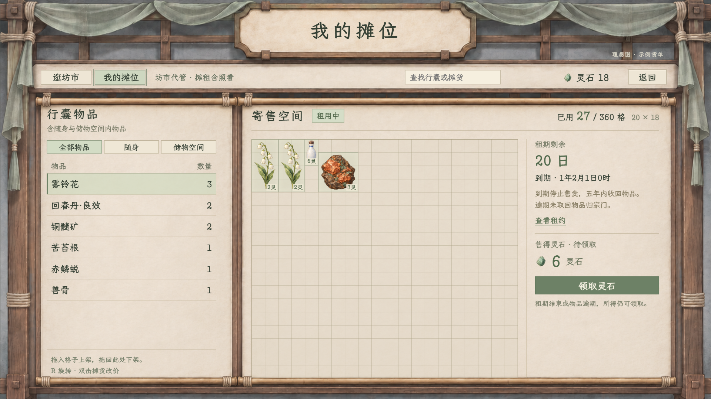
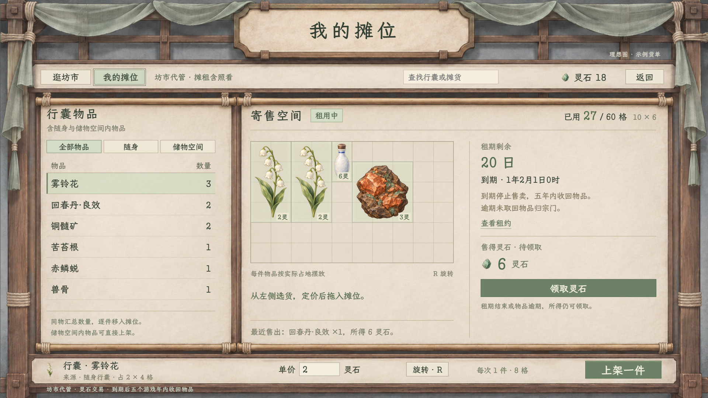
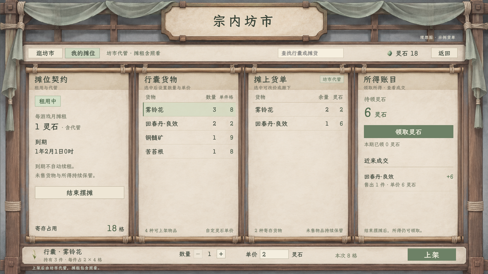
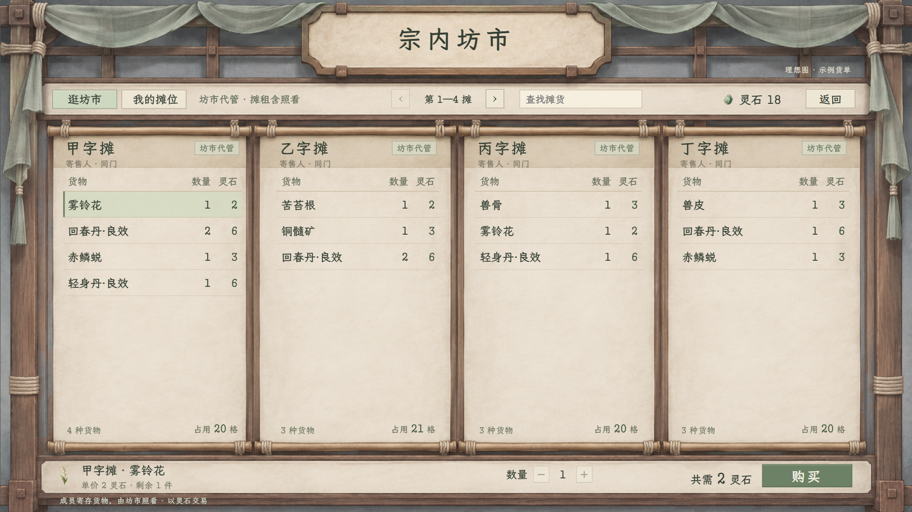

# 玉虚宗内坊市：试玩界面与交互样板

## 2026-11-07 当前：拖入弹数量与定价，拖回左侧下架

用户要求删除下方常驻操作栏，中央不再显示说明或成交记录，全部用于格子；单格确认48→36，缩小25%。用户允许扩展摊位格数，本稿按 **20×18，共360格** 铺满中央供视觉评审，尚未认定为正式经济容量。

[打开新版可点预览](我的摊位_拖入管理预览_20261107.html#mine) · [1280窗口](我的摊位_拖入管理_1280.png) · [拖入后的数量与定价弹窗](我的摊位_拖入定价弹窗_1920.png) · [拖回左侧下架](我的摊位_拖回下架_1920.png) · [到期拖回取物](我的摊位_拖回取回_1920.png) · [本轮验证记录](我的摊位_拖入验收_20261107.json)。

上架从左侧物品行拖入有效空格，落点有效才弹出数量和灵石单价；取消前后均不扣物。批量仍逐件占格，第一件保留落点，其余试放空位，不把数量堆成一格，也不移动其他货物。拖动中R旋转；从格内拖回左侧即尝试收回该件，不再需要下架按钮。双击未售物品可弹窗改价。数量超库存、价格无效、落点重叠、无效拖动与取消均保持资产；重复确认不会重复上架。储物空间内物品仍可直接拖出上架，五年取回和逾期所得保留沿既定规则。

去底栏框架由已有原创坊市双栏底图编辑生成，保留顶部和布幔纸木风格，将原底栏区域延伸为正文。[新底图](../../../textures/ui/yuxu_market_20261107/market_stall_space_frame_v2.png) · [最终提示词](我的摊位_去底栏框架_v2_生成提示词.txt) · [本稿参数](我的摊位_拖入规则_20261107.json)。使用内置图片生成工具，未改物品图标或把文字／格线烘焙入背景。

浏览器真实交互通过：拖入后弹窗、数量／单价正整数和上限、两件逐件占16格、首件保留落点、取消及重复确认、戒内直转、旋转、拖回左侧、双击改价、到期取回及逾期后的灵石领取、逛坊横拖与切页保位。1920中单格实测约35.98像素，1280约23.99，已按底图与1920设计画布换算；小窗口无主区域越界、名称截断或缺图，控制台无警告或错误。

**36格共用显示已接入正式游戏**的行囊、储物空间及领取，普通120格、各戒指宽高和物品逐件占格保持。编译0警告0错误，7组场景341项检查通过。[实际行囊1920](全局格子36验证/储物空间/01_行囊尺度1920.png) · [实际戒指1280](全局格子36验证/储物空间/03_戒指矩形收纳1280.png) · [实际领取1280](全局格子36验证/领取/03_领取收纳_1280.png) · [规则与接入边界](../../plans/物品与装备/物品格子显示缩小与坊市拖入定价_20261107.md)。已有“卸力”资源UID警告仍回退到原文本路径，未阻断验证。

**新版坊市仍为独立预览**：不接人物、NPC、正式资产或存档；取回夹具返回原来源，未完整模拟真实接收空间碰撞。归宗只记录演示去向，未写真实公库；公共货单与管理页仍是独立样例，未建立共享成交事务。不要将全局格距已接入误读为坊市新事务也已接入。

## 上一轮：左侧行囊列表，右侧60格摊位（已由上方拖入版替代）

用户明确修正管理页：左侧以列表汇总行囊，包含储物空间内物品；右侧展示实物占格的摊位，同时查看租期并领取售得灵石。本轮按确认的 **10×6，共60格** 重做双栏样板，替代下方四列管理页。

[打开新版可点预览](我的摊位_格子管理预览_20261107.html#mine) · [1280 窗口](我的摊位_格子管理_1280.png) · [到期待领](我的摊位_到期待领_1920.png) · [逾期归宗](我的摊位_逾期归宗_1920.png) · [拖入预览](我的摊位_拖入预览_1920.png) · [形状不足的示例](我的摊位_形状校验_1920.png) · [本轮验收](我的摊位_空间验收_20261107.json)。

左列提供全部／随身／储物空间筛选，同一定义、品质与属性的物品合并数量，空间内仍逐件占格。选货后设置灵石单价，可从所在空间直接拖入摊位，也可“上架一件”寻找当前朝向下的有效位置；不必先把储物戒指中的物品取回普通行囊。拖入或旋转会检查矩形边界与重叠，R 旋转同步改变宽高和贴图；取消上架或无效落点不扣原空间的物品。选择摊货可移动、改价和取回，实例身份保持。

摊位旁显示租期剩余、到期时刻、代管和取回说明、售得灵石与领取按钮。用户确定：每游戏月1灵石含代管、租期30日；到期停卖，物品须在到期后 **5个游戏年内**收回，达到取回截止仍未收回则归宗门、不再返还。售得灵石独立保留，逾期仍可领取。到期样例切换为“到期待领”，自动选中一件摊货，底栏可取回、不可上架或改价；逾期样例移除已归宗物品，保留所得领取。现行历法一年360日，时间不随现实等待推进。

双栏无字底图由本轮原创坊市框架编辑生成，保留布幔、绳结、纸木和外框，将内部四幅货单改为窄清册与宽寄售纸面；格线、物品、数字与交互仍为控件叠加。[新底图](../../../textures/ui/yuxu_market_20261107/market_stall_space_frame_v1.png) · [最终生成提示词](我的摊位_双栏底图_v1_生成提示词.txt) · [确认参数](我的摊位_空间规则_20261107.json)。使用内置图片生成工具，没有复用善功堂背景。

验证：真实鼠标拖入、拖动中R旋转、移位、越界／重叠回退、从戒内直接上架、改价不改历史、按原身份取回、租金及重复确认、领取及重复确认均通过；租满及取回截止均检查前一小时与达到时刻。剩余15格但放不下2×4物品的夹具也被正确拒绝。六组对外示例货单另经[60格逐件排放验算](列式货单_60格排放验算_20261107.json)，并非只核面积。1920／1280截图核对通过，列名、说明和主区域未越界；浏览器无警告或错误，逛坊横拖及切页保位保持。

以上为隔离演示样板，未更新 Godot、人物、NPC、资产或存档。来源与取回仅演示实例流转，未模拟真实行囊／戒指接收空间的完整碰撞和领取放置；归宗仅记录演示去向，未写入真实公库。公共货单与管理页仍为独立样例，未建立共享成交事务。旧试玩的无限保管及戒内先取回限制，须按[最新方案](../../plans/剧情与宗门/玉虚宗内坊市交易与租摊_20261107.md)更新后才算正式接入。

## 上一轮：四列我的摊位管理页（已由上方双栏空间稿替代）

用户追问“我的摊位呢”，本轮在同一套坊市框架中补齐独立管理页，顶部“逛坊市／我的摊位”可实际切换。[直接打开我的摊位](列式寄售摊_横拖预览_20261107.html#mine) · [1280 窗口](我的摊位_管理页_1280.png) · [未租用状态](我的摊位_未租用_1920.png) · [上架后](我的摊位_上架后_1920.png) · [预览验收](我的摊位_预览验收_20261107.json)。

四幅货单分别承载摊位契约、行囊货物、摊上货单和所得账目。租约列显示每游戏月 1 灵石、含代管、到期不自动续租及当前寄存占用；中间两列选货，底栏设置数量和灵石单价，选择摊货后改为保存价格与撤下余货；右列领取所得并查看近期成交。摊主仍不出现在画面中，沿用本轮原创木梁、布幔和纸面素材。

可点预览已支持确认租用、结束摆摊、按实际样例持有数量上架、同定义同价合并、改价、撤下和领取。结束摆摊不退租金，未售货物与待领灵石继续保留；未租用时禁止上架和改价，仍可撤下与领取。默认展示已有租约、18 格寄存货物和 6 枚待领灵石，均为隔离演示数据；刷新页面恢复初始样例，不生成新成交或自动补货。

浏览器交互检查了取消及重复确认、租金恰扣 1 枚、上架从行囊扣除而不制造收入、改价不修改旧成交、撤下返还数量、所得只领取一次、停摊后取回，以及切回逛坊后横拖与位置保持。1920×1080、1280×720 均截图检查，小窗口主要区域和名称未越界，图片加载正常，浏览器无警告或错误。

此轮仅补视觉与交互样板，未修改正式游戏界面、人物、资产或存档。样板没有推进租期时钟，也未模拟真实行囊空间与领取放置；撤下及领取的空间校验须沿用正式游戏事务。摊位总格数与形状仍待定，只累计逐件实际占格，不设置容量上限或声称已验证空间排放。下方较早版本“租用仅弹窗”的说明不再代表本轮管理页。

## 2026-11-07 最新：直接横拖，只用灵石

用户要求货单区域直接左右移动，并在讨论多种交易方式后明确只保留灵石。[打开横拖预览](列式寄售摊_横拖预览_20261107.html) · [实际操作短演示](列式寄售摊_横拖演示_20261107.webm) · [横拖途中截图](列式寄售摊_横拖途中_1920.png) · [1280 窗口](列式寄售摊_横拖起始_1280.png) · [本轮验收](列式寄售摊_横拖验收_20261107.json)。

整排摊位的纸面、木框和文字一同连续横移，标题、搜索和购买底栏固定。可按住货单列头、空白处或商品行横拖，触控板横向滚动及 Shift＋滚轮也可浏览；每列普通上下滚轮仍只滚动该列。拖动达到横向阈值后不再触发该次商品点选，松手即停，不强制整摊翻页。搜索保留当前横向位置。

沿用本轮新生成底图，通过控件背景区域将各列与货单重组为连续摊位；没有修改原始位图，也没有重新生成背景。浏览器实测鼠标横拖 335 像素时，纸面同步移动约 335 像素，标题与底栏位置不变，拖动结束未误选；列内纵滚、搜索保位、普通选货与数量／总价检查通过，1920／1280 主区域未越界。短演示为真实鼠标操作录制，已加速以缩短等待。

本轮仍仅修改视觉样板，未接入游戏人物、资产或正式坊市代码。交易只用灵石，不添加换物条件或支付方式切换。

## 2026-11-07 列式逛坊稿：每摊一列货单

用户要求参考善功堂的列表形式，每个摊位单独一列，同屏并列多摊并横向查看其他摊位；摊主不必出现，坊市代管、摊租含照看。用户已确认：同摊按各物品实际占格组合多种货物，列表同类合并显示数量。此版替代下方已被否定的单摊柜台稿。

[1280×720](列式寄售摊_理想图_1280.png) · [可点视觉样板](列式寄售摊_理想图_20261107.html) · [全新生成无字底图](../../../textures/ui/yuxu_market_20261107/market_ledger_frame_v1.png) · [生成提示词](坊市货单框架_v1_生成提示词.txt) · [素材与验证记录](列式寄售摊_生成与验收_20261107.json)。

新底图通过内置 imagegen 重新生成，采用布幔、绳结木梁与四幅卷式货单；未使用善功堂外框、檐瓦或白石场景拼接。纸木、灰青石与灰绿布面沿用玉虚统一风格。文字、货物列表和交互均由浏览器控件叠加，背景没有烘焙商品或文字。

画面只作理想图和本地交互预览，未接入游戏人物或存档。六个示例摊位以现有物品和试玩价格组成不同混合货单；[示例数据](列式货单_示例数据_20261107.json)记录资源路径、数量、占地与单价，同一正式定义且同价才合并。同类合并不减少实物占格。例如甲字摊：雾铃花 1 份（8 格）＋回春丹·良效 2 颗（4 格）＋赤鳞蜕 1 件（6 格）＋轻身丹·良效 1 颗（2 格）＝20 格。当时总格数与形状未定，所以旧图仅写已用格数；现行已确认10×6，六组样例后续排放验算见页首，不以旧夹具的空容量字段覆盖新裁定。

验证：1920×1080、1280×720 均截图检查，四列、长物品名与底栏未溢出；资源图片加载正常，浏览器无警告或错误。实际点击检查了选货、数量与总价、横向换摊、搜索不移动摊位。样板的购买和租用弹窗仅作视觉演示，不结算资产。

## 上一稿：单摊柜台理想图（用户已否定）

用户进一步明确：成员把货物寄存在坊市，每个摊位由坊市代为照看，摊位租金已包含看管；玩家一摊一摊逛，不需要画摊主。[查看理想图](寄售摊_理想图_20261107.png) · [画面来源](寄售摊_理想图_20261107.html)。图中的摊位、货物、数量和余额都是示例；图中货物可由真实物品图标替换，不能据此生成实际库存。

画面沿用已认可的善功堂框架和纸面，借用白石坊市画面作为寄售摊氛围占位，并非认定玉虚正式场景。当前只输出静态设计图；既有坊市仍为下方所述试玩界面，逐摊浏览和同门货物寄存代管尚未接入。具体 NPC 寄存条件和处置边界以后续规则为准。

## 2026-11-07 试玩首版已接入

从和光峰“宗内坊市”进入 Godot 实际界面，使用和光峰画面、现有物品图与纸面布局。逛坊页支持分类、搜索、选择真实摊货和确认购买；摊位页支持租用、上架、改价、撤下、结束摆摊、查看最近成交以及通过既有领取界面收取灵石。购买显示 1 点精力费用，到期时间精确到小时。

[实机逛坊 1920×1080](实机_逛坊_1920.png) · [实机摊位 1920×1080](实机_我的摊位_1920.png) · [实机逛坊 1280×720](实机_逛坊_1280.png) · [实机摊位 1280×720](实机_我的摊位_1280.png) · [交易与租摊策划](../../plans/剧情与宗门/玉虚宗内坊市交易与租摊_20261107.md)。实机截图使用隔离测试人物与库存，不代表某个玩家存档中的实际摊货或余额。

验证：项目编译通过；实际图形窗口的坊市测试通过 64 项检查，覆盖和光峰正式入口与返回、真实库存和灵石、玉虚同门的当面交易不为空库存生成货物、其他人物原交易逻辑、旧库存灵石隔离、价格及精力、租约月界、月结工作分支、上架改价撤下、满包保留、取消与领取、重复结算、资源存档读回及原生界面按钮。未使用真实玩家存档槽。原善功堂原生界面回归通过 23 项检查。测试中已有的“卸力”技能资源 UID 无效警告会回退至文本路径，未阻止以上测试。

## 早期浏览器交互样板

下方浏览器样板仅供回看布局，不读取或写入游戏人物、库存和存档。正式玩法以本页上方及[交易与租摊策划](../../plans/剧情与宗门/玉虚宗内坊市交易与租摊_20261107.md)为准。

[打开可点样板](index.html) · [逛坊市 1920](坊市_逛坊_1920.png) · [我的摊位 1920](坊市_我的摊位_1920.png) · [逛坊市 1280](坊市_逛坊_1280.png)

## 画面与交互

- “逛坊市”：分类和搜索、示例摊货、商品详情、购买数量与确认；示例采购只改变本页面临时数据。
- “我的摊位”：每游戏月 1 枚灵石为首版摊租测试值；样板可演示确认租用、选择行囊、填数量与单价、上架、撤下、模拟一笔出售及领取所得。样板中的模拟成交与正式 NPC 月结分别运行。
- 顶部明确标示“交互样板·演示数据”。商品图标和字体读取项目现有资源，示例人物、商品价格、数量和余额均为虚构展示，不是正式数据或价格设定。
- 背景暂借白石坊市素材作页面氛围参考，不表示玉虚坊市场景已经制作或认定应直接复用。构图采用灰青、木色、米白纸面，接近现行内景与物品图标风格。

## 验证与边界

使用 Microsoft Edge 的 Playwright 浏览器交互：检查租用确认、上架、模拟售出、待领所得与领取，以及浏览、购买确认与样例余额／数量变化；检查 1920×1080、1280×720 页面截图和主要详情区与底栏不重叠。样板不模拟行囊空间、租期时钟、NPC 真实需求、存档及资产事务；这些必须在正式实现中单独验证。
