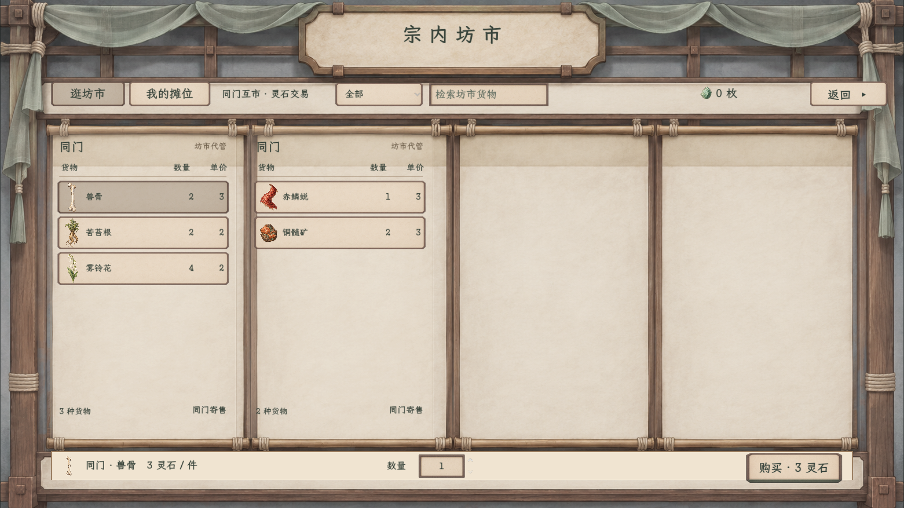
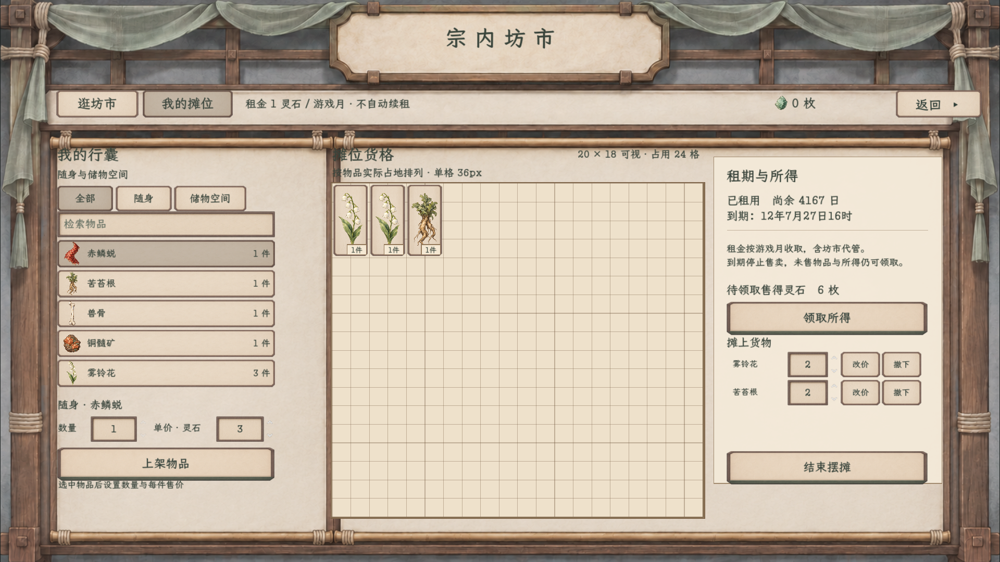

# 宗内坊市纸墨木石 · 2026-11-10

“逛坊市”和“我的摊位”已接入正式 `YuxuMarketPanel`，通过和光峰宗内坊市入口打开。实机截图由隔离预览场景生成，不读取或写入正式存档。

## 实机画面

1280×720：[逛坊市](实机_逛坊市_1280.png) · [我的摊位](实机_我的摊位_1280.png)

早期静态探索：[可切换 HTML 样稿](宗内坊市纸墨样稿_20261110.html) · [逛坊市](逛坊市_纸墨样稿_1920.png) · [我的摊位](我的摊位_纸墨样稿_1920.png)。早期稿里的按钮表现不再作为当前规则依据。

## 当前接入范围

- “逛坊市”显示在场摊主的分列货单，支持筛选、搜索、选货、数量选择、确认购买。
- “我的摊位”显示随身及可访问储物空间的物品，支持来源筛选、搜索、选货、数量设置、上架、改价、撤下、租用／结束摆摊、领取所得。
- 中央 20×18 是当前展示布局，不代表已定经济容量，也没有持久化的真实格子坐标。上架仍通过选择物品与“上架物品”按钮完成；之前方案里的拖入定价、拖回下架尚未接入。
- 当前按钮按[固定用途映射](../../plans/界面与美术/按钮用途与素材映射规范_20261109.md)：页内切换、筛选、返回、取消、改价、撤下使用 Regular；购买、租用／结束摆摊、上架、领取和确认使用 Primary；输入使用纸槽，数值调整使用裸三角。返回使用 Regular 纸面“返回 ▸”，不使用跨页 Navigation 签。选中整张纸面压暗，不染绿；不可用控件统一降低饱和度。
- 现有交易、租期、月结及领取规则仍以[坊市主案](../宗内坊市交易界面_20261107/README.md)和[交易与租摊方案](../../plans/剧情与宗门/玉虚宗内坊市交易与租摊_20261107.md)为准。五年后归宗与真实坐标存档尚未接入，界面不宣称已实现。
