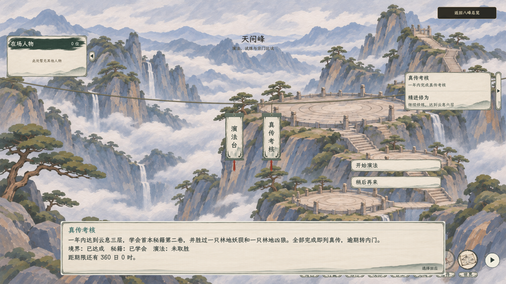
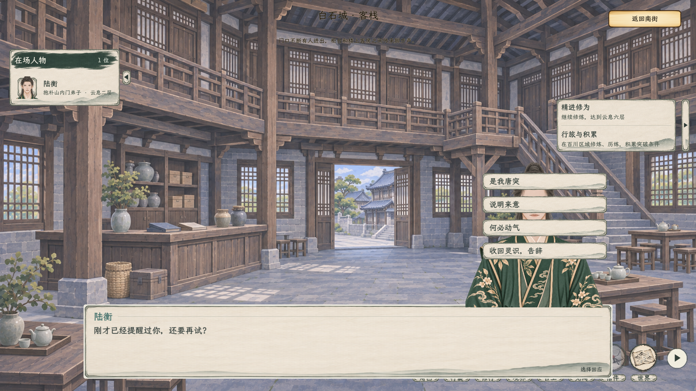

# 对话选项的固定位置

2026-11-07 旧版记录。用户随后要求选项区底边动态贴合对话栏上沿；[查看当前方案与实机](../对话选项贴合对话栏_20261107/README.md)。本页图片保留纵向固定锚点的旧效果。重叠时选项仍显示在立绘前方，文字与点击保持可用。

[1280×720 考核选项](考核选项_1280.png) · [1280×720 有立绘](立绘重叠_1280.png)

上述图片由隔离测试存档在 Godot 正式场景中截取，考核与人物数据为测试样本。

## 验证

- C# 构建通过，0 警告、0 错误。
- 图形窗口检查考核对白在 1920×1080、1280×720 的位置、正文长短变化与鼠标点击；完整考核战斗往返复跑通过。
- 人物探查图形流程 152 项通过，覆盖立绘显示／隐藏时选项位置不变、选项图层、鼠标点击和战斗往返；白石至玉虚预备弟子流程 65 项通过。
- 首次图形检查在切换窗口尺寸后进入考核战前准备时出现一次 Godot 资源句柄异常；随后相同完整图形流程复跑通过。本轮未排查该偶发异常的根因。
