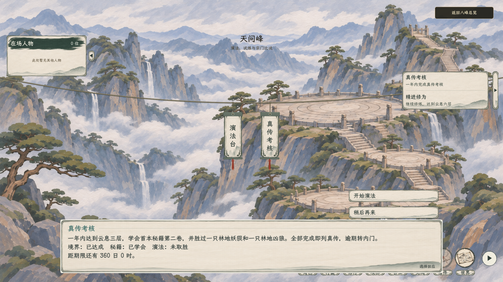
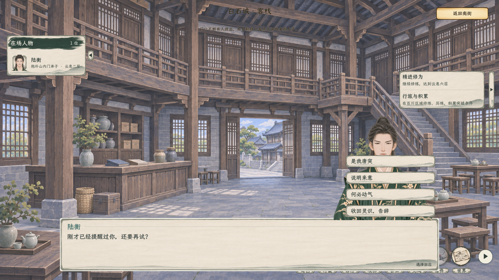

# 对话选项贴合对话栏

2026-11-07，按用户要求，回应选项的底边紧贴对话栏上沿；对话栏因正文长短或窗口尺寸而改变高度时，选项同步上下移动。横向仍在右侧，不因立绘或人物名单避让，重叠时选项显示在立绘前方。本页保留选项贴合时的原图；[后续旁白与事项标题格式](../旁白与事项标题_20261107/README.md)已将考核说明的说话者修正为“旁白”。

[1280×720 考核选项](考核选项_1280.png) · [1280×720 有立绘](立绘与选项_1280.png)

上述图片使用隔离测试存档在 Godot 正式场景中截取，考核与人物数据为测试样本。

验证：C# 构建 0 警告、0 错误；考核对白图形检查 20 项通过，覆盖两种窗口尺寸、正文变长后的跟随和实际鼠标点击；人物探查图形流程 152 项通过，覆盖四项回应、立绘显示／隐藏、点击与战斗往返。
