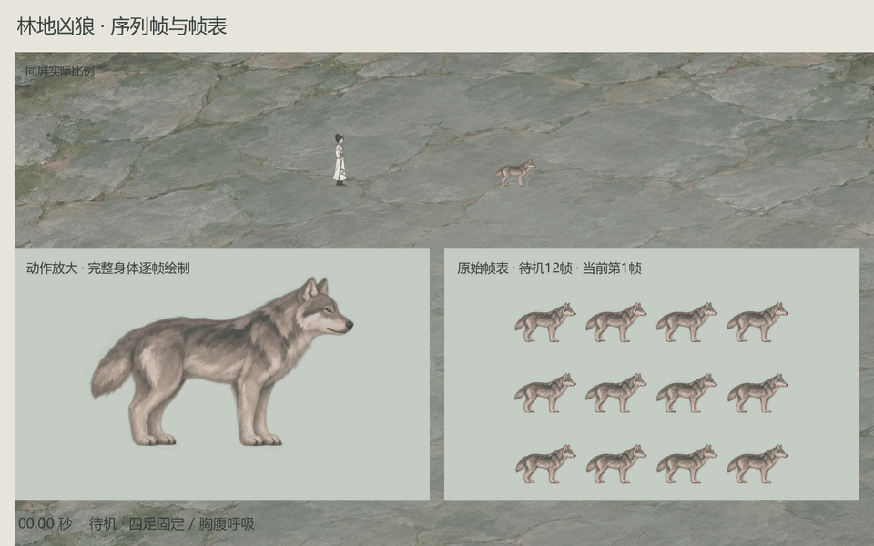

# 局内凶狼：整狼序列帧表

2026-11-04，用户最新明确“直接用序列帧”“用序列帧表，注意帧数”。本轮改为完整身体逐帧绘制，狼的局内表现由AnimatedSprite2D播放，骨骼候选退出当前入口。保留人物旁的小尺寸比例，既有战斗规则和数值保持。

## 实际源帧数

| 动作 | 源帧数 | 播放 |
| --- | ---: | --- |
| 待机 | 12 | 2.4秒循环 |
| 走动 | 16 | 按实际位移推进循环 |
| 小跑 | 16 | 按实际位移推进循环 |
| 蓄势 | 8 | 原0.8秒 |
| 扑咬 | 6 | 原0.2秒 |
| 收势 | 10 | 原1.5秒 |
| 受击 | 6 | 0.28秒表现 |
| 倒地 | 12 | 1.2秒，末帧保持 |
| **合计** | **86** | **五张源帧表、八段动画** |

帧数指图集中实际存在的完整绘制单元，不含重复采样出的录像帧。每张表均检查格数、非空、边界、完全相同像素的重复格；86格分别寻址，全部源格可进入播放。走动和小跑用相位指导表区分四足次序，首尾按同一循环检查。

## 帧表与播放资源

- [走动16帧表](../../../tools/action_battle_test/art/forest_wolf_frames_v2/walk16.png)，4×4。
- [小跑16帧表](../../../tools/action_battle_test/art/forest_wolf_frames_v2/trot16.png)，4×4。
- [待机12帧表](../../../tools/action_battle_test/art/forest_wolf_frames_v2/idle12.png)，4×3。
- [蓄势／扑咬／收势24帧表](../../../tools/action_battle_test/art/forest_wolf_frames_v2/bite24.png)，6×4，依次8＋6＋10格。
- [受击／倒地18帧表](../../../tools/action_battle_test/art/forest_wolf_frames_v2/hurt_death18.png)，6×3，依次6＋12格。
- [原生SpriteFrames资源](../../../tools/action_battle_test/art/forest_wolf_frames_v2/forest_wolf_sequences.tres)，附五张无损原生纹理资源，可在Godot检查帧数与顺序。
- [时序、比例与定位说明](../../../tools/action_battle_test/art/forest_wolf_frames_v2/sequence.json)、[源帧检查记录](../../../tools/action_battle_test/art/forest_wolf_frames_v2/sheet_qa.json)、[播放脚本](../../../tools/action_battle_test/forest_wolf_sequence.gd)。

各表只使用一个统一的像素密度换算，匹配同一只狼的体型；同段各帧不独立缩放、不拉伸或变形。少量站立／落地格用整格平移做定位，保证地面一致；腾空扑咬格保留离地高度。原始PNG不改像素，不抠底或程序补画。

原生SpriteFrames中的帧是源图像素尺寸；游戏中的同屏大小、脚点和原战斗阶段映射由sequence.json与播放脚本统一控制。帧表里的狼均面右，面左时镜像整张完整身体。

## 接入与验证

当前已有侧向即时试玩及人物即时演练的狼已读取本资源包。追逐只改变播放相位，不改变真实速度或碰撞；蓄势、冲出、收势直接读取原战斗阶段剩余时间。暂停保留当前格，受击只改变表现，死亡不循环，重开回待机。

主项目Godot 4.7.2 Mono及独立Godot 4.7均通过294项序列帧检查，覆盖86格、八段实际播放、16帧循环、阶段时间、暂停、朝向、倒地末帧和当前场景接入。基础技能26项回归通过。视觉仍供用户评价，检查通过不等于美术已获认可。

GPU动作预览同时显示当前动画和对应原始帧表；移动预览按60fps记录实际位置，供检查走动／小跑衔接与同屏大小。渲染记录在 `output/forest_wolf_sequences_20261104/`。

## 实机预览与资源包

同屏实测人物高89像素，狼高45像素，狼约为人物高度的50.6%。图中的放大窗口仅用于检查嘴、尾巴和四肢，上方才是局内实际大小。

- [完整动作录像](wolf_sequence_actions.mp4)：330张GPU画面，30fps，11秒，含待机、追击、转向、蓄势、扑咬、收势、受击、暂停、倒地与重开。
- [移动录像](wolf_sequence_motion.mp4)：240张GPU画面，60fps，4秒，保留走动／小跑的原始记录频率；[便览GIF](wolf_sequence_motion.gif)为30fps采样。
- [86源帧完整资源包](forest_wolf_sequences_86.zip)：五张原始透明PNG、原生SpriteFrames及无损纹理、时序定位数据、播放脚本和完整提示词。

录像画面数与美术源帧数分别统计；增加录像帧不会增加源帧。本轮八段源帧全部在实际播放采样中出现，详见 `output/forest_wolf_sequences_20261104/smoke_report_main.json` 与 `smoke_report_standalone.json`。

## 完整提示与来源

使用内置imagegen分别生成五张帧表，原样保存。完整提示：

- [走动](../../../tools/action_battle_test/art/forest_wolf_frames_v2/walk16.prompt.txt)；
- [小跑](../../../tools/action_battle_test/art/forest_wolf_frames_v2/trot16.prompt.txt)；
- [待机](../../../tools/action_battle_test/art/forest_wolf_frames_v2/idle12.prompt.txt)；
- [扑咬](../../../tools/action_battle_test/art/forest_wolf_frames_v2/bite24.prompt.txt)；
- [受击／倒地](../../../tools/action_battle_test/art/forest_wolf_frames_v2/hurt_death18.prompt.txt)。

原始生成均位于 `E:/tmp/CodexData/generated_images/01a1a5d6-4512-7453-be43-807c3d28e7e0/`，对应文件依次为 `exec-676c9bbe-e6ba-4fe3-9e32-388258332db0.png`、`exec-8cabf16e-6cd3-471c-b7d5-000867552604.png`、`exec-86b6a2e2-ed84-4aee-bc9d-8a6d132738c2.png`、`exec-455850d6-a325-4a29-953a-1cfde16fcea1.png`、`exec-a2006b8b-0306-4b47-bfee-4dfbe56278a3.png`。
