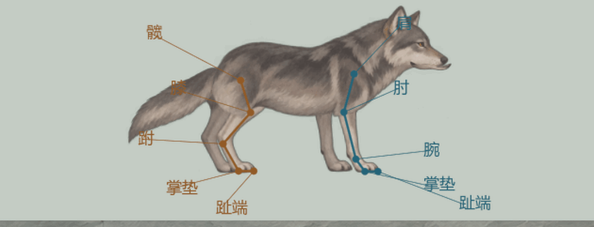

# 局内凶狼：第三版素材、完整四肢关节与小尺寸步态

> **当前入口已改用序列帧。** 用户最新确定直接用整狼序列帧表，本骨骼目录转为历史记录；现行素材、帧数和接入见[整狼序列帧正式改版](../局内凶狼序列帧正式改版_20261104/README.md)。

2026-11-04。第三版素材与小尺寸接入后，用户继续指出关节不自然。本轮进一步修正掌垫与腕／跗控制点混淆，改为每腿五点四段骨骼。当前共26骨，接入已有侧向即时试玩与人物即时演练。视觉仍供用户评价，不将技术检查通过写成用户认可。

## 当前造型与同屏尺寸

采用灰褐手绘、自然头身比例、短密毛和较小尾巴。躯干、脖颈、头与上颚是一张连续画面，由躯干与头骨共同蒙皮，减少头颈拼接；下颌、四肢和尾巴独立。近侧腿根位于连续身体下方，隐藏肩胯圆形盖片接缝。

运行时统一缩放0.55，旧候选为0.85。独立透明GPU截图实测：人物可见高度89像素，狼43像素，比值48.3%。脚底偏移收至3单位，影子与血条同步缩小；比较使用同一局内脚底线。

[同屏正常大小与关节叠线完整动态](wolf_joint_review.gif)、[站姿关节点](wolf_joint_standing.png)。上图是关节放大检查，局内大小保持人物的48.3%。演示共120帧／30fps，封装GIF为15fps并保持4秒原时长；包含右行、提速、减速落足、停留与反向。

## 素材与可编辑骨骼

- [活动图集](../../../tools/action_battle_test/art/forest_wolf_ingame_v3/source.png)：1254×1254 RGBA，七件配套素材，原生透明。
- [坐标、骨锚与口腔标点](../../../tools/action_battle_test/art/forest_wolf_ingame_v3/rig.json)。
- [可编辑原生骨架](../../../tools/action_battle_test/art/forest_wolf_ingame_v3/forest_wolf_rest.tscn)：26根Bone2D、7件Polygon2D蒙皮、2389顶点；根缩放0.55，无自定义脚本依赖。骨骼编辑器中的长度与指向也按实际骨链设置。[外部无损纹理](../../../tools/action_battle_test/art/forest_wolf_ingame_v3/wolf_atlas.res)保留源PNG质量。
- [动画运行器](../../../tools/action_battle_test/forest_wolf_rig.gd)、[原生骨架导出](../../../tools/action_battle_test/export_forest_wolf_rest.gd)、[原生场景检查](../../../tools/action_battle_test/verify_forest_wolf_rest.gd)。

## 步态修订

此前三骨链把前腕／后跗当作接地点，脚掌整块跟转，支撑时关节读不出正常的屈伸。本轮控制点按[伊利诺伊大学兽医学院犬科影像解剖图谱](https://vetmed.illinois.edu/imaging_anatomy/)核对：前腿为肩→肘→腕→掌垫→趾端；后腿为髋→膝→跗→掌垫→趾端。腕／跗和掌垫现在是不同的节点。

支撑相锁定真实掌垫，腕／跗可在掌垫上方屈伸，抬脚时趾端可独立收起。每段保持原长度，肩髋固定在胸／骨盆上；移除无界拉动肩髋来够落点的补偿。用弯曲方向与伸展护栏防止肘、膝翻面，骨干主要保持刚性，只在关节附近窄带混权。骨骼显示角度与节点旋转的区别按[Godot Bone2D文档](https://docs.godotengine.org/en/stable/classes/class_bone2d.html)处理。

步长、支撑占比和步频继续按实际速度与身体缩放配合，低速四足依次承重，再过渡到对角小跑。停步先把不可达的长步收回落稳，再恢复站姿；躯干只做有限的整体承重下沉，肩髋不会脱离身体。头部做稳定补偿，尾根保留惯性。

首次创建后的位置／缩放调整、重开与远距离瞬移会重新建立脚点，防止网格拉向旧位置；同位置的零时间步精确暂停。现有待机、蓄势、扑咬、收势、受击和倒地接口保留。

## 验证与范围

主项目Godot 4.7.2 Mono与独立Godot 4.7分别通过189项狼专项检查，并通过新增的720帧关节结构检查。真实掌垫全方向最大支撑漂移约0.028单位，四段骨长最大误差0.00032单位，肩髋根相对胸／骨盆最大漂移0.00025单位；膝与跗保持相反弯向，承重趾端与掌垫共面。停稳后脚掌高度误差小于0.00008单位。另检查权重、嘴部、倒地、暂停、重开和瞬移；可编辑原生场景以26骨、七件蒙皮在主项目加载通过。

移动视频核对每帧速度积分与位置变化，4秒净位移约88.667单位，误差小于0.001。当前GPU帧和报告位于 `output/forest_wolf_joint_revision_20261104/`：`smoke_report_main.json`、`smoke_report_standalone.json`、`anatomy_report.json`、`capture_report.json` 和 `frames/`。

本轮只改狼的美术和动画表现，既有速度、伤害、费用、攻击时机、碰撞与结算保持。后续人类NPC模拟方向沿[即时战斗主案](../../plans/即时动作战斗恢复与共同取景_20261104.md)，俯视实验和正式队列未随本轮更换。第一、二版与序列帧试样保留追溯，不作为本轮视觉成品。

## 生成来源与完整提示

使用内置imagegen。原始生成PNG原样复制到项目，程序只负责图集映射、网格与绑定，未用代码补画源图。

- [造型参考提示](../../../tools/action_battle_test/art/forest_wolf_ingame_v3/master.prompt.txt)与[参考原图](../../../tools/action_battle_test/art/forest_wolf_ingame_v3/master_reference.png)：原始生成 `exec-50ee5285-1855-4d18-851b-12901cccf71a.png`。该参考外围光晕不进入运行时。
- [最终七件素材完整提示](../../../tools/action_battle_test/art/forest_wolf_ingame_v3/source.prompt.txt)：原始生成 `exec-4e5c8800-ce3a-422d-a955-97a100624a08.png`，已重新要求并检查真实透明外围。

原始生成目录：`E:/tmp/CodexData/generated_images/01a1a5d6-4512-7453-be43-807c3d28e7e0/`。

