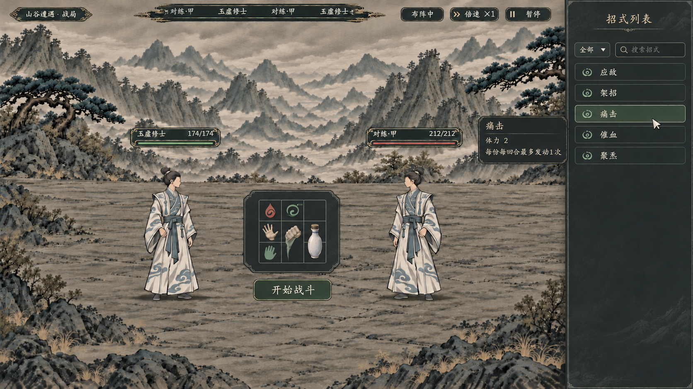

# 方案二：炭灰·布阵态理想图

> 2026-11-07。状态：**供用户比较的静态视觉候选，未接入游戏。** 本图只展示布阵状态；开战后右侧列表隐藏、招式盘缩到左下角的状态由另一张图展示，不在本图冒充已实现。



## 参考与产出

- 输入参考：[上一版岩灰右栏理想图](../局内战斗暗色UI候选_20261106/02_岩灰右栏_理想图.png)。沿用其中的水墨山谷、两位白青衣人物和暗色界面气质，将招式盘从右栏移到画面中间偏下。
- 已生成图片为 **1672×941、RGB、约 16:9 的 PNG**。项目内文件是生成器输出的原样复制，未裁切或拉伸。
- 内置 `image_gen` 生成原件：`E:/tmp/CodexData/generated_images/01a1b122-9835-7ba2-b447-228c73a3c5bc/exec-1d77ffe0-09b8-4c6c-a622-782fb6d816f0.png`。
- SHA-256：`bd3f1b10db9ab1269234b1fd7ac78c380ab6b8982771d21242189e4216d714be`。

## 检查与局限

- 已查看构图：中间为小型九格及其下方“开始战斗”，右侧是搜索与招式清单，悬停信息以小卡显示；保留两名人物和水墨山谷，没有第二块九格、常驻详情栏或底部全宽面板。
- 这是生成的静态图片，按钮、悬停、摆放和战斗均不可交互；仅用于评估布局和材质，未改变游戏场景、技能或数值。
- 图中文字与图标为生成示意，可能有笔画或小尺寸偏差；正式界面应使用项目字体和真实技能数据重绘，格子尺寸与点击区域以实际控件检查为准。

## 完整生成提示词

```text
Use case: precise-object-edit.
请以提供的深色战斗画面为编辑参考，生成唯一一张 16:9 游戏内【炭灰·布阵态】高完成度视觉理想图。本次唯一目标是将布局改为：中间招式盘、右侧招式列表。保留参考图优美宽阔的水墨山谷、地面和面对面的两位完整白青衣修士；不改变人数、不挡住人物。保留顶部纤细深色行动条、生命条、倍速和暂停。此画面为开始战斗前的布阵状态，顶部如有状态文字写“布阵中”。

移除参考图右侧栏里的整个三乘三招式盘，把它搬到画面水平中间略偏下、两位人物之间的独立小型深炭灰纸墨浮台。浮台紧凑，约画宽 15%～18%，而不是半屏或底部全宽面板；其正中只有一个小而清楚的 3×3 网格，九个方格大小相等，合计约画宽的 7.5%～9%，具有行囊式细灰绿格线。图标是独立透明物象而非卡牌：一格掌势、一格气血、一格有方向的化法，以及可占两格的拳劲或丹瓶；保留可辨认的空格。图标不得画成大卡牌。浮台正下方只有一个清晰的按钮“开始战斗”。

右侧保留窄炭灰列表栏，内容仅有类别按钮、搜索框、五条已学招式：“应敌”“架招”“痛击”“催血”“聚炁”。右侧栏内绝对不能保留第二个 3×3 盘，不要独立的常驻详情列，也不要取消／确认按钮。悬停“痛击”时，只在右栏左侧附近出现一个小型深黑灰只读提示卡，没有操作按钮；提示内容为“痛击”“体力 2”“每份每回合最多发动1次”。保留小鼠标指针显示悬停。

配色：炭灰 #252b2d 与深岩灰 #303638 为主，浅灰米色文字，少量松灰绿细线；材质哑光，浅淡水墨纸纹、少雕饰。中文字使用规整楷体，字号层级统一清楚。不要亮白纸底、泛光、霓虹、科技面板、紫蓝赛博风、浏览器框、底部铺满宽度的大面板。不要出现第三个人或额外人物。UI 只作视觉理想图，不添加未确认的玩法、数据或手动选目标。
```

