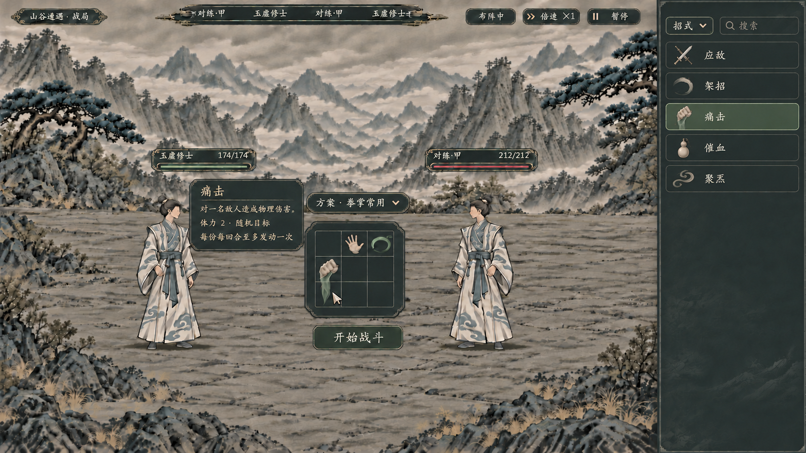

# 方案入口与选招悬停：生成说明

> 2026-11-07。静态视觉理想图，未接入游戏。当前版按用户澄清保留右侧选招／物品列表，只去掉“招式列表”大标题；方案选择器另放中央盘上方。



## 最终文件与方式

- 项目文件：[05_布阵方案与悬停.png](05_布阵方案与悬停.png)，1672×941，约16:9，PNG原样复制。
- 使用内置 `image_gen`，没有使用CLI或对图片另做裁切、拉伸、文字后贴。
- 最终原件：`E:/tmp/CodexData/generated_images/01a1b044-8605-77b1-83d5-6e79977d53f0/exec-6870af10-ca83-43b1-b515-36774a8021b5.png`。
- SHA-256：`900b3277d81e110452a20b2a5d074ce351350c5f22d5720c80bec6dc3d09e9ed`。

## 参考链与取舍

初始风格参考为[炭灰布阵图](02_炭灰_布阵理想图.png)。生成中间稿曾把方案列表置于右侧；用户随后明确“右边还是显示列表，只不过……不要显示招式列表这几个字”。因此该布局没有采用，最终编辑恢复右侧单招来源，将方案入口改置中央盘上方。当前项目文件以最终更正稿为准。

中间稿原件只作为生成来源留存，不作为当前布局：
1. `E:/tmp/CodexData/generated_images/01a1b044-8605-77b1-83d5-6e79977d53f0/exec-ffad54ca-08f5-46b8-ad17-2b632425f281.png`。
2. `E:/tmp/CodexData/generated_images/01a1b044-8605-77b1-83d5-6e79977d53f0/exec-17376e87-6557-46e2-99c4-4f394451169d.png`，也是最终更正调用实际使用的编辑参考。

## 视觉检查与局限

- 已查看最终图：右侧为分类／搜索和应敌、架招等单项，不再有“招式列表”大标题或方案卡；中央盘上方为紧凑折叠方案选择器。
- 中央仅一个九格盘，拳劲为同一纵向两格对象；盘边只读暗色悬停，没有旋转、卸下、应用按钮。方案菜单展开、鼠标行为和开战收起本图未演示，不能算交互验收。
- 图中的图标、方案名、人物数值及短提示只用于布局示意。右侧应敌的交剑、催血的瓶形等不是正式图标设计，也不授予额外用器或耗材要求；正式素材仍按[招式意象与透明图规格](../../plans/战斗与构筑/九格初始招式盘与图标占格设计_20261106.md)重新制作。
- 正式招式提示须读取真实效果、费用、目标和限制，遵守简略／详细显示。图中痛击短句没有完整效果数值，不能直接当正式玩家文案。
- 炭灰仅为本轮布局参照，配色仍待选择；生成的格距和字号不锁定最终控件尺寸。本轮没有改动游戏结算或存档。

## 最终更正提示词

```text
Use case: precise-object-edit / Chinese xianxia UI mockup.
对提供的水墨战斗布阵图做布局纠正。非常重要：此前把右侧单招列表误换成了“布阵方案”列表，这不是用户要的。本次必须恢复右侧单招/物品来源列表，并且不要任何“招式列表”大标题。请保留参考图水墨山谷、两名完整白青衣修士、顶部HUD、中央小九格盘、开始战斗按钮、左侧痛击悬停卡和暗炭灰墨纹风格。只调整下列两个区域：

1. 右侧窄栏：彻底删除“布阵方案”大标题、“我的方案/推荐布阵”页签、三张带小九格的方案卡、锁头，以及底部“点击方案，一键摆盘”。这里仍是可以选择已学招式和持有物品的普通紧凑来源列表。右栏顶端直接从小型筛选与搜索开始，不留巨大空标题区：一行类别下拉“招式 ▾”和搜索框“搜索”，下面竖排五条等高的窄横条，简洁图标在左，名称分别“应敌”“架招”“痛击”“催血”“聚炁”，不要把方案放在这个列表里。第三条“痛击”低饱和灰绿选中。各条使用一个独立小物象图标，非大卡牌非小九格。不要在任何地方写出“招式列表”四个字，不写“技能列表”替代大标题，不另加大字号栏名。列表下半部自然留暗色空白，仍无常驻详情面板。

2. 布阵方案入口另放：在中央九格小盘的上方，紧贴盘的上沿，放一个和盘宽度接近的紧凑深色下拉控件，文字“方案 · 拳掌常用 ▾”。这是局外已保存方案的选择入口，目前折叠状态，不展开第二个大列表、不增加横向长栏。与中央盘和下方“开始战斗”形成一列，居中对齐。玩家可从此换方案一键摆盘，也能使用右栏继续选单招。此图不要加保存方案按钮。

中央盘继续严格保留一个3列3行的小盘：第1行空、白色掌势、绿色护持弧；第2和第3行第1列为同一条纵向两格拳劲，其他都空。左侧悬停卡保留只读痛击内容、无按钮、深底柔和灰米字，不遮人物脸和血条。所有UI用克制细灰绿/旧铜边，规整楷体，无亮白纸板、泛光、赛博效果。不要增加第三个人。完整16:9，高完成度游戏界面理想图。
```

## 中间稿提示词（复现链，仅记录）

```text
Use case: precise-object-edit / high fidelity Chinese xianxia game UI concept.
编辑提供的参考图，生成一张完整16:9局内【布阵方案选择】理想图。它是同一游戏同一场景的新一版界面。严密保留参考的水墨山谷、石地、两名完整白青衣修士、顶部纤细行动条与灰绿血条。保持整个界面的暗炭灰、灰绿、极细旧铜边、柔和灰米色规整楷体；不使用明亮米黄面板，不使用泛光或科技元素。不要画浏览器框。整体为克制、紧凑、可读的真实游戏界面，画面不要增加第三个人。

最重要的修改：右侧窄栏完全改为【布阵方案】，绝对不要“招式列表”，绝对不要逐行展示应敌/架招/痛击等单招列表。右侧宽约全画面20%，使用现有炭灰墨纹面板。顶部标题精确写“布阵方案”，下面两个简短页签“我的方案”“推荐布阵”，再下面一行“搜索方案”。主体是3张紧凑的方案横卡，每张左侧为大约54像素的迷你九格布局缩略图，右侧为方案名及小号状态；这是方案自身的缩略图，不是第二个可操作招式盘。三张的文字分别是：
“拳掌常用” ／ “当前方案”
“守势回春” ／ “可用”
“御器备用” ／ “缺少器物”
第一张弱灰绿选中，第三张降低亮度且有小锁形标识。卡片之间留细小空隙，整齐对齐。不要大面积发光绿，不要额外的确认/应用按钮，不要在此栏展示任何单招列表，不要摆一排独立法宝装备槽。列表下方留充足暗色空白，底部仅一句低对比小字“点击方案，一键摆盘”。不要加战中编辑组合的按钮。

画面中间略偏下仍保留一个很紧凑的小型炭灰招式盘浮台，与参考图大小相近，两个人物完全露出。盘内仅一个清楚的三列三行、共9个正方格。图标采用单个清晰透明物象、行囊物品般柔和水墨淡彩，不能画纸底人物卡。为避免图示误读，本图中央实际占格必须严格如下：
第1行：空格、一个白色掌势（1格）、一个护持弧（1格）
第2行：一个两格纵向拳劲的上半部、空格、空格
第3行：同一拳劲的下半部、空格、空格。
这是一份占纵向两格的拳劲，不是两个图标。各真正空格保持空白，未放丹药、化法或法宝，不额外加方向箭头。整盘与人物相比小而精致，不扩大成半屏。盘下保留单个“开始战斗”按钮。

本图展示一张【悬停卡】，不是常驻详情区：鼠标指针停在中央盘的两格拳劲上，在盘的左上侧空白位置浮出一张宽度约全画面15%的暗黑灰卡，离指针有一点空隙，既不压住盘也不遮住人物脸与血条。卡片外形与现有深色控件统一，薄灰绿边线、微小旧铜角、柔和米灰文字；不要亮色大纸板、不做多层套框。只读无按钮，无拖拽按钮、无旋转按钮、无卸下按钮。内部排版标题更亮略大：“痛击”；一根细分割线；正文左对齐精确写三段：
“对一名敌人造成物理伤害。”
“体力 2 · 随机目标”
“每份每回合至多发动一次”
标题、正文、资源行使用有节制的字号层级，充分留边，文字不要顶边。此图只示意悬停形制，不加入伤害数字或新机制。
顶部可保留“布阵中”“倍速 ×1”“暂停”。高完成度、整体统一，与既有水墨战斗控件同风格；保持暗色UI和两位修士的原始画风。
```

## 中间稿局部图形校正提示词（仅记录）

```text
Use case: precise-object-edit. 请对这张已完成的水墨战斗布阵方案界面做非常局部的图形校正，保留整图构图、九格中央盘、两个人物、悬停文字、全部按钮、右侧方案卡位置、所有标题文字、配色与材质不变。只修正右侧第二、第三张【迷你方案缩略图】，其余不要改。
第二张“守势回春”的迷你九格中，把左下方的绿色手掌图形替换为一只细长的白瓷回春丹瓶，瓶子从第2行第1列延伸到第3行第1列，清晰占竖向两格；上方原有掌形与护持弧保持。它只是方案预览。
第三张“御器备用”的迷你九格中，现在的白色丹瓶不符合御器含义，把该白瓶替换为一柄细长的灰蓝色小飞剑轮廓，同样在第2行第1列至第3行第1列之间，剑柄与剑尖清楚、无发光，保持缺少器物时的低亮度。不要画丹瓶、不要增加新文字。它只用于图形身份识别，不定义正式法宝占格或新技能。
保持中文准确，整体16:9，其他像素视觉尽可能原样。
```

