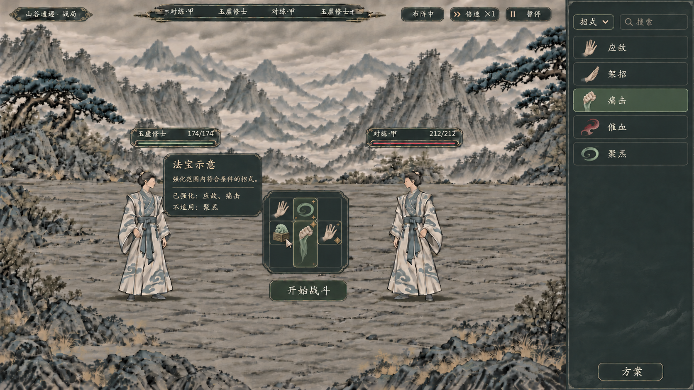
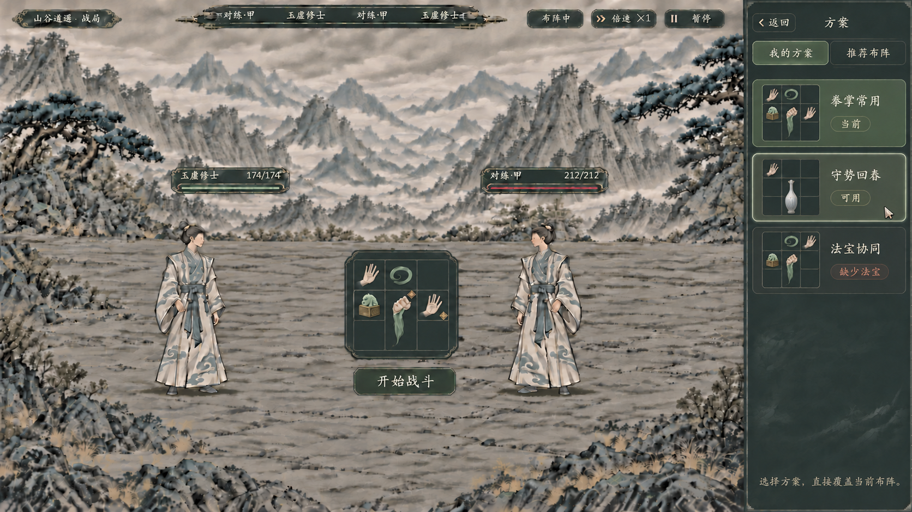

# 法宝范围强化与方案子页：生成记录

> 2026-11-07。两张静态理想图，用于审阅范围／受益标记和方案子页；未接入游戏。法宝单手持与完整架构另见[规划](../../plans/物品与装备/法宝手持与范围强化完整规划_20261107.md)。

## 06：默认选招、法宝范围与方案按钮



- 参考：[05版选招与悬停图](05_布阵方案与悬停.png)，保留山谷、人物、暗色控件，撤去盘上方方案下拉。
- 使用内置 `image_gen`；最终1672×941 PNG原样复制，未另行裁切、拉伸或后贴文字。
- 原件：`E:/tmp/CodexData/generated_images/01a1b044-8605-77b1-83d5-6e79977d53f0/exec-532cde0d-45c9-4a73-81ac-4b7673ecf4d3.png`。
- SHA-256：`d8c51fd009fa202aaae717ac0e043c5452850d19fe92880df2674e020d0708ca`。
- 已查看：右侧普通招式条目与底部方案按钮；中央法宝覆盖格有星点，痛击和应敌各有一枚受益菱标，聚炁没有受益菱标；提示卡只读。
- 该玉印为示意样器，1格与四个覆盖位置未作为正式规则。法效数值、维持灵识及物品定义未画入此稿。正式提示须显示实际内容，不能照搬“法宝示意”作为玩家物品名。
- 星点表示范围，菱标表示合格受益，需在真实控件中继续校准小尺寸辨认度，不能只依赖颜色。

## 07：方案子页



- 参考：06原件，保持同一盘面和人物，右栏切为返回／方案页签及预览条目，撤去中央法宝悬停。
- 使用内置 `image_gen`，1672×941 PNG原样复制。
- 最终原件：`E:/tmp/CodexData/generated_images/01a1b044-8605-77b1-83d5-6e79977d53f0/exec-35e20d5e-85ce-44b8-a26d-ab6af3bc9114.png`。
- SHA-256：`b91293e0627705fd453e46cf92520d681b64dda913ffb7c1e5d86c9fd14222f2`。
- 中间稿：`E:/tmp/CodexData/generated_images/01a1b044-8605-77b1-83d5-6e79977d53f0/exec-d261ebbe-6deb-4953-8e9b-bc31cfe4f538.png`，其中第二个预览误画两只丹瓶，已局部更正为一只纵向两格瓶。
- 当前画面为选择前，第一项是当前盘，鼠标悬停第二项；没有确定／应用／覆盖确认按钮。设计规定选中合法项即完整替换并返回选招，此静态图尚未实现点击。
- 卡片名称、缩略图及缺项状态均是例子，不代表读取实际人物、物品、库存或可运行的推荐构筑。保留受益角标只是关系示意，没有执行战斗计算。

## 06完整提示词

```text
Use case: precise-object-edit / polished xianxia combat UI concept.
对提供的水墨战斗画面做新版【法宝范围强化与方案按钮】编辑。必须保留同一山谷石地、完整的两位白青衣修士、顶部纤细HUD，暗炭灰墨纹、柔和灰米楷体、少量灰绿与暗铜细边。保持画幅16:9。格子继续小而精致，中央盘大小不要增大，人物不能被遮住。不要新建浏览器框，不要亮纸底或泛光。

【方案入口纠正】完全移除原来中央盘上方的“方案·拳掌常用”下拉。中央盘上方恢复空白，不再有下拉。右侧依然以选招来源为主：顶端只有类别“招式 ▾”与“搜索”，下面5条普通单招横条为“应敌”“架招”“痛击”“催血”“聚炁”，清楚的小物象图标和名称整齐对齐，不用九格缩略图代替单招图标。应敌用掌势，架招用护持手掌，痛击用拳劲，催血用朱墨气血意象，聚炁用青墨气旋，不画武器交叉或药瓶冒充招式。不要出现“招式列表”四个字的大标题。右栏底部新增一个紧凑、清晰的单按钮“方案”，位置在底部靠内侧，使用现有深色控件外观。这个按钮用于进入另一个方案子页；此张图不展示方案列表和子页、不展示展开下拉。

【中央九格的法宝与受益标记】九格采用以下严格位置，所有格子仍等大：
第1行：架招（左）、聚炁（中）、空格（右）。
第2行：一件小型青铜玉印式法宝（左）、竖向两格痛击拳劲的上半部（中）、应敌掌势（右）。
第3行：空格（左）、同一痛击拳劲的下半部（中）、空格（右）。
法宝主体为一个清楚的小型青铜印座与青玉印钮，原创新设计，完整放在第2行第1格；不是丹瓶，不画第二件武器，不复制任何他作素材。本图的1格法宝仅作视觉示例，不写尺寸数据。
当前鼠标悬停在这个法宝上：法宝的强化范围示意为右侧扇形4格——第1行第2格、第2行第2格、第3行第2格，以及第2行第3格。仅这4格显示极淡的灰绿范围底色和细小暗金星点，禁止把全盘染色。
此示例只强化攻击招式：痛击和应敌各自显示一个小小的旧铜色菱形“受益标记”，痛击即使两个占格都在范围里也只有一个角标，不能两枚。聚炁所在格虽有范围底色，但不显示受益角标；架招与空格也不要角标。标记清晰可见、克制不发光，痛击作为两格同一对象可以用一圈细线轻描整体。

【悬停卡】将原痛击悬停内容改成法宝说明，仍在中央盘的左上侧空处，不挡人物脸和生命条，不压住盘。只读深色卡无按钮。标题“法宝示意”，下一行“强化范围内符合条件的招式。”，分隔后两行“已强化：应敌、痛击”“不适用：聚炁”。不要写伤害加成数值、灵识费用、冷却或尚未确定的新关键词。标题与正文层级和留边保持克制。

盘下保留“开始战斗”按钮。只一个中央操作盘，无常驻详情列，无底部全宽面板。整体统一现有水墨战斗控件，不要大范围高亮。
```

## 07完整提示词

```text
Use case: precise-object-edit / xianxia UI second state.
用参考图生成同一场景的下一张【方案子页，选择前】理想图，保持完全相同的16:9水墨战场、两位修士、顶部HUD、中央九格尺寸位置、法宝玉印及盘内招式摆放、下方开始战斗按钮、暗炭灰墨纹材质、柔和灰米楷体。不要重新设计背景，不添加第三个人。

本次仅将【右侧栏】从选招页切换成【方案子页面】，这是点击上一张右下角“方案”按钮进入的内容：
- 右栏顶端一行紧凑导航，左边“‹ 返回”，旁边小标题“方案”，与当前控件字级一致，不用巨大标题。
- 导航下方两个小页签“我的方案”“推荐布阵”，我的方案为当前页。
- 删除来源类别下拉、搜索招式框及五条单招内容；子页里不混入单招。
- 主体有三张排列整齐的方案横卡，每卡左侧是简洁的小3×3盘预览，右侧是名称和可用状态。第一卡“拳掌常用”／“当前”；第二卡“守势回春”／“可用”；第三卡“法宝协同”／“缺少法宝”。第一张低饱和灰绿选中，第二张鼠标悬停细边微亮，第三张降低亮度并标明缺项。缩略图图案与中央盘一致地采用物象小图，不画完整人物卡。
- 第一卡小预览对应中央当前布局：顶行手掌、气旋、空；中行玉印、两格拳劲上部、掌势；下行空、同一拳劲下部、空。第二卡“守势回春”小预览可用1格护持手掌和纵向两格白瓷丹瓶，第三卡包含小玉印，勿再把丹瓶放成法宝。
- 栏底不再保留“方案”入口按钮，没有“确定”“应用”“覆盖确认”“取消”等按钮，只有低对比提示“选择方案，直接覆盖当前布阵”。这句提示清楚完整不出现技术词。
- 此图是选择前，当前中央盘仍对应第一卡；鼠标停在第二卡旁，尚未改变中央盘。

移除参考图左侧的法宝悬停说明卡，恢复该处战场景物。鼠标现在在方案卡上，不要中央盘范围的格子底色或星点；但保留痛击和应敌各一个很小的暗铜菱形受益角标，表示依然被盘上法宝强化。不要给聚炁加菱形，不把两格痛击拆成两份。保持中央盘单个、小巧，没有第二个可操作盘。
整体像同一游戏界面的一次子页切换，低亮度、克制细边，与其他控件风格一致。
```

## 07局部更正提示词

```text
Use case: precise-object-edit. 对这张方案子页图只做一个局部校正，其他所有构图、文字、人物、中央盘、右侧卡片和配色保持原样：第二张“守势回春”的迷你九格预览现在出现上下两只小白瓶，请将它们合并替换为【一只完整的细长白瓷丹瓶】，从第2行第2格延伸到第3行第2格，清楚占竖向两格。瓶口在第二行上部，单个完整瓶身一直延伸至第三行底部，不能分成两瓶，也不能放在两个互不相连的位置。仍保留该预览第一行左侧的一格护持手掌。所有其余元素不改，不添加任何按钮或说明，保持16:9。
```

