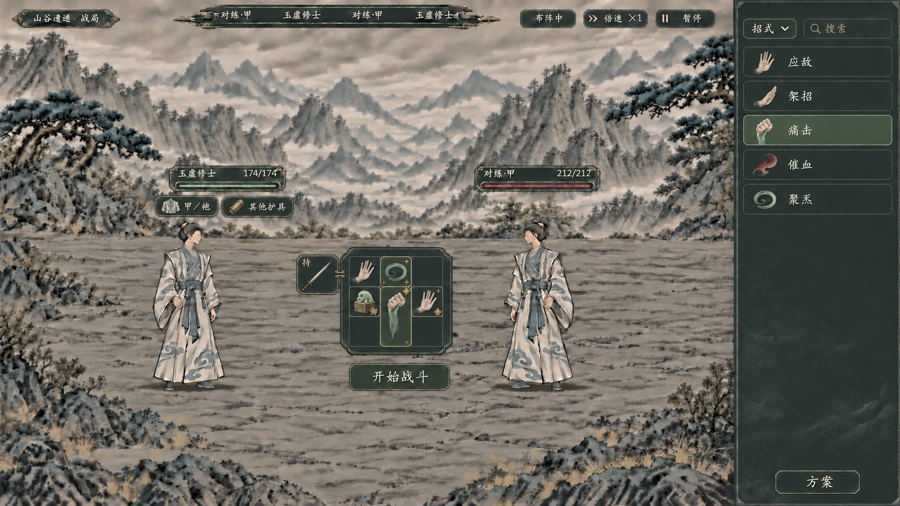

# 外围手持与双护具：08生成说明

> 2026-11-07。最新布阵状态静态理想图，用于审阅外围手持与局外双护具的位置。不是正式游戏界面，未修改战斗运行、物品数据或存档。规则见[最新分工案](../../plans/物品与装备/外围手持槽与护具分工设计_20261107.md)。



## 来源与保存

- 使用内置图像生成工具编辑[06布阵图](06_法宝范围强化与方案按钮.png)，编辑前已查看本地参考图。
- 最终图原样复制到本目录，未裁切、拉伸或后贴文字；06／07原图保留。
- 原件：`E:/tmp/CodexData/generated_images/01a1b044-8605-77b1-83d5-6e79977d53f0/exec-09032a28-5289-44f1-b15a-cd80d542b141.png`。
- 项目原图：[08_外围手持与双护具_布阵理想图.png](08_外围手持与双护具_布阵理想图.png)。
- SHA-256：`5b2539bc1b0fb823471f356c41cf683916d057276e6d842d7f8445bfee377e20`；复制后与生成原件一致。

## 已查看的内容与边界

- 主盘保留九格起步示例、原位置的招式与盘内玉印；玉印角标“御”，不与外围手持混淆。
- 仅一个外围手持槽，接主盘第一行左侧；完整剑形适配槽内，主盘其他行没有多出空格列。人物仍未持剑，符合尚未开战、手持待启用的展示。
- 人物信息下方两个只读护具图标，分别标“甲／袍”“其他护具”；不接主盘、不形成穿戴纸娃娃栏。
- 右栏仍是单招来源、分类与搜索，下方保留“方案”；没有“招式列表”大标题、方案下拉或常驻详情。
- 本图撤去悬停卡以便看整体位置；正式详情仍悬停显示，暗色只读卡的风格沿06参考，不能以本图无卡理解为取消详情。
- 剑、法衣、护腕和玉印均是视觉占位，不新增正式物品、御使能力、格形、范围、资源或数值。法效范围与受益标记仍为06中的示例关系。
- 九格只代表极早期；外接框、图标与文字的精确像素仍需正式控件校准。开战后收起右栏、主盘与外接槽一并缩到左下的规则保留；本图不展示战斗态，也未实现拖放、扫描、方案跳转或装备事务。
- 护具两个位置及分类由用户确认；开战继承收益、本场固定、外围槽附随行读取仍是设计推荐，图片不替代规则确认。

## 完整提示词

```text
Use case: precise-object-edit, ui-mockup.
Asset type: 完整的16:9修仙回合战斗【布阵状态】静态理想图。
Edit target: provided image is the existing project concept 06. Preserve its entire ink-painted mountain valley, ground, two complete blue-white-robed cultivators, top HUD, dark ink-green / charcoal panels, muted antique-brass thin edges, warm gray Chinese calligraphic text, exact compact central 3x3 board scale, right skill source sidebar and bottom “方案” button. Do not redesign the environment or enlarge the board.

Make only the following updates to match the newly agreed equipment structure:

1. Remove the existing large “法宝示意” hover card and mouse pointer entirely, restore the underlying environment. This full-layout picture shows no tooltip and no permanent details panel. Keep the compact central nine cells and the exact same skills/artifact locations: row1 架招 / 聚炁 / empty; row2 bronze-jade seal artifact / upper half of the same vertical two-cell 痛击 / 应敌; row3 empty / lower half of that 痛击 / empty. Preserve small range star dots and ONE benefit diamond per eligible skill, no new numeric bonuses. Artifact remains inside main board as 御使, add at most a tiny “御” corner badge to the artifact.

2. Add exactly ONE external hand-held weapon socket flush against the LEFT edge of the FIRST ROW of the central board. Its center must align with the first row's cell centers. It is one small square the same size as an ordinary board cell, outside the existing 3x3, connected directly to that boundary by a tiny antique-brass join. Do not occupy an existing main-board cell, do not add another column to all rows, do not add lower empty external sockets. The silhouette must read as one detachable peripheral socket attached to just one boundary cell. Inside place ONE complete slender sword with muted steel blade and dark bronze hilt, its whole silhouette scaled proportionately to fit this single socket diagonally. No oversized sword crossing multiple cells and no cropped blade. Tiny corner label “持”. The two cultivators must remain unarmed in this pre-battle state, no second sword on the person and no second hand socket.

3. Add TWO small fixed read-only armor badges beneath the PLAYER character's health/name plate, in the available empty space above his head without overlapping the face or central board. They are a compact horizontal pair tied to character information, visibly separate from the draggable board.
First badge: one folded blue-white robe inventory-style icon; short label exactly “甲／袍”.
Second badge: one muted bronze wrist-guard inventory-style icon; short label exactly “其他护具”.
Use compact shaped dark badges with subdued borders, not extra grid cells and not connected to the board. These show two out-of-combat worn armor positions; never draw a shield being held, never add head/chest/feet equipment paper-doll slots. These are visual placeholders, no fabricated names/stats/numbers.

4. Right sidebar stays dominated by the five individual skills “应敌”“架招”“痛击”“催血”“聚炁” with readable object icons, existing “招式” category filter and search above, “方案” button below. Do not add a big “招式列表” heading. Do not replace it with presets, inventory grids, equipment details, or a second skill board. Preserve the “开始战斗” button below the central board. No permanent tooltip, no action buttons in floating descriptions, no new top-of-board preset dropdown.

Style constraints: restrained dark ink green/charcoal, soft grey ivory text, antique dull brass linework matching the input controls. No bright parchment, no neon, no white cards, no glow, no technical annotations, no red explanatory arrows, no numbered callouts, no screenshot frame, no watermark. Preserve the scene composition and compact layout so all added sockets remain readable and the characters stay fully visible.

```

