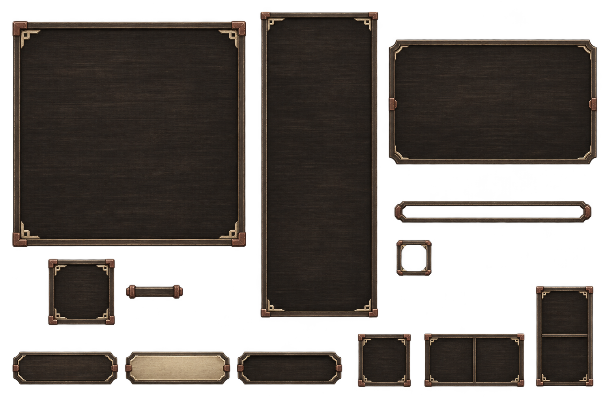

# 乌木骨饰UI素材：总览与两张独立底板

> 2026-11-07。**本批乌木素材后续被用户认为太压抑、要求更换，不作为已认可材质。**此前C方向选择是历史记录，不能替代对实际素材的评价。最新改稿见[26雾青薄玉候选](26_雾青薄玉_生成说明.md)；下文保留原件、提示词与当轮检查，未接入正式战斗。



## 本轮文件

| 文件 | 源尺寸 | 透明通道检查 |
| --- | --- | --- |
| [23_乌木骨饰_UI素材总览.png](23_乌木骨饰_UI素材总览.png) | 1536×1024 | RGBA；Alpha 0～254；四角为0 |
| [24_乌木骨饰_招式盘底板.png](24_乌木骨饰_招式盘底板.png) | 1254×1254 | RGBA；Alpha 0～255；四角为0 |
| [25_乌木骨饰_右侧列表底板.png](25_乌木骨饰_右侧列表底板.png) | 826×1903 | RGBA；Alpha 0～255；四角为0 |

素材总览包括：主盘底板、外接手持小槽与连接件、右侧列表底板、悬停框、三种按钮外观、血条边框、单个状态边框，以及单格／横两格／竖两格的边框示意。仅主盘、列表另生成独立文件，其他部件目前保留在总览中，未冒称已全部完成独立切片。

24／25由内置图像生成工具参照23分别生成，非程序裁图；保留窄木边、骨白角饰与暗赤铜包角。主盘与列表内部均无文字、图标和固定行数，不把九格或六条来源永久画入底板。实际格线、内容与成长布局仍由控件处理。

## 来源与检查

- 全部使用内置图像生成工具；23为全新生成，24／25以已查看的23本地原件为编辑参考，均请求并保留透明背景。
- 以上PNG原样复制进项目，复制后逐张与原件比对SHA-256；未用脚本改色、擦背景、裁切或合成。
- 已查看整体材质、木纹、角饰与空白内面；读图确认三张均为RGBA、具有完全透明区域，四角Alpha为0。23内部最大Alpha为254，24／25为255；不把预览结果冒称所有部件都已达到正式切片／拉伸验收。
- 文案和招式图标未烘入这些素材。血条／状态边框只是美术部件，不授予状态、不增加固定状态槽，双护具不回到血条下。
- 当前样板默认已改为乌木，灰宣／素绢保留作历史对照；本页新PNG尚未替换控件边框或配置正式九宫格拉伸。没有修改卡牌、资源、费用、目标、应对、装备能力或存档。

- 23_乌木骨饰_UI素材总览.png：原件 `E:/tmp/CodexData/generated_images/01a1b044-8605-77b1-83d5-6e79977d53f0/exec-2c95b6b0-436b-4acf-811b-6f35915b3710.png`；SHA-256 `e71ee42632de53947c59ff1c53660699ba8e99d51fb5e038361424abb0326f9a`。
- 24_乌木骨饰_招式盘底板.png：原件 `E:/tmp/CodexData/generated_images/01a1b044-8605-77b1-83d5-6e79977d53f0/exec-faf840d6-d17b-4441-9e7f-b58bfe696097.png`；SHA-256 `a303adad30f464462d84f0eb838d5eeeeea93376630c04ee89ae9622436dd93e`。
- 25_乌木骨饰_右侧列表底板.png：原件 `E:/tmp/CodexData/generated_images/01a1b044-8605-77b1-83d5-6e79977d53f0/exec-752ba07d-ad10-4bd8-9f8a-a492546cf996.png`；SHA-256 `3d4943856a0a3c13e5965105ab23fb6a5219f0095a998b2851a65a88bf263f47`。

## 23总览完整提示词

```text
Use case: stylized-concept / original game UI asset kit.
Asset type: a polished high-resolution 2D UI COMPONENT ASSET SHEET for a Chinese xianxia PC game, on a genuinely TRANSPARENT background. This is an artwork deliverable of empty UI parts, NOT a screenshot, NOT HTML widgets, NOT a gameplay mockup.

Chosen art direction: 乌木骨饰 — dark brown ebony wooden cases and trays, narrow matte bone-ivory inlays, small dark red-copper joints. Flat orthographic FRONT VIEW, suitable for overlaying a game interface. Fine hand-painted wood material, subtle horizontal grain, softly worn edges and restrained shallow bevels. Low brightness, mature and understated, clearly readable contours. Primary wood near #292620 / #24231f, wood edges near #625848, aged ivory near #b7ad94, red copper near #735344. Ivory refers to COLOR and small decorative inlays, NOT literal bones: no skulls, horns or skeletal motifs. No shiny gold, no green glass, no luminous jade, no bright parchment. Keep most of each panel dark and calm so the game can place text on it.

Arrange the following separated empty components neatly with ample transparent gutters, all sharing one visual language and crisp detail:
1. Upper-left: a substantial SQUARE move-board base panel, broad quiet inset dark-wood center and a beautifully crafted but thin wooden rim. Tiny ivory corner inlays and small red-copper corner bindings. Center MUST REMAIN EMPTY: no permanent 3x3 grid, no icons, no writing. This frame must be able to serve a growing board later.
2. Beneath it: ONE small separate SQUARE hand-weapon socket with the same wood and ivory detail, and a small short horizontal connector beside it. Empty, no weapon, no text.
3. Center-right: a TALL NARROW source-list background panel, roughly width-to-height 1:2.3. Empty uninterrupted interior, subtle wood surface, simple rim and sparse ivory end details. No baked rows, search bar, tabs, labels or headings.
4. Upper-right / nearby open area: a medium horizontal tooltip/details frame, about 3:2, finer rim and ample empty interior. No buttons, no text.
5. Lower region: THREE short horizontal empty button plates aligned together: normal dark wood; primary aged-bone inlay face with dark wood sides; pressed/darker wood. Each a distinct single horizontal button, no letters, no symbols.
6. ONE thin horizontal empty health-bar border; no red fill, no numbers. Nearby ONE separate small square status-icon border. Do not make a fixed row of status slots.
7. Bottom corner: three compact OCCUPIED-FOOTPRINT frame samples showing a single square (1x1), exactly two equal squares horizontally (2x1), and exactly two equal squares vertically (1x2). Thin visible grid dividers, equal cell pitch, empty centers; these are sample cell frames, not a fixed board.

The whole sheet should feel like carefully painted actual production UI art that belongs in a grounded xianxia game. Clean alignment, clear component separation, enough safe margins, consistent light from upper left but very shallow depth; NO perspective tilt, NO camera scene, NO tabletop behind components, NO cast shadow outside the parts, NO overlap between objects.

STRICT: NO text of any language, NO numbers, NO labels, NO captions, NO game logo, NO watermark, NO characters, NO scenery, NO skill illustrations, NO inventory items, NO neon, NO oversized ornate carving. True alpha transparency everywhere outside each component, not a drawn checkerboard, not white or black background. Keep the internal wooden surfaces opaque.
```

## 24招式盘底板完整提示词

```text
Use case: precise-object-edit / game UI component extraction and refinement.
Input image: the provided transparent ebony-and-aged-ivory UI component asset sheet is the EDIT TARGET and material reference.
Output exactly ONE isolated large SQUARE MOVE-BOARD BASE PANEL, derived from the LARGE UPPER-LEFT square frame in the sheet. Remove ALL other components and all inter-component background remnants. Preserve the original chosen 乌木骨饰 art direction: low-brightness black-brown ebony face, subtle horizontal hand-painted grain, narrow softly worn wood rim, tiny aged bone-ivory geometric corner inlays, and four small dull red-copper corner bindings. Reproduce its front-facing orthographic shape and restrained shallow bevels faithfully, with consistent fine detail and enough safe margin all around.
The panel center remains an OPAQUE, quiet dark wooden inset where dynamic grid lines and move icons can later be placed. NO baked grid, NO cells, NO sword socket attached, NO numbers, NO characters, NO writing, NO logos. No bright gold or glowing edges, no heavy ornate carving, no skulls, no bone anatomy. Do not add drop shadows, scene lighting or scenery around the frame.
Crucial alpha requirement: preserve actual alpha transparency. Every pixel outside the outer frame must have zero alpha except its tightly antialiased edge. The internal wooden surface must be opaque. Do not paint a beige/black/brown/checkerboard background. This is an individual production-style UI PNG component, not a poster or component sheet. High-resolution square image, keep the complete frame unclipped.
```

## 25列表底板完整提示词

```text
Use case: precise-object-edit / game UI component extraction.
Input image: the provided transparent 乌木骨饰 component sheet is the EDIT TARGET and material reference.
Output exactly ONE isolated TALL NARROW SOURCE-LIST BACKGROUND PANEL, derived from the tall central panel in the sheet. Width to height about 1:2.3. Faithfully preserve its quiet black-brown ebony interior, fine horizontal grain, narrow weathered wood rim, tiny aged bone-ivory geometric corner inlays and four small dull red-copper corner bindings. Orthographic flat front view, crisp painted game-UI asset, shallow soft bevels, low brightness. Same materials as the sheet; do not turn it into shiny gold or green glass.
Entire INTERIOR is opaque dark wood and uninterrupted: no baked skill rows, no search field, no tabs, no text, no icons, no slots, no scroll bar, no title. The actual interface will arrange varying-height grid-footprint entries over this base later. Keep the rim slender, do not sacrifice the inner usable area to ornaments.
True transparent alpha outside the frame and narrow antialiased outline only; zero-alpha background, no brown haze, checkerboard, scene or cast shadows. Safe transparent margin on all sides, complete frame not cropped. Remove every other object from the sheet. This is a single production-style empty UI component PNG, not a full game screenshot. No watermark, no writing, no numbers, no characters or weapons.
```

