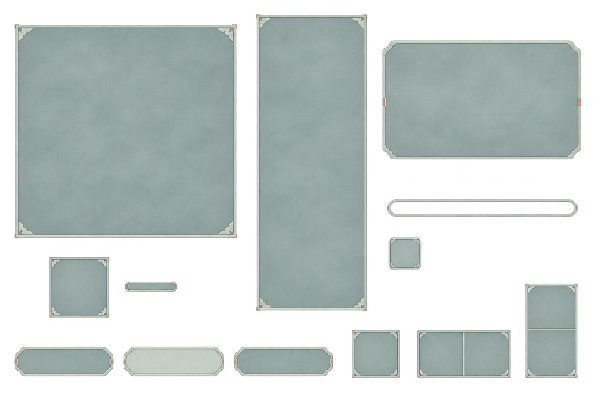

# 雾青薄玉UI素材：乌木稿之后的轻浅候选

> 2026-11-07。用户认为上一批乌木UI“太压抑了，换一换”。本轮生成一张更轻浅的材质总览供查看，未冒称用户已经选中，也未改任何战斗规则。



- 新材质：低饱和雾青灰、浅玉细边、小云角，减轻深木色、大包角与重凹槽；继续避免亮白、奶黄和发光。
- 部件集合与上一张基本一致：空白主盘、手持槽与连接件、列表底板、悬停框、按钮、血条／状态边框及三种占格示意。主盘和列表不固定画入九格／来源行，文字图标仍留给控件。
- 使用内置图像生成工具，以已查看的[23乌木总览](23_乌木骨饰_UI素材总览.png)为编辑参考，要求保留透明背景；未用脚本改图或擦背景。
- 原件：`E:/tmp/CodexData/generated_images/01a1b044-8605-77b1-83d5-6e79977d53f0/exec-5b39e077-53d2-4661-bfff-9da88017fda3.png`；项目[原图](26_雾青薄玉_UI素材总览.png)原样复制并核对哈希。
- 源尺寸：1536×1024，RGBA；Alpha范围0～254，完全透明像素630147，四角Alpha均为0。SHA-256：`efc31ebe12ec3db26d3008c6e8f22539040398c319bf63e018d23ef6089dafef`。
- 已查看配色、边框变薄、角饰与各部件分离；本轮仅总览预览，未逐件拆分或配置拉伸，未替换11／19旧材质样板或正式游戏。旧乌木原件保留作历史。

## 完整提示词

```text
Use case: precise-object-edit / complete game UI material redesign.
Edit the provided transparent game UI component sheet. The user finds the ebony version oppressive. Replace its MATERIAL, PALETTE and EDGE WEIGHT with a visibly lighter, more open Chinese xianxia direction: 雾青薄玉, mist-celadon gray and thin pale jade. This must feel airy and gentle, not a dark wooden chest.

KEEP the same set of empty components and approximately the same arrangement so the user can compare them: a large square move-board base, one small separate hand socket plus connector, one tall narrow source-list background, a horizontal tooltip frame, three button plates, a thin empty health-bar border, one separate status border, and single-square / two-horizontal-square / two-vertical-square footprint samples. No text or icons, no scene or characters.

NEW MATERIAL:
- Mid-light, LOW-SATURATION misty blue-gray / celadon-gray faces, around #8fa5a3 and #a1b1aa. Soft matte fine mineral/satin texture with very slight ink-wash variation, no dark wood grain or large heavy stone veins.
- Thin pale gray-jade edge, around #b8c2b3, with one restrained slate-ink hairline defining the silhouette. Border width and apparent thickness roughly ONE THIRD of the original. Almost flat front view, extremely shallow depth.
- Corners are small gently curved or clipped cloud-like jade joins, clean and delicate. Remove ALL thick copper caps, big square metal brackets, metallic gold trim, rustic wood, chunky bevels and heavy recessed wells.
- Tiny restrained warm clay-red accents are allowed on a few short joins, under 1 percent of the total area. No gold, no glowing jade, no mystical light emission.
- Internal faces are evenly readable and calm, clearly lighter than the previous near-black version. They must not become bright white, creamy yellow, pale parchment or highly saturated mint-green. We want soft medium-light celadon gray, not glare.
- One primary empty button may have a slightly lighter matte jade face; the other two buttons use the same quiet blue-gray family. No lettering, glyphs or embossed symbols.
- The square board and tall list centers remain opaque calm material and EMPTY, with no permanent 3x3 board or list rows baked in. The three little footprint samples alone retain exact simple square dividers.

COMPOSITION / OUTPUT:
An actual polished UI component asset sheet on true ALPHA TRANSPARENCY, not a screenshot or tabletop. Preserve external transparency: zero alpha outside the components with only tight antialiased edges, no background mist, no cloudy backdrop or drop shadows. Keep fine safe margins and separation, orthographic front-facing 2D game-UI art. The parts should look lightweight and refined rather than gloomy, stone-heavy or ceremonial.

Strictly no words, Chinese characters, numbers, labels, watermark, inventory items, landscapes, people, skulls, dark black/brown centers, brass/gold/copper corner blocks, shiny reflections, opaque checkerboard, white background or external decorative clutter.
```

