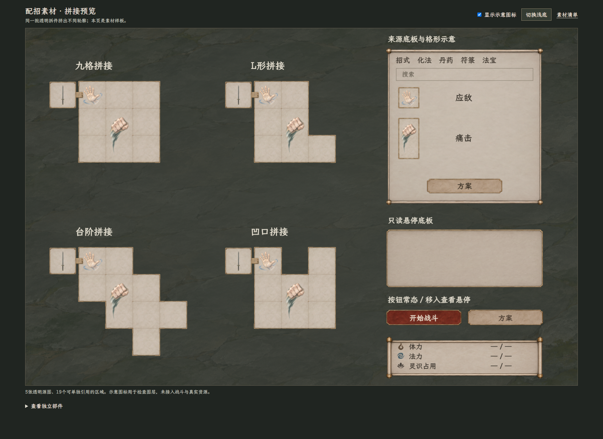
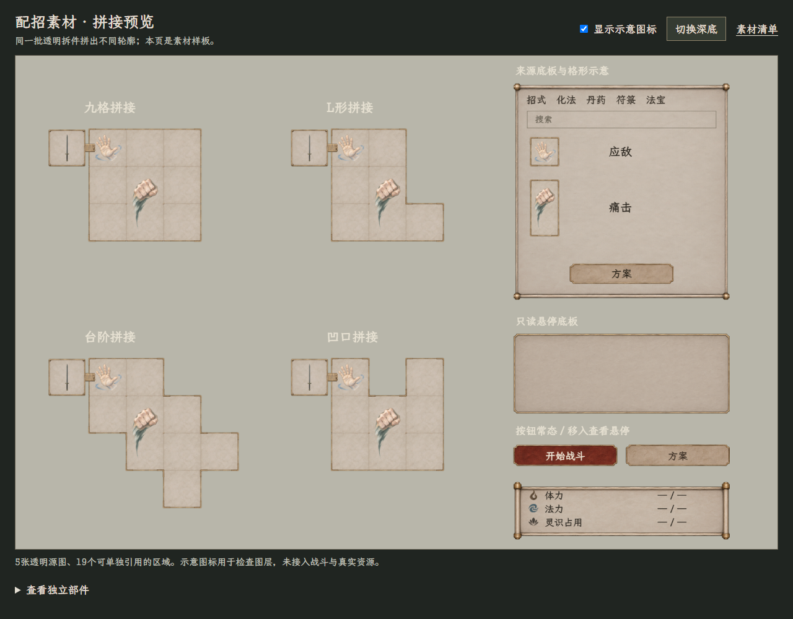

# 首批配招界面素材与验证

> 2026-11-07。用户授权按38选定样式开始准备素材。本批已完成透明源图、Godot区域引用、可点拼接预览及基础验证；尚未将这套新皮肤替换进正式战斗。这里是界面素材记录，不重定招式占格、费用、目标、应对、资源或存档规则。

## 查看与领取

- [实际素材拼接预览](39_素材拼接预览.html)：可切换深／浅底、显示／隐藏示意图标、展开独立部件；按钮移入时使用悬停图。此页是素材验收台，页内说明文字不属于游戏页面标题。
- [首批素材压缩包](39_配招界面素材包_v1.zip)：保留 `textures/ui/combat_board_20261107_v1/` 路径，解压到项目根目录即可保持资源引用；不带Godot导入缓存或正式场景替换。
- [区域、切片、尺寸与原图哈希清单](../../../textures/ui/combat_board_20261107_v1/skin_manifest.json)。
- [原生资源读取结果](../../../textures/ui/combat_board_20261107_v1/native_validation.json) · [浏览器拼接检查结果](../../../textures/ui/combat_board_20261107_v1/browser_validation.json)。
- 视觉依据：[38用户选择记录](38_选定参考与适配说明.md)；交互边界：[局内UI主案](../../plans/界面与美术/局内战斗UI重设计_20261107.md)。





## 交付构成

五张透明PNG源图保持生成原像素，通过19个AtlasTexture区域独立引用。未把理想图整张当作UI，也未用后期涂改方式伪造透明底。部件名称与精确矩形均见清单。

| 文件 | 尺寸 | 用途 |
| --- | --- | --- |
| [grid_parts_atlas.png](../../../textures/ui/combat_board_20261107_v1/grid_parts_atlas.png) | 1254×1254 | 单格底面、直边、凸／凹角、手持连接、手持槽、接点与空心强调框 |
| [source_panel.png](../../../textures/ui/combat_board_20261107_v1/source_panel.png) | 971×1619 | 无字的右侧来源框，分类、搜索、格形、名字、方案按钮另画 |
| [tooltip_panel.png](../../../textures/ui/combat_board_20261107_v1/tooltip_panel.png) | 1536×1024 | 无字只读悬停底板，不含操作区 |
| [buttons_atlas.png](../../../textures/ui/combat_board_20261107_v1/buttons_atlas.png) | 1254×1254 | 主按钮、次按钮的常态与悬停，共四块 |
| [resources_atlas.png](../../../textures/ui/combat_board_20261107_v1/resources_atlas.png) | 1448×1086 | 无字资源框、体力／法力／灵识三枚图符 |

19个引用区域包括原始格面 `cell_face_source` 和去除自带边线的内部格面 `cell_face` 两个版本；实际拼接使用后者，再单独加边。验收台部件画廊展示18项，原始格面作为源参考不重复摆出。

本批只交付通用界面部件。验收台借用[旧应敌样张](../九格招式盘与战斗界面_20261106/招式样张_应敌_1x1.png)、[旧痛击样张](../九格招式盘与战斗界面_20261106/招式样张_痛击_1x2.png)及现有行囊细剑核对叠层，不是本批新画的逐招图标，也不将旧样张尺寸当作最新招式数据。新二十招的制作与接入以[人类招式新版目录](../人类招式图标新版_20261107/README.md)的独立记录为准。

## 拼接与使用约定

1. 主盘输入为实际可用格坐标。只给这些坐标画格面，邻格存在才连接；不存在的位置保持透明。九格、L形、台阶、凹口均是渲染验收用例，不定义初始形状、成长路线或容量。
2. 外轮廓用直边加旋转的凸／凹角；主盘与唯一手持槽的连接段独立。手持槽不计为主盘可用格，也不因盘形多凹角复制新槽。
3. 图层依次为格面、接缝／边角、整份物品或招式图。多格同一对象内部的接缝不绘制，完整图标只画一份，避免半透明袍袖仍透出横线。强调框围绕整份占形，不盖到图案上。
4. `cell_face` 使用源图246×246内部区域，超过每格128源像素要求。显示格距由控件布局决定，缩放不改变真实占格。右侧来源统一格距，多格对象扩大条目高度／宽度，名字保持同一列。
5. 凸角 `anchor_fraction=[0.095,0.095]`，凹角 `anchor_fraction=[0.095,0.905]`；后者的转折点在源区域左下。定位后再旋转，不能把两个区域的左上角直接当成相同转角点。
6. 面板和按钮使用九宫拉伸。清单内 `source_insets` 是图集像素，`display_insets` 是预览显示单位，不能当成同一数值直接缩放。源图的边角保形，中心平铺／拉伸；目前提供AtlasTexture和绘制示例，没有声称已制作完整Godot主题。
7. 名字、分类、搜索、按钮文字和资源数字都由实际控件绘制，PNG无这些业务文字。素材验收台的资源为 `— / —`，未伪造充满比例；正式显示读取体力／法力当前值与上限、灵识占用与容量。真实0仍显示0。
8. 页内的四块盘与右侧部件同时展示只是验收排版。正式配招仍按主案：无标题暗幕、中央一块主盘、右侧来源、底部居中资源；战中左下缩盘、列表隐藏，战场站位不被侧栏挤偏。

## 已完成的检查与范围

| 检查 | 本批结果 |
| --- | --- |
| PNG与透明度 | 5张RGBA，四角透明；透明区域真实alpha为0。可见红色边缘像素0，源图哈希与生成原件一致 |
| 区域引用 | 19个区域均在原图边界内；保留原始PNG，不输出重绘切图 |
| 原生读取 | Godot 4.6.2隔离检查成功加载5张图片和19个实际AtlasTexture，区域与纹理链接一致 |
| 真实拼接 | 四种轮廓共33个有效格中心均已绘制，包围范围内10个缺格中心保持透明 |
| 图标层级 | 四种盘各31个接缝位置的有色图标像素，共124个，覆盖误差0；每盘应敌／痛击各一幅 |
| 两档画面 | 深底1920×1400、浅底1280×1000均无横向溢出；按钮移入确实切至主按钮悬停块 |

原生检查使用独立小工程读取本包资源，没有启动主游戏、运行C#战斗或读写存档；不能将其计为完整战斗编译或接入。浏览器检查针对真实素材与图层，不代替正式拖放、暗幕返回、方案覆盖、资源绑定、速度结算、合法阶段编辑或成长盘交互验收。

复现入口：[素材索引生成器](../../../tools/ui_materials_20261107/build_pack.py)、[原生检查小工程](../../../tools/ui_materials_20261107/native_check/project.godot)、[原生检查脚本](../../../tools/ui_materials_20261107/native_check/validate_pack.gd)。索引生成器只读图像像素并写区域／清单，不修改PNG。

## 生成来源与完整提示词

五次生成均设置 `transparent_background=true`，以[38原图](38_用户选定_逐格拼接参考.png)作为唯一风格参考，均为新素材而非抠取参考图。原件保留在 `E:/tmp/CodexData/generated_images/01a1b044-8605-77b1-83d5-6e79977d53f0/`，下表文件名与本包一一对应；本包采用逐字节复制。

| 本包文件 | 保留原件文件名 |
| --- | --- |
| grid_parts_atlas.png | exec-c1314946-0a7e-4c0b-b64c-479f7dd5b2d7.png |
| source_panel.png | exec-c072dc68-28f2-4f82-a572-002caac80ffe.png |
| tooltip_panel.png | exec-e9d8b26d-20e7-4709-b493-d120eb629904.png |
| buttons_atlas.png | exec-67e1c6d1-8c97-41d8-ad95-f827954bdd92.png |
| resources_atlas.png | exec-deb9775b-b9ec-4908-832e-17aae4a2e834.png |

完整提示词由以下公共段、两个换行、对应分项段按原样拼接，未省略生成时的要求。

### 公共段

```text
Use case: UI game-asset production.
Create a NEW production-ready raster UI asset, with REAL ALPHA TRANSPARENCY outside all painted parts. The supplied local image is STYLE REFERENCE ONLY: use its selected main move-board's muted gray-taupe paper, thin worn bronze/ink edge and restrained hand-painted xianxia inventory look, and its paper-scroll controls. DO NOT reproduce the screenshot, battlefield, characters, weapons, skill art or UI text.
The user selected this exact style for a modular move board that may have irregular cell layouts. Keep the rendering orthographic/front-on, crisp and flat at game-UI scale, subtle paper fiber, thin unobtrusive edges, no shiny metal, glow, thick black wood, jade, repeating cloud emblems or decorative lettering. No words, Chinese characters, letters, numbers, labels, watermarks, placeholders or checkerboard pattern baked into pixels. Background is genuine transparent alpha, not gray, white or a painted checkerboard. Leave clear transparent safety margins and do not crop any piece.
All artwork must be blank skin/framework only; runtime fonts, real resource data and move images will be layered separately.
```

### 逐格拼接与手持部件

```text
Output ONE square 1024×1024 modular sprite ATLAS. Exactly EIGHT separated components arranged in a regular FOUR-COLUMN by TWO-ROW layout. Transparent gutters, no table/grid lines and no labels. Each component centered in its own quarter-width/half-height slot; no part may cross into another slot.
Top row left to right:
1. A perfectly SQUARE flat gray-paper CELL FACE, about210×210px, with smooth square edges and subtle low-contrast fibers. Completely BORDERLESS, no metal corner, no symbols, no internal grid, no cutouts. Opaque useful surface, transparency only outside the square. This face repeats under every valid cell.
2. One STRAIGHT HORIZONTAL EXTERNAL BORDER STRIP, about210px long and only10px thick, matching the reference's fine worn muted bronze edge, with no end caps or corner decorations. Entire strip kept in this slot.
3. One small CONVEX OUTER CORNER, an L-shaped matching thin border, both arms about48px, stroke about10px; empty/transparent inside the L, no paper rectangle.
4. One small CONCAVE INNER CORNER for a notched board perimeter, the reverse-facing compact L-shaped inside-turn trim, arms about48px and stroke10px, transparent negative space. It must be isolated, not a frame.
Bottom row left to right:
5. A short horizontal HINGE / CONNECTOR BRIDGE about100×24px, two tiny discreet rivets and thin worn metal plate, transparent around it. Connects the ONE outside hand socket to a main board edge.
6. ONE completely EMPTY SQUARE HAND-SOCKET FRAME about210×210px, with the same gray-paper face, thin external border and four tiny corner joints; no weapon, no words, no glyph. Exactly one square, not a row/column of empty slots.
7. One tiny round dull-metal CORNER RIVET / JUNCTION PIN about28×28px, minimal patina, no large halo. An isolated single small object.
8. One delicate SQUARE HOVER/SELECTION OUTLINE about210×210px, thin pale desaturated warm-ink line with a tiny restrained corner accent, transparent center and outside, no fill, no glow, no words.
All eight parts share the same visual material family and lighting. Face, border strips and corner trims are SEPARATE pieces, never a finished rectangular 3×3 board. This atlas will be referenced by regions and composed at runtime into rectangular, L-shaped and stepped valid-cell layouts. Keep transparent gutters large enough to isolate every part.
```

### 右侧来源底板

```text
Output ONE tall PORTRAIT blank SOURCE-LIST PANEL skin, approx aspect3:5. Match the selected reference's RIGHT scroll panel: one continuous muted gray-taupe worn paper body, a slender horizontal scroll rod at the top and bottom, small understated aged-brass end caps, fine narrow side edging. Calm readable mid-value paper, not bright yellow/white and not oppressive dark.
The entire INNER PAPER BODY is COMPLETELY BLANK: no tabs, categories, search box, dividers, grid, icons, buttons, scrollbars or text. Those are runtime controls. No title/header ornament.
Straight parallel edges and orthographic face, no perspective. Consistent thin cap thickness so the body can stretch vertically and the central horizontal portion can stretch without stretching corners. Preserve an ample unpainted safety margin around the one isolated frame. Real transparent alpha outside. Do not include multiple panels, a screenshot or a presentation.
```

### 只读悬停底板

```text
Output ONE blank compact RECTANGULAR TOOLTIP / secondary panel skin, landscape aspect about3:2. Flat muted gray-taupe paper interior, fine dark-ink line and narrow worn-bronze rim, very small simple cut/chamfer at the four corners, just enough material definition to match the reference without large scroll rods or ornate cloud/gold corners.
Completely blank body: no letters, numbers, labels, icons, rows, headers, separators, buttons, placeholders or texture resembling writing. Straight orthographic frame designed for a nine-slice StyleBox, clear crisp edges, subtle paper texture only. One isolated panel, genuine alpha outside, center is useful opaque gray paper. Keep four corner details small and consistent so the flat center can stretch. No screenshot and no multiple components.
```

### 按钮常态与悬停

```text
Output ONE square sprite ATLAS with exactly FOUR completely BLANK horizontal button skins in a TWO-COLUMN by TWO-ROW layout, each centered in its own quadrant with large transparent gutters. All four have the SAME approx4:1 outline dimensions, same thin worn-metal edge, tiny understated chamfered corners, flat hand-painted material.
Top-left: PRIMARY button NORMAL — muted deep vermilion paper/paint inset and narrow dull-bronze edge, inspired by the reference's 开始战斗 button, without printing any text.
Top-right: matching PRIMARY HOVER — exactly same shape and size, modestly lighter vermilion and a slightly clearer thin edge, no bright glow.
Bottom-left: SECONDARY button NORMAL — muted gray-taupe paper fill and thin worn-metal/ink frame, inspired by the reference's 方案 button, no text.
Bottom-right: matching SECONDARY HOVER — exactly same shape and size, modestly lighter paper and edge, no glow.
No icons, text, arrows, check marks, numbered state labels, comparison titles or divider lines anywhere. No words inside the buttons. Every button isolated on genuine transparent alpha. Keep corner decoration restrained, not large repeated cloud motifs. This is a production texture atlas for runtime button labels.
```

### 资源框与三枚图符

```text
Output ONE landscape 1024×768 UI sprite ATLAS containing exactly FOUR separated parts on true transparent alpha.
TOP HALF: one wide BLANK RESOURCE PANEL FRAME, aspect about3:1, centered with transparent margins. Same muted gray-taupe paper and slender worn scroll-post sides / small dull-bronze ends as the reference's bottom-center resource panel. Entire interior blank and uninterrupted: absolutely no numbers, words, progress bars, rows, dividers, glyphs or placeholders printed inside.
BOTTOM HALF: THREE isolated resource glyphs, equally spaced left to right, with large transparent gutters and no captions:
- Left: a small dark warm-umber STAMINA FLAME / curved flame-droplet silhouette, elegant ink shape matching the reference's first resource glyph.
- Middle: a small desaturated gray-blue MANA SPIRAL / water-qi swirl, simple readable ink form matching the second glyph.
- Right: a small dark charcoal SPIRIT-OCCUPANCY LOTUS / fan of narrow petal strokes, matching the third glyph.
Each glyph approx110×110px, silhouette crisp and visible at small scale, no square tile or paper backing behind the glyph. No new glyphs, currencies or pseudo-text. Keep the wide top frame separate from the three glyphs. The resource labels and actual current/capacity values are NOT part of this asset and will be drawn as text.
```
