# 局内战斗：配招暗幕与真实格形来源

> 2026-11-08当前：**38／39皮肤已接入真实人类招式盘及独立试演入口。**[原生画面与资源栏修正](../新版战斗测试入口_20261108/README.md) · [入口与边界](../../plans/界面与美术/新版战斗测试入口与界面接入_20261108.md)。本目录保留已选参考、首批素材与历史探索，9格及不规则部件预览不等于后期成长盘已开放。
>
> 2026-11-07素材阶段：38逐格拼接样式已选，39备妥五张透明源图与十九个区域引用，并用于九格、L形、台阶、凹口的真实拼接，含手持槽、来源／悬停／资源底板及按钮。源图及素材包保留；外围手持实际参战、护具及器蕴仍按其专题管理，撤下护具HUD不删除装备能力。

## 当前交付：首批透明界面素材

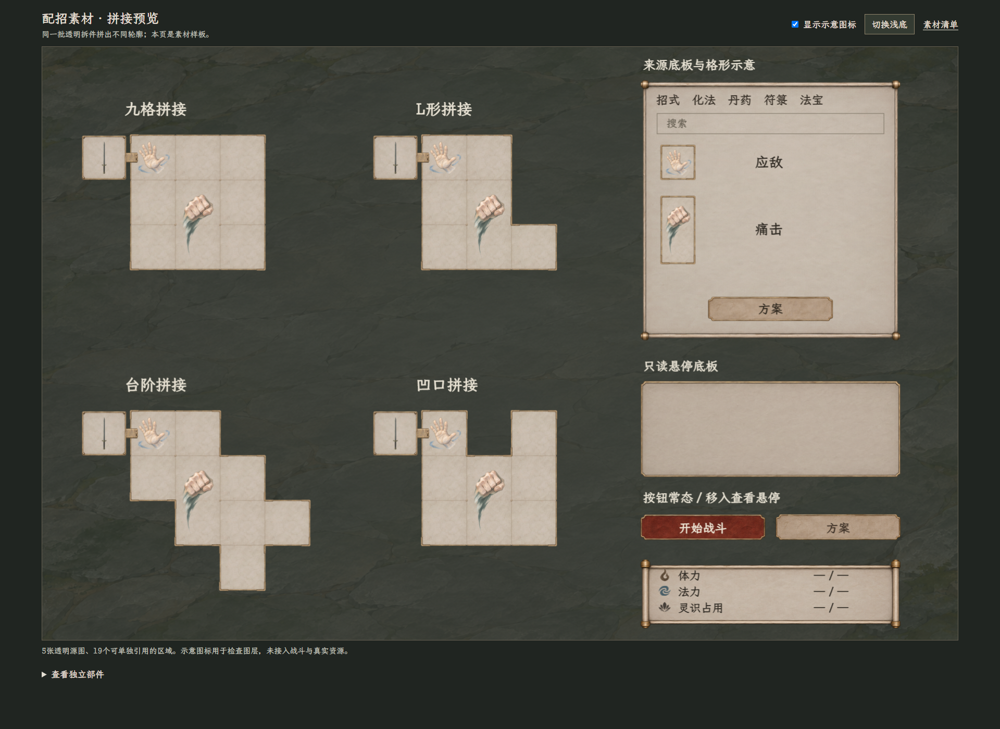

[可点预览](39_素材拼接预览.html) · [首批素材包](39_配招界面素材包_v1.zip) · [清单、使用与验证记录](39_首批素材与验证.md) · [浅底1280核对](39_素材实拼_浅底1280.png)。预览可切换深浅底、隐藏图标、查看独立部件，并检查按钮悬停。

五张PNG保留真实透明底和原像素，以AtlasTexture区域引用；同一份多格图标不重复、内部格线不穿过图案。Godot隔离读取五图十九区域通过。资源数字为未绑定占位，旧应敌／痛击只作图层核对；本批不是完整战斗实装，也不重定逐招占格。

## 当前已选：逐格拼接式配招界面

[来源、选定范围与适配记录](38_选定参考与适配说明.md)。38是用户新上传图片的原样副本，不是重新生成；以它作为当前视觉基准。图中九格／3×3是极早期示意，未来按真实可用格拼接格面、接缝和外轮廓，缺口透出背景，不补成假空格。手持仍是独立唯一外围槽。

主盘及来源图标继续覆盖格线、多格图案连续；资源填充和数字以实际数据为准，不能照抄参考比例。点击暗幕保留草稿，方案载入核验实际格形，缩到左下仍保留原盘形。正式适配边界见[局内UI主案](../../plans/界面与美术/局内战斗UI重设计_20261107.md#按实际格形拼接不固定矩形盘)。

38阶段只保存选定参考并更新文档；39首批素材的实际拼接结果见上方。11仍是固定3×3旧骨架，不冒称已经完成不规则盘或暗幕交互。35～37转为历史对照。

## 历史：三种结构对照（未作为当前方向）

| 候选 | 结构与观感 | 完整理想图 |
| --- | --- | --- |
| A 无底板刻度 | 只留角标和定位刻度，图标直接浮在暗幕上 | [35 A](35_A_无底板刻度.png) |
| B 旧纸卷轴 | 整张旧纸承载，卷边和小纸签手持位 | [36 B](36_B_旧纸卷轴.png) |
| C 竹简拼接 | 三条纵向竹简与细绳，材质触感更明显 | [37 C](37_C_竹简拼接.png) |

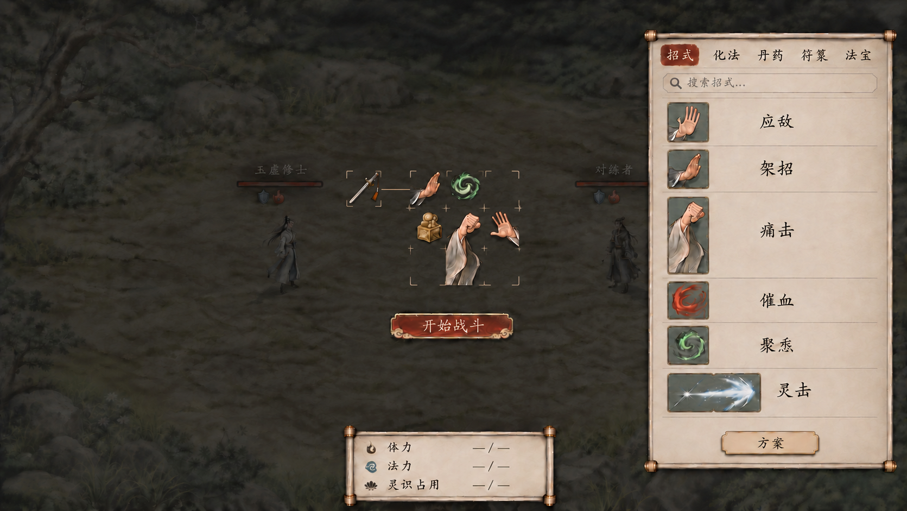

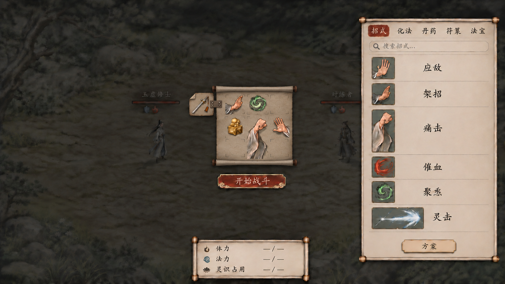

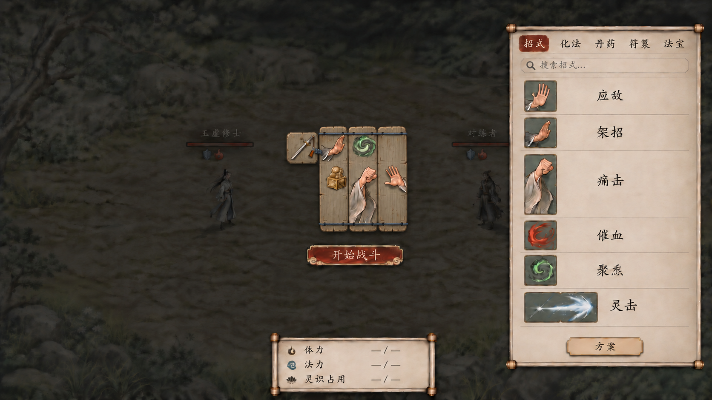

[完整提示词、原图与检查](35_37_招式盘三款候选_生成说明.md)。三款同源制作，未把其中任何一款视作已选定。保留空格定位、多格完整图案与单个手持位；右侧来源和资源区按原设计。生成图存在局部尺寸、文字与对齐差异，准确占形仍读实际数据。

## 上一轮：一体灰石盘（未获认可）

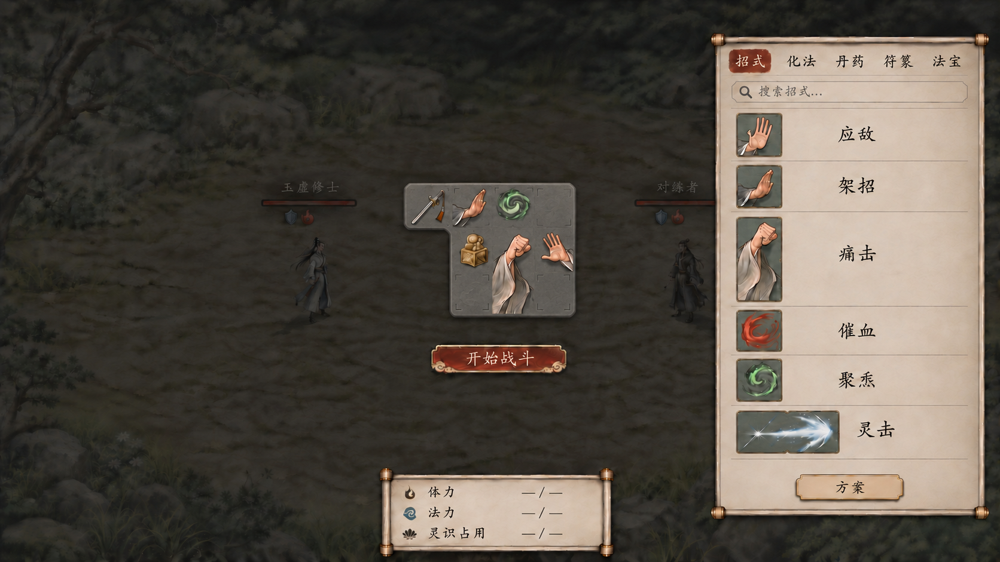

本轮只改中央盘和唯一手持接点的底板。用一整块中灰石面取代绢底、竹框和重复云纹，空位用浅刻短角定位，已摆对象直接在共同石面上呈现；不再一格一块底牌。右侧来源保留原样，页顶无文字、暗幕返回、资源居中与图标不被格线切开继续保留。

[完整提示词、来源与检查](34_一体灰石盘_生成说明.md)。34是本轮建议，尚未获选定或接入。手持接点外形是视觉示意，不增加格数，也不固定以后接点方向。

## 上一轮：灰青绢底（用户认为重复）

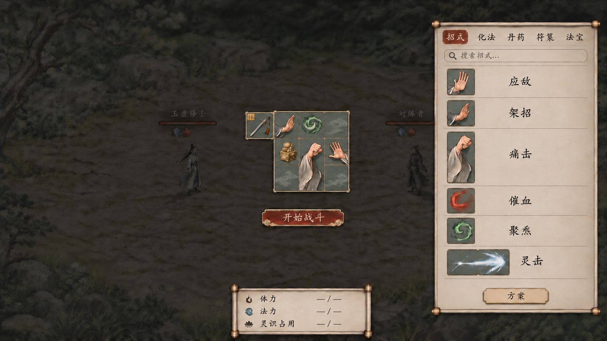

主盘用灰青织纹、薄竹压边和低对比淡墨纹，保持小巧；手持槽同材质。多格招式只保留一幅连续图案，内部格线不再穿过痛击袍袖和灵击气劲，主盘与右侧都遵守。空格纹理只是装饰，不代表新属性或特殊格。

资源提醒只是要求注意真实显示：体力／法力当前值与上限，灵识已占用与容量；没有选择隐藏或压暗资源区。新稿改用`— / —`，避免虚构比例；真正数值要由战斗对象读取。图稿依旧是候选，不冒充已经绑定角色。

[提示词、字段来源与本轮检查](33_灰青绢底与图层_生成说明.md)。11已修复图标高于格线的显示顺序，1280检查通过；它仍是旧骨架，未套用新绢底，未实现暗幕交互。32及此前图稿继续保留来源。

## 上一轮：无标题暗幕与放大来源

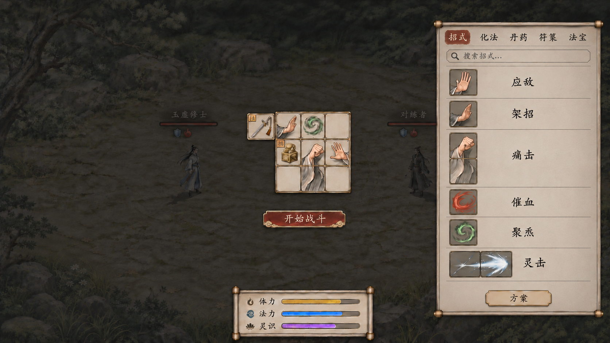

撤去30的“布阵／战前准备／招式盘”标题、装饰横线和整页纸底。主盘与来源浮在压暗战场上；裸露暗幕可点击关闭，保留草稿、筛选、选中项和滚动，从“配招”入口重新打开。关闭不提交、不结算，也不穿透点中战场；真正布阵环节的名称与流程保持独立。

右侧区域与格形放大，每项常态只有实际格形图标和名字。单格、横双格、竖双格按同一显示格距比较，效果、费用与次数仅悬停；保留分类、搜索和方案按钮。主盘继续紧凑，开战仍沿[28的左下小盘与居中资源布局](28_鬼谷参考_开战理想图_v2.png)。

[原图、完整提示词与检查](32_配招暗幕_生成说明.md)。本轮仅静态图与规范更新，未实现暗幕点击。图稿的名称列与格线仍是生成近似，精确控件须另验统一格距，不将旧六项样张当成最新逐招参数。

## 上一轮：不透明配招页（标题与纸底已撤回）

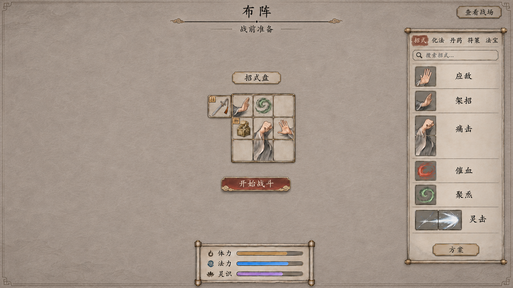

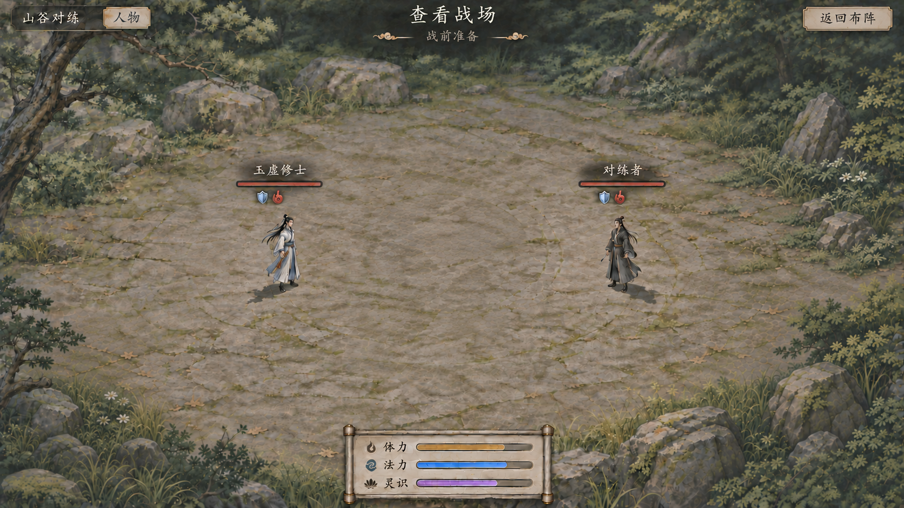

默认在独立不透明子页中搭配，战场人物、生命和行动信息不混排进编辑区。“查看战场”只隐藏子页，不提交、不开始结算；“返回布阵”保留草稿、筛选、搜索、选中项、来源／方案页与滚动位置。配好后点击开始／继续战斗才提交，进入[28战中布局](28_鬼谷参考_开战理想图_v2.png)：左下小盘、底部中央资源、列表隐藏。

回合末允许整理时复用同一配招子页；临时隐藏查看仍停在整理阶段，普通暂停不开编辑。方案按钮仍从配招页右侧进入该栏的方案选择页，合法选中直接覆盖草稿并返回来源，不另弹确认。

[生成原图、完整提示词与检查](30_31_配招子页与战场查看_生成说明.md)。本轮仅设计与静态图；11／19仍是上一轮同屏布阵骨架，未验证新子页往返、草稿保留或提交事务。30的来源名称仍有少量生成列偏差，实际控件须统一名称列；旧六项样张不覆盖最新逐招方案中的占格与份数评审。

## 上一轮：整屏对称的同屏布阵与开战图

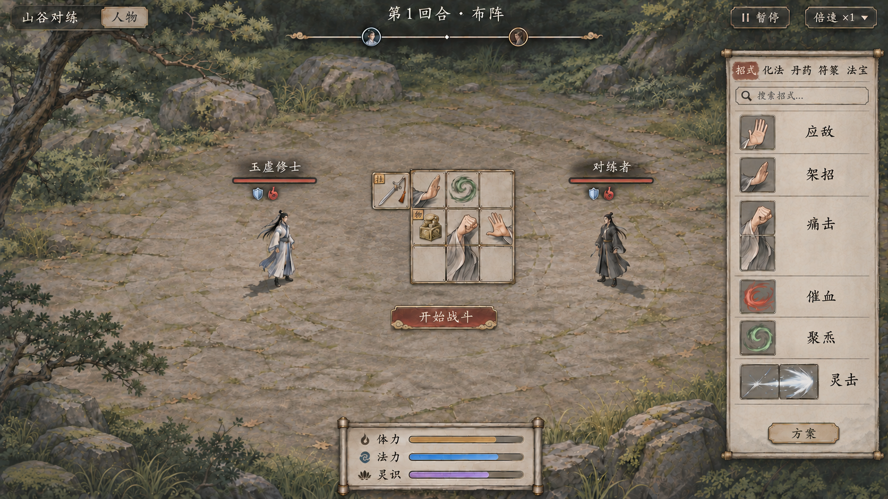

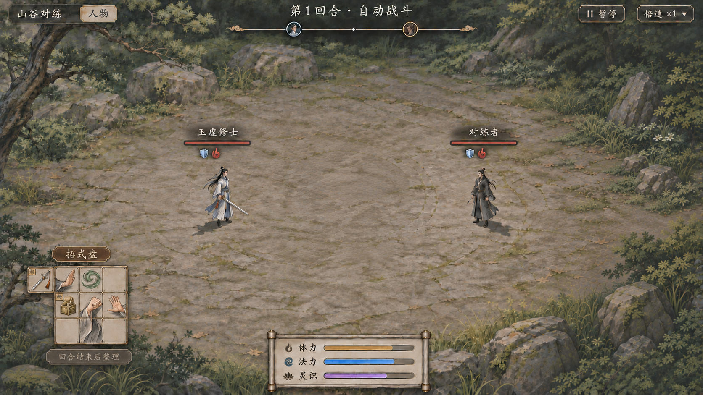

右侧来源不扣除战场宽度；双方始终围绕整屏中轴对称，展开／隐藏列表不移动角色或镜头。布阵时主盘连唯一手持槽整组居中；开战仅收起来源、把同盘缩到左下。资源始终留在底部中央，名称、细生命条与状态行继续分层。图稿为整体观感候选，右栏生成文字仍有少量列偏差，实际控件采用统一名称列；不把图稿当成像素级规范。

[上一轮提示词、来源与验证](27_28_鬼谷参考理想图_生成说明.md)。两张均由内置图像工具生成并原样保存，没有从第三方截图裁取运行时素材。27同屏配招由30独立子页替代，28继续表达战中信息位置；v1仅保留历史。

11布局样板增加[29固定战场与简洁状态](29_固定战场与简洁状态.css)，只同步整屏坐标、资源与生命条，未接入上图完整美术。1920×1080、1280×800已核对两态坐标不变、资源居中、右栏不碰敌方生命框；回合末整理后也保持原位。样板里的旧木质不代表当前选定风格。

## 上一轮：雾青薄玉素材候选（未选定）

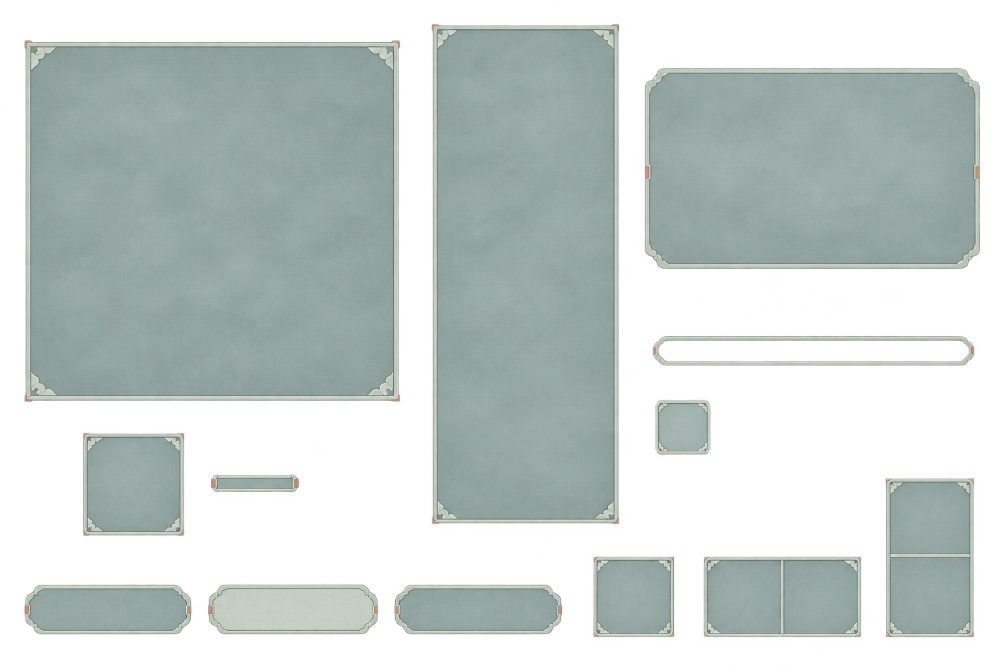

换为低饱和雾青灰面、窄幅浅玉边和小云角，减轻黑褐大底、木纹与金属包角的厚重感；仍保留主盘、手持槽、列表、悬停、按钮及状态边框这一组部件。仅生成新总览，未逐件拆分。见[原图、完整提示词与透明检查](26_雾青薄玉_生成说明.md)。

11／19仍以历史材质作交互骨架，坐标以最新29为准；不将它们当成上方完整美术已接入的证明。

## 上一轮乌木素材（用户要求更换）

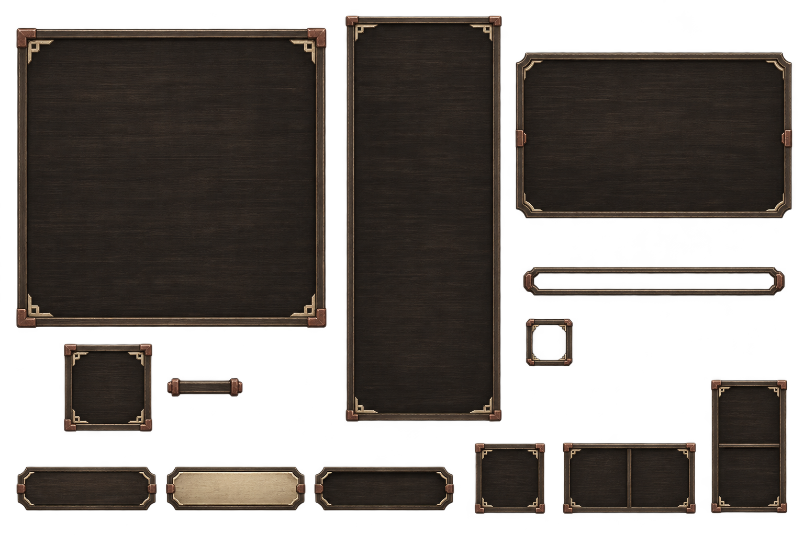

[独立招式盘底板](24_乌木骨饰_招式盘底板.png) · [独立列表底板](25_乌木骨饰_右侧列表底板.png) · [完整提示词、来源与透明检查](23_25_乌木UI素材_生成说明.md)。三张均由内置图像生成工具制作并原样保存；总览含按钮、悬停与状态框，其余部件暂未逐件切分。新PNG尚未替换样板中的控件边框，未接正式战斗。

## 历史风格对照（此前选C，随后要求更换素材）

[打开历史风格对照](19_三款新风格.html)，仍默认当时的乌木；灰宣／素绢保留作参考。顶部可切换材质及布阵／开战，切换不重置盘面；这不是当前整体风格已经确认的证明。

| 候选 | 造型与材质 | 完整布阵图 |
| --- | --- | --- |
| 灰宣墨线 | 低亮中灰纸面、深墨字、墨线分隔与少量朱色 | [20灰宣](20_灰宣墨线_布阵1920.png) |
| 素绢朱印 | 暖灰褐织纹、墨褐字、暗朱短签 | [21素绢](21_素绢朱印_布阵1920.png) |
| 乌木骨饰 | 炭褐木纹、灰骨字、嵌片按钮与木匣托盘 | [22乌木](22_乌木骨饰_布阵1920.png) |

前三款对照由真实网页控件绘制，记录见[当轮说明](19_三款新风格_说明.md)；本轮已另生成上方23～25实际素材。四个未完成的招式图标仍为标明的占位，不因选中材质就冒称全部完成。

## 可点布局骨架（默认乌木）

[打开局内UI布局样板](11_局内UI布局样板.html)。直接打开即可查看；它使用项目现有素材与真实网页控件演示排版，不计算伤害、不运行正式战斗或存档。

- 右侧每个来源项显示真实拼格：应敌／架招／催血／聚炁1×1、痛击1×2、灵击2×1。列表单格尺寸一致，整幅图标跨格，较高条目增高，名称同列。
- 角色血条下只显示状态图标。双护具从“人物”详情查看，不挂在血条下面。
- 布阵时中央小盘与右侧来源；开始后同盘连唯一手持槽缩到左下，右栏隐藏；演示共同回合结束后才能恢复整理。
- 主盘与双方人物均用整屏坐标，右栏浮层不挤动战场；资源两态均在底部中央。最新坐标核对见27／28生成记录。
- 方案按钮进入子页，选项直接覆盖样板布局并返回来源；分类、搜索和只读悬停独立工作。
- 小人物与场景仍用项目已有素材以便比较材质；上一轮深色薄边配色已否定，不宣称未来所有视角美术已完成。

[上一轮布阵1920截图](12_拼格布阵_1920.png) · [上一轮开战1920截图](13_自动战斗_1920.png) · [旧风格来源与当轮验证](09_11_来源与验证说明.md)。这些截图保留当轮验收记录，不代表最新页面或材质；当前配招／查看以上方30／31为准，战中沿用28的信息位置。

[布阵1280截图](14_拼格布阵_1280.png) · [开战1280截图](15_自动战斗_1280.png)。浏览器已核对两种宽度无页面溢出、格形与名称列一致；新页无控制台错误，正式游戏未接入。自动化工具不允许直接导航file协议，验证通过仅限本机的HTTP预览完成，不冒称已通过file自动化检查。

## 历史风格探索稿（已否定）

[09：俯视场景与深色界面探索](09_俯视局内风格_布阵探索.png)由内置图像生成工具制作，用于看小人物、地面和整体材质方向。其中央盘偏大、来源名称列与部分细格距未精确统一，不能直接作为布局标准；准确拼格与状态位置以11控件样板为准。

后续两次编辑和纯背景生成均连接失败，未得到精修图或新纯背景。本轮没有改用需另行授权的图像API。11使用本项目已有的纯俯视石地与透明人物素材，不裁切09或他作截图作为底图。完整提示词与失败边界见[来源记录](09_11_来源与验证说明.md)。

## 交互和显示边界

悬停为只读暗色卡，不带旋转／取下等操作按钮，不作为常驻详情列。正式效果仍按[简略／详细规范](../../plans/界面与美术/信息展示与规则详解分层规范_20261026.md)读取实际值，样板不虚构伤害、摆放上限或技能总次数。部分图形仅用于布局示例，逐件正式图标另审。

当前样板只验证两态布局、来源格形与交互边界；不替代自动目标、逐格检查、应对、周天、灵识、器体或真实耗材事务的正式战斗测试。资源栏比例和状态出现是视觉占位，不代表实际角色数值／效果。08和更早原型的测试不能计入本轮结果。

## 历史图稿

以下保留出处与讨论过程，不作为当前排版推荐。尤其08的血条下护具徽标和等高图标来源列表已被用户否定。

| 图稿 | 原用途 | 来源与边界 |
| --- | --- | --- |
| [01墨青](01_墨青_布阵理想图.png) | 旧侧视配色比较 | [生成记录](01_生成说明.md) |
| [02炭灰](02_炭灰_布阵理想图.png) | 旧侧视配色比较 | [生成记录](02_生成说明.md) |
| [03墨黑](03_墨黑_布阵理想图.png) | 旧侧视配色比较 | [生成记录](03_生成说明.md) |
| [04开战左下小盘v2](04_开战后_左下小盘_v2.png) | 收盘方向 | 原侧视场景，未表达本轮全部状态／拼格规范 |
| [05方案与悬停](05_布阵方案与悬停.png) | 旧盘上方方案下拉 | [生成记录](05_生成说明.md)，下拉入口已撤回 |
| [06法宝范围与方案按钮](06_法宝范围强化与方案按钮.png) | 范围／受益标、右栏方案入口 | [生成记录](06_07_生成说明.md)，法宝与范围均为示例 |
| [07方案子页](07_方案子页_选择即覆盖.png) | 选择即覆盖流程 | [生成记录](06_07_生成说明.md)，保留流程，不沿用旧等高来源列表 |
| [08外围手持与双护具](08_外围手持与双护具_布阵理想图.png) | 上一轮位置示例 | [生成记录](08_外围手持与双护具_生成说明.md)，排版已被用户否定 |

更早亮纸色和固定详情列的[旧浏览器原型](../九格招式盘与战斗界面_20261106/交互原型说明.md)仍仅作历史，不能重新当成当前风格。
