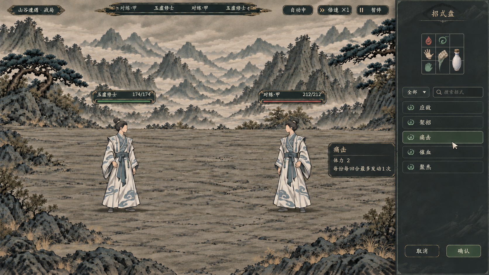

# 方案 B：岩灰右栏暗色战斗 UI 理想图

> 2026-11-07。状态：**供用户比较的静态理想图，尚未接入游戏，未改动正式战斗 UI、招式和数值。**本方案只示意回合间整理状态，实际操作、文字、尺寸和规则以确认后的原生界面为准。



## 内容与参考

- 宽幅水墨山谷与两位白青衣修士保留为主体；右侧布阵抽屉使用哑光炭灰／岩灰，顶部紧凑九格，下方是搜索、招式列表和取消／确认。
- “痛击”旁的小暗色三行卡仅表示悬停详情；画面没有常驻详情栏和底部全宽大面板。小图标、剩余空格以及控件只作构图示意。
- [当前自动战斗收起态](../九格招式盘与战斗界面_20261106/自动战斗收起态_1600.png)：只参考山谷、人物和笔触，不继承浅色底栏。
- [正式回合制单挑实景](../男女首套回合制人物_20261106/正式队列_1v1.png)：只参考战场、人物与旧版顶部状态位置，不继承旧队列卡与浅色技能栏。
- 本图为 **16:9 横屏 PNG，1672×941，RGB**。最终项目文件是生成器最终输出的原样复制，未裁切、拉伸或覆盖现有素材。SHA-256：`a4f8880e6deab79171a3b046da77c91b7831b7a63edb60ec85750b0059fa03de`。
- 最终生成原图：`E:/tmp/CodexData/generated_images/01a1b122-9835-7ba2-b447-228c73a3c5bc/exec-cda3ded0-6d37-4dbb-9d83-23ed5329bdb8.png`。初稿与九格修订的原图分别为同目录下的 `exec-85f5b67a-bdca-425c-84b0-ef4b0c5cb8d0.png`、`exec-131cfd63-79eb-4cf0-bc45-d0aace2beec2.png`。

## 检查与局限

- 已人工查看：战场与人物完整；无底部全宽面板；右侧为单一暗色抽屉；提示卡在抽屉左侧且不带操作按钮；保留顶部行动、血条、暂停和倍速。旧截图遗留的“自动：关”已定向改成“自动中”。
- 原图中右栏约占画宽 19%，九格可见边框宽约 145 像素；按 1920 宽换算分别约 364 像素和 167 像素。它接近但未严格达到目标的 300～340 像素右栏和 144×144 九格，且为目视估算；将来实现时应按确认的真实控件尺寸重建。
- 画面有沿用参考实景的暖赭细边；具体边色、灰度与山谷比例仍待用户评价。生成图中文字和细小图标可能出现笔画或形状偏差，不能作为正式文案或素材：文字应由原生楷体控件重新绘制，数值和技能名单须读取真实数据。
- 鼠标、悬停、按钮和摆放均为画面演示，没有实际交互或战斗结算；本图不指定初始盘形、各招最终占格或法宝规则。

## 初次生成完整提示词

```text
Use case: ui-mockup.
制作一张高完成度的中国水墨修仙游戏战斗 UI 理想图，方案 B：“岩灰右侧窄抽屉”。16:9 横屏，整幅游戏画面，设计尺寸按 1920×1080 的相对比例；它是项目未来界面的审阅概念图，不是网页或手机界面。

输入图 1：参考游戏战斗的山谷场景、两名白青衣修士及笔触质感。图 2：参考现行实战山水画面、人物站位、顶部行动条和血条。但两张原图中的底部大片亮纸色 UI、旧队列卡牌均不继承。

构图：整张画面左侧约 82%～84% 是宽阔连续的水墨山谷与完整地面，两名白青衣修士面对面站在战场，身体完整，人物按原图比例不过大、不要被遮挡；上方保留纤细的行动进度条、生命条及小巧的“暂停”“倍速”控件。右侧是贴屏边、宽约 300～340 / 1920（全屏宽度 16%～18%）的窄而完整的布阵抽屉，暗色半不透明岩灰底、细弱松灰绿边线、哑光墨痕；这是回合间整理的单个抽屉，不再有任何底部全宽信息面板或常驻详情栏。战场左侧与中央保持干净完整，不能另增横向大面板。

右侧抽屉从上往下布局：标题“招式盘”，一个非常紧凑的 3 列×3 行九格盘，9 个等大正方形，各格以 1920 设计画布约 48 像素为参考，整个盘含边框约 144×144，盘面宽度约抽屉的一半，严禁把九格放大成大号卡牌；行囊式透明物象直接跨真实格子，线条细，保留明显空格。图标示例：一格手掌势、一格气血、一格有方向箭头的化法、竖向占两格的拳劲、一只竖向占两格的白瓷丹瓶，另留空格，图标清楚但不绘名字在格内。盘下面是紧凑的类别、搜索与已学招式纵向清单，真实示例名称“应敌”“架招”“痛击”“催血”“聚炁”，文字整齐清晰，列表行以项目既有窄按钮风格表示，避免图标变成大卡面；抽屉底部只有“取消”“确认”两按钮。

正在悬停“痛击”时，在右侧抽屉左边、靠近当前对象的位置，出现一个小型深炭灰只读浮动提示卡，只显示以下三行准确文字：
“痛击”
“体力 2”
“每份每回合最多发动1次”
提示卡没有操作按钮；鼠标箭头轻指痛击。不在页面常驻一整列详情。

整体界面色彩为炭灰 #252b2d、灰岩 #303638、克制的松灰绿细线、灰米色文字；中文采用与项目楷体接近的端正字体，层级可读。界面材质哑光，边框薄而精致，有极淡笔墨肌理；人物和山水仍保留参考图的青白服饰与传统水墨画风。画面不模糊，允许山谷地面暗一些以突出人物和界面。

约束：UI 层全部暗色，不使用大块亮白纸面；不要底部全屏大面板；不要常驻详情栏；不使用巨大网格、不改变三行三列结构；没有发光、金属镜面、亮金框、紫蓝赛博风、网页浏览器框；不出现额外角色、手动选目标控件、不增加法宝主动能力或新数值。面向用户呈现为精致、可信的游戏内原生界面，且右侧抽屉布局应显著区别底部面板式方案。
```

## 九格尺寸定向修订完整提示词

```text
Use case: precise-object-edit.
请精准修改提供的这张游戏 UI 概念图，只改右侧抽屉顶部的 3×3 九格盘尺寸和紧随其后的留白，不要重做布局。

关键修改：现在九格盘画得太大。把整个九格盘缩小到画面宽度的 7.5%，约为原盘宽度的 62%；等效于 1920×1080 游戏设计基准下，整个盘 144×144 像素，每格 48×48。九格盘仍在右抽屉顶部居中，9 格必须严格等大，3 行 3 列清晰可数。保持每个格子里的原有掌势、气血、方向化法、横跨两格的拳劲与丹瓶的关系，并保留空格；不要额外添加卡牌、发光或字块。九格缩小后，允许紧随九格下方的搜索和五条招式列表整体轻微上移以保持疏密自然，列表内容不变。

保留原画的全部其他内容和位置：画面保持 16:9，中国水墨山谷战场、地面与两名白青衣修士完整；右侧抽屉仍占屏幕约 16%～18%，色调 #252b2d／#303638；保持顶部行动条、血条、暂停和倍速。鼠标悬停“痛击”的小型暗色提示卡贴在右侧栏左侧，只能有三行字：“痛击”“体力 2”“每份每回合最多发动1次”，不带任何按钮。下方保留“应敌、架招、痛击、催血、聚炁”列表与底部“取消、确认”按钮。

不添加底部横向面板、常驻详情栏、亮纸背景、紫蓝色霓虹、发光金框、浏览器边框或任何新玩法。文字尽量准确；不要修改战场角色数量、姿态或背景光照。
```

## 自动战斗状态文字修订完整提示词

```text
Use case: precise-object-edit.
请只对提供的这张游戏 UI 理想图做一处文字修正：顶部偏右目前的按钮写着“自动：关”，这与本游戏全程自动战斗的设定冲突。请将这个按钮文字准确替换为“自动中”，保持原按钮尺寸、位置、深炭灰底色、细边、字体与设计不变。右侧相邻“倍速 ×1”和“暂停”按钮不变。

除了上述这一个按钮文字，不要改变其他任何内容：保持整张 16:9 画面、两名白青衣修士和水墨山谷、右侧约六分之一画幅的岩灰布阵抽屉、抽屉顶部紧凑的三行三列小盘、五条招式列表和底部取消／确认按钮、左侧仅三行文字的深色“痛击”悬停提示卡。不要添加新按钮、金光、大纸面或常驻详情栏。
```

以上均使用内置 `image_gen` 工具完成：先依据两张本地参考生成，再以生成图进行两次定向修改。最终图片仅作为方案 B 的视觉候选。

