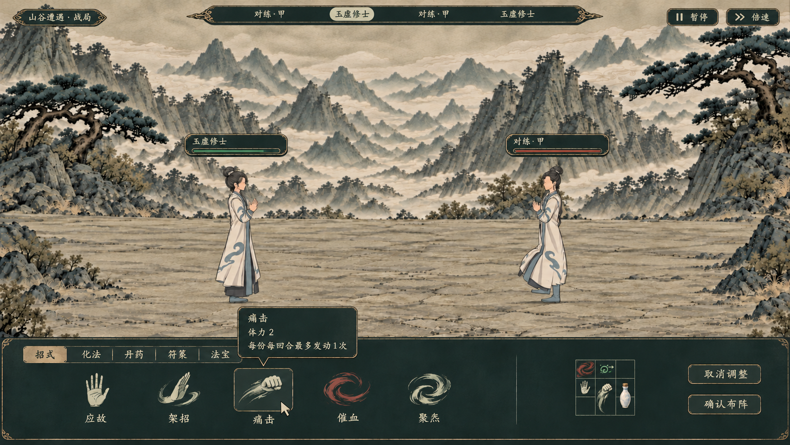
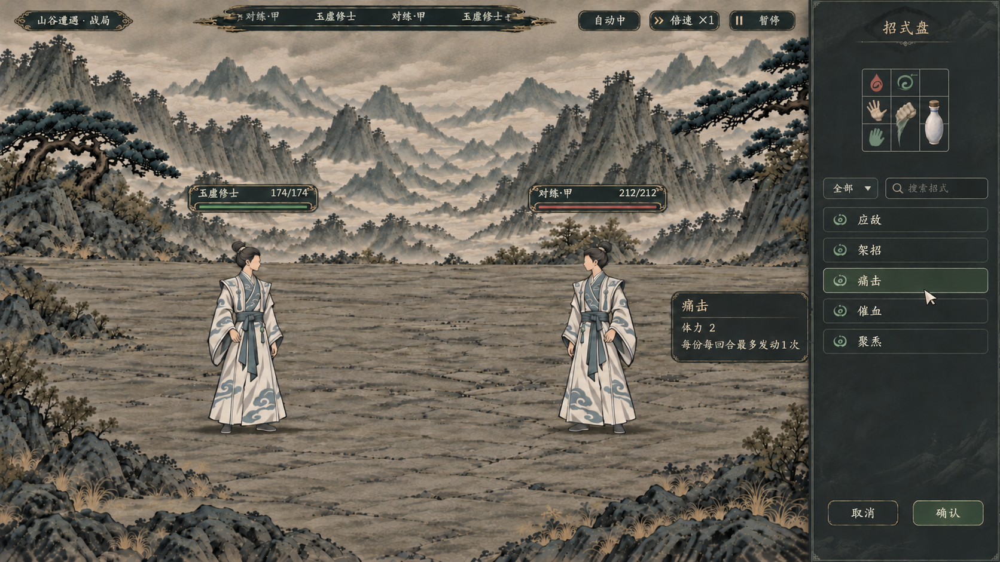
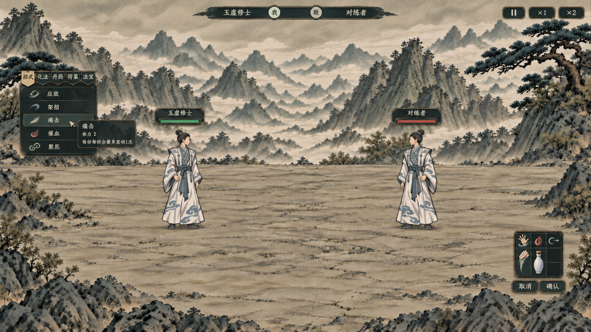

# 局内战斗暗色 UI：三套布局候选

> 最新覆盖：用户已指定“右侧列表、中央布阵；开战后列表隐藏、盘缩小移到左下”。当前入口为[固定布局的三种配色及开战态](../局内战斗布阵与开战理想图_20261107/README.md)。下方不同布局只保留为历史风格探索。

> 2026-11-07 更新，本轮图片目录沿用开始制作时的 20261106。状态：**暗色与悬停详情方向已确认，具体布局供用户抉择；三张均为静态理想图，未接入游戏。**
>
> 用户最新要求：上一轮大面积浅纸色太亮，常驻“详情”区不采用，信息改为悬停查看。本文覆盖[上一轮界面原型](../九格招式盘与战斗界面_20261106/交互原型说明.md)的浅纸底与固定右侧详情布局。战斗规则、技能效果、费用、次数和真实物品规则仍以[九格战斗总案](../../plans/战斗与构筑/九格招式盘与自动战斗重构提案_20261106.md)为准。

## 一、三图的共同边界

- 三图统一展示回合间整理，便于比较选招与摆盘的位置；图上的鼠标说明卡表示悬停瞬间，移开即消失，不是常驻详情。
- 局内控件使用深墨青、炭灰或墨黑面，文字为柔和灰米色，边线为克制松灰绿及少量暗铜；战场仍保留项目水墨山谷的自然明暗，不把整个场景改成夜景。
- 保留小格与直接跨格的透明招式意象。以 1920×1080 的 48 设计单位／格、九格约 144×144 为排版参考；三张统一以 3×3 示意初始九格，不因此确认最终盘形或各招尺寸。
- 技能与物品信息不占一整列；图内只有一张小型只读悬停卡。移动、旋转、取下等操作由对象交互或通用操作承载，悬停卡不塞操作按钮。
- 所有技能数量、图标、人物、文字和数值均是视觉示意；生成图不是正式技能素材、真实角色快照或运行验收。各招的摆放上限、法宝、丹符等未决规则不由构图决定。

## 二、布局比较

本页的 1／2／3 只编号 UI 候选，与已选的“应对方案 A”无关。

| 候选 | 回合间整理布局 | 自动战斗时的收起建议 | 适合的取舍 |
| --- | --- | --- | --- |
| **1：墨青底栏** | 底部低矮操作带，左侧横向选招，右侧小盘和确认；战场留在上部 | 收起选招清册，只保留紧凑盘面与必要资源、整理入口 | 操作集中，接近现有底栏习惯；招式多时需分页或横向浏览，底栏会占据一段战场高度 |
| **2：岩灰右栏** | 右侧窄抽屉，上盘、下列表，确认放在抽屉底部；悬停向左避让 | 列表收起，抽屉缩成小盘区域，不保留整条空侧栏 | 选招、摆盘和确认集中在同侧；多人战场需要为右侧留出安全区 |
| **3：墨黑悬浮** | 左侧小型清册与分类书签，右下独立小盘，中下部战场完整可见 | 清册和分类收起，只留右下小盘与整理入口 | 遮挡最少，战场感最强；选招与落点相隔较远，拖拽和视线移动更多 |

### 1：墨青底栏

底部约占画面高度四分之一。横向清册使用清楚的物象与短名称，盘面保持小尺寸；较长效果只在悬停卡显示。推荐底色 `#182b2a`、次层 `#213735`，文字 `#d4cfbf`。图中局部浅暖选中标签属于候选细节，正式实现可统一替换为深松绿选中态。

### 2：岩灰右栏

以屏幕宽约 16%～18% 的抽屉为目标。小盘、检索、条目、确认保持一条阅读路径，列表行使用短名称及小图；提示卡贴近当前条目，向战场侧避让。推荐底色 `#252b2d`、次层 `#303638`，细松灰绿边与灰米色字。

### 3：墨黑悬浮

清册目标宽约 260／1920，右下盘单独留安全区。两块控件采用薄暗边和少量笔墨肌理，未使用的中下部不补一整块底板。推荐底色 `#181f20`、次层 `#202c2c`，选中只用柔和灰绿填充。该布局更突出战场，但后续须验证双方多人站位和拖拽路径。

## 三、字号与排版建议

正式文字继续使用项目 `resources/font/LXGWZhenKaiSlabGB-Regular.ttf`。下面是统一的控件字号建议，不以生图中的笔画或字宽作为实际字体标准。

| 层级 | 1920×1080 参考字号 | 1280×720 排版目标 |
| --- | ---: | --- |
| 面板标题／悬停名称 | 24／22 | 20／20 |
| 招式名、正文、主按钮 | 20 | 尽量保持 18，必要时收紧间距和调整宽度 |
| 费用、次数及次级信息 | 18 | 16 |
| 辅助提示 | 16 | 14；不能承担必须读清的效果条件 |

名称不压在小格图案上，格内只保留方向、状态等必要标记。费用和剩余次数在清册及悬停里对齐；名称、数值和正文分层，不把技能解释铺在战场上。选中不发光、不放大图标；使用暗松绿填充或细边表达。

## 四、悬停详情的布局约定

1. 清册项和盘面对象复用同一份真实信息。悬停卡贴近当前对象，避开其实际占格和鼠标落点；靠近屏边时换侧或上移，保持完整可见。
2. 普通悬停只读，移开或开始拖动后收起；选择对象用于摆放、移动等操作，不再固定打开一栏详情。
3. 理想图为了看布局只放了少量文字；**正式信息不能被限制为图中的三行**。效果、费用、目标、关键词、触发条件、次数、冷却和真实代价按现行规范完整展示。简略／详细与公式遵循[信息展示规范](../../plans/界面与美术/信息展示与规则详解分层规范_20261026.md)，主悬停完整展开，不另加内部滚动条或策划说明。
4. 丹药、符箓和法宝继续读取各自真实信息类型，不将“每份每回合一次”误套到物品；悬停不执行招式、不抽随机数、不消费物品。

## 五、生成来源与检查范围

三图均使用内置 `image_gen`，基于项目原画和实机画面生成；完整提示词、定向修订和生成原件记录分别在：[1 的生成记录](01_生成说明.md)、[2 的生成记录](02_生成说明.md)、[3 的生成记录](03_生成说明.md)。最终图片已保存到本目录。

| 文件 | 图像尺寸 | 目视结果及局限 |
| --- | --- | --- |
| [1：墨青底栏](01_墨青底栏_理想图.png) | 1671×941 | 暗色底栏、单个悬停卡、小盘符合方向；仍有少量浅暖选中标签；格线和画布不是像素级标准 |
| [2：岩灰右栏](02_岩灰右栏_理想图.png) | 1672×941 | 无全宽底栏、无常驻详情；右栏及九格比排版目标略宽，正式控件需按选定尺寸重建 |
| [3：墨黑悬浮](03_墨黑悬浮_理想图.png) | 1672×941 | 左清册、右下盘与完整中下战场清楚；悬浮区的精确尺寸、多人避让及小屏可读性需实际界面验证 |

三图均已人工查看暗色面、常驻详情移除、悬停位置、基本布局及小盘比例。生成文字、条目图标和重复的顶部姓名等存在示意偏差，不作为新玩家文案或真实数据；正式接入时由原生控件、当前技能信息与实际人物绘制。此次没有修改正式战斗代码、技能资源、存档或旧交互原型；布局由用户在三套中选择后再落到可操作界面。
