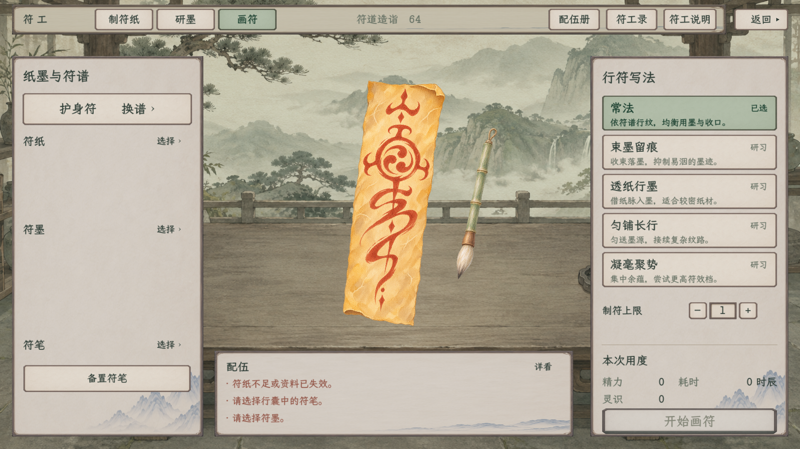

# 工艺顶栏与炼丹控件修订

**当前效果已更新为[三资源等距与符工模式按钮下移](等距与符工页签下移/README.md)。** 炼器已补精力，三资源行靠右且组间等距；符工三个模式按钮在左侧纸面顶部，正文同用中性米白纸面。下面的1114项与截图是初版历史，不作为当前修订验收。

2026-11-09。[当前范围与规则边界](../../plans/界面与美术/工艺顶栏与炼丹控件修订_20261109.md) · [按钮用途映射](../../plans/界面与美术/按钮用途与素材映射规范_20261109.md)。

炼丹、符工共用炼器同族横条，右上返回独立留出16设计单位间距。炼丹已撤去炼成展示区与丹方册副标题，重做册本图标、筛选按钮分型和直滑轨。炼丹与符工修改正式原生页；炼器只修样稿，新版仍未接入正式入口。

## 完整效果

炼丹：

画符：

| 页面／状态 | 1920×1080 | 1280×720 |
| --- | --- | --- |
| 炼丹主界面 | [完整图](alchemy_paper_main_1920.png) | [完整图](alchemy_paper_main_1280.png) |
| 拣药与直滑轨 | [完整图](alchemy_paper_picker_1920.png) | [完整图](alchemy_paper_picker_1280.png) |
| 功用选中 | [完整图](alchemy_paper_picker_utility_1920.png) | [完整图](alchemy_paper_picker_utility_1280.png) |
| 丹方册分类与条目 | [完整图](alchemy_paper_notebook_1920.png) | [完整图](alchemy_paper_notebook_1280.png) |
| 八味满配 | [完整图](alchemy_paper_full_eight_1920.png) | [完整图](alchemy_paper_full_eight_1280.png) |
| 符工·制纸 | [完整图](talisman_header_paper_1920.png) | [完整图](talisman_header_paper_1280.png) |
| 符工·研墨 | [完整图](talisman_header_ink_1920.png) | [完整图](talisman_header_ink_1280.png) |
| 符工·画符 | [完整图](talisman_header_drawing_1920.png) | [完整图](talisman_header_drawing_1280.png) |
| 炼器样稿主界面 | [完整图](炼器_主界面_1920.png) | [完整图](炼器_主界面_1280.png) |
| 炼器悬停 | [完整图](炼器_按钮悬停_1920.png) | [完整图](炼器_按钮悬停_1280.png) |
| 炼器按压 | [完整图](炼器_按钮按下_1920.png) | [完整图](炼器_按钮按下_1280.png) |
| 炼器质材 | [完整图](炼器_质材_1920.png) | [完整图](炼器_质材_1280.png) |
| 炼器选材 | [完整图](炼器_选材_1920.png) | [完整图](炼器_选材_1280.png) |
| 炼器性材 | [完整图](炼器_性材_1920.png) | [完整图](炼器_性材_1280.png) |
| 炼器和材 | [完整图](炼器_和材_1920.png) | [完整图](炼器_和材_1280.png) |
| 炼器器物册 | [完整图](炼器_器物册_1920.png) | [完整图](炼器_器物册_1280.png) |
| 炼器说明 | [完整图](炼器_说明_1920.png) | [完整图](炼器_说明_1280.png) |
| 炼器只读演出 | [完整图](炼器_炉火定器_1920.png) | [完整图](炼器_炉火定器_1280.png) |

36张均为Godot原生Viewport完整截图，无重画或图像加工；已逐张目视核对。文字与按钮同行、返回独立、切页后顶栏保持，无新增中央深色文字块。丹方册图标来源见[透明原图生成记录](丹方册图标来源.json)。

## 本轮验证

统一构建0警告、0错误。六次最终原生运行均退出0：

| 专项 | 每个尺寸检查数 | 每个尺寸完整图 | 验收边界 |
| --- | ---: | ---: | --- |
| 炼丹 | 146 | 5 | 正式Owner绑定、真实全目录与灵识／精力／造诣、八味满配、剂量、筛选、丹方册、返回及新顶栏；未开炉 |
| 符工顶栏 | 149 | 3 | 三页真实点击切换、同字号同高、横条／返回间距、配伍册／符工录／说明打开关闭、原地点返回、浏览不改库存精力；不是整套制作事务回归 |
| 炼器独立样稿 | 262 | 10 | 顶栏同高且无交叠、返回独立、各投料分类、数量、选材、书册、说明、按压及只读炉火；未绑定正式人物或提交炼制 |

两种尺寸合计1114项、36图。详见[合并验收与源码SHA](本轮原生验收.json)、[构建日志](编译.log)，不混入旧UI或网页计数。

| 专项记录 | 1280 | 1920 |
| --- | --- | --- |
| 炼丹逐项／日志 | [逐项](alchemy_checks_1280.json) · [日志](alchemy_原生验收_1280.log) | [逐项](alchemy_checks_1920.json) · [日志](alchemy_原生验收_1920.log) |
| 符工顶栏逐项／日志 | [逐项](talisman_checks_1280.json) · [日志](talisman_原生验收_1280.log) | [逐项](talisman_checks_1920.json) · [日志](talisman_原生验收_1920.log) |
| 炼器样稿逐项／日志 | [逐项](forging_checks_1280.json) · [日志](forging_原生验收_1280.log) | [逐项](forging_checks_1920.json) · [日志](forging_原生验收_1920.log) |

仅使用output内隔离用户目录及临时人物，没有读取或改写用户旅程。日志保留既有《卸力》资源UID按文本路径回退提示；最终无运行错误。中途曾查出炼丹资源文字收缩为字体最小高度、炼器说明与标题相挤，以及炼器测试宿主退出时临时CLR数组晚释放；均已分别修正后复拍，最终记录以上表为准，过程说明保留在合并验收中。

## 接入与后续

炼丹、符工顶栏已改正式原生实现。炼器只有独立纸墨样稿更新，正式炼器仍是原入口；本轮不借顶栏修订接入新炼器。百工、见闻继续暂存；善功堂、藏经阁、凝核保留。

[全页按钮用途检查](../按钮用途全页审计_20261109/README.md)与[普通交易独立样稿](../普通交易纸墨木石样稿_20261109/README.md)分别归档，不把审计登记或样稿通过当作全游戏已统一。
