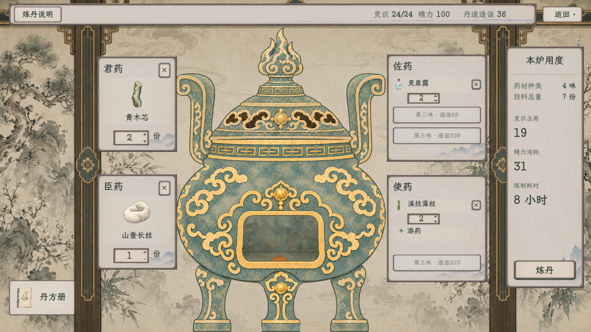
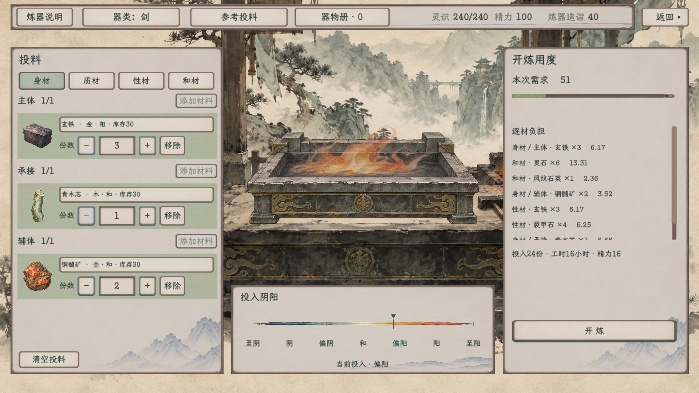
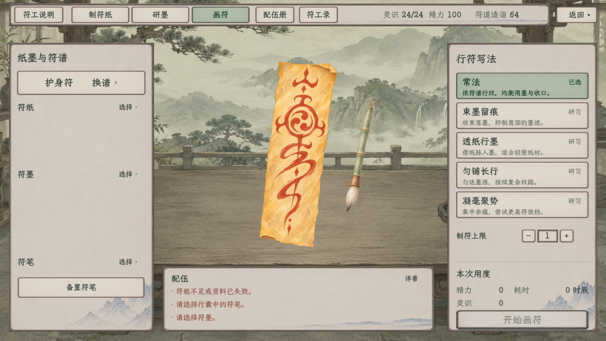

# 工艺顶栏：同列、右对齐与统一纸色

此页为上一轮记录；当前三资源组改为等距排列，符工三个模式按钮已移到左侧纸面顶部，见[最新完整图](../等距与符工页签下移/README.md)。本页1248项与509项不沿用为最新验证。

2026-11-09，当前修订。[现行主案](../../../plans/界面与美术/工艺顶栏与炼丹控件修订_20261109.md)。

三页说明统一放左侧同一位置，撤去后面重复的炼丹／炼器／符工页面名及炼丹地点字样。中部只保留本页功能；灵识整组向右收齐，精力、造诣各用同一固定列。炼器已补精力，读现行初始容量作为独立试演资料，不定义新数值或接入正式人物。

顶栏与正文均采用中性米白纸面，撤去炼器专用偏绿压暗。炼器主阅读纸面、普通按钮和输入一起对齐共用材质，材料灰青衬面、整纸选中与按压反馈保留。右上返回继续独立在横条外，留出16设计单位间距。

## 当前完整效果

炼丹：

炼器独立样稿：

符工·画符：

说明按钮、灵识栏右沿、精力和造诣的位置三页一致；灵识整组随数字宽度在同一栏内向右收齐，其他栏不被推移。炼丹无中部模式按钮时保留留白，不再填多余标题或地点。当前炼器的精力100来自既有初始精力常量，只作未绑定人物的样稿资料；实际炼制规则未接入本样稿。

## 两种窗口与交互状态

| 状态 | 1920×1080 | 1280×720 |
| --- | --- | --- |
| 炼丹主界面 | [完整图](alchemy_paper_main_1920.png) | [完整图](alchemy_paper_main_1280.png) |
| 拣药 | [完整图](alchemy_paper_picker_1920.png) | [完整图](alchemy_paper_picker_1280.png) |
| 功用选中 | [完整图](alchemy_paper_picker_utility_1920.png) | [完整图](alchemy_paper_picker_utility_1280.png) |
| 丹方册 | [完整图](alchemy_paper_notebook_1920.png) | [完整图](alchemy_paper_notebook_1280.png) |
| 八味满配、大灵识数值 | [完整图](alchemy_paper_full_eight_1920.png) | [完整图](alchemy_paper_full_eight_1280.png) |
| 符工·制纸 | [完整图](talisman_header_paper_1920.png) | [完整图](talisman_header_paper_1280.png) |
| 符工·研墨 | [完整图](talisman_header_ink_1920.png) | [完整图](talisman_header_ink_1280.png) |
| 符工·画符 | [完整图](talisman_header_drawing_1920.png) | [完整图](talisman_header_drawing_1280.png) |
| 炼器主界面 | [完整图](炼器_主界面_1920.png) | [完整图](炼器_主界面_1280.png) |
| 炼器按钮悬停 | [完整图](炼器_按钮悬停_1920.png) | [完整图](炼器_按钮悬停_1280.png) |
| 炼器按钮按下 | [完整图](炼器_按钮按下_1920.png) | [完整图](炼器_按钮按下_1280.png) |
| 炼器质材 | [完整图](炼器_质材_1920.png) | [完整图](炼器_质材_1280.png) |
| 炼器选材 | [完整图](炼器_选材_1920.png) | [完整图](炼器_选材_1280.png) |
| 炼器性材 | [完整图](炼器_性材_1920.png) | [完整图](炼器_性材_1280.png) |
| 炼器和材 | [完整图](炼器_和材_1920.png) | [完整图](炼器_和材_1280.png) |
| 炼器器物册 | [完整图](炼器_器物册_1920.png) | [完整图](炼器_器物册_1280.png) |
| 炼器说明 | [完整图](炼器_说明_1920.png) | [完整图](炼器_说明_1280.png) |
| 炼器只读演出 | [完整图](炼器_炉火定器_1920.png) | [完整图](炼器_炉火定器_1280.png) |

## 本轮验证与接入

统一构建0警告、0错误；两种窗口六次最终运行均退出0，合计1248项、36张完整原生Viewport图。初版1114项及中间同列稿不计入本轮。

| 专项 | 每档检查 | 每档图数 | 范围 |
| --- | ---: | ---: | --- |
| 炼丹UI | 153 | 5 | 去除重复文字、同列与灵识右沿、正文同纸色、真实资料、选药／剂量／筛选／丹方册／满配／返回；未开炉 |
| 符工顶栏 | 173 | 3 | 三页切换、固定说明与资源列、灵识右沿、真实精力／灵识、书册／说明弹层、原地点返回；此组不制作 |
| 炼器样稿 | 298 | 10 | 重复标题撤除、精力补齐、同列与灵识右沿、主面板中性纸色、各分类／数量／弹层／原只读演出及反馈；无正式人物或事务 |

另作1280符工完整原生回归509项、16图，包含三工艺自然演出／跳过结束后的实际精力、灵识显示与人物一致，以及原制作、支付、库存、保存与退出约束。此组与顶栏检查分开登记。[制作刷新逐项](制作刷新复验/talisman_checks_1280.json) · [日志](制作刷新复验/制作刷新复验.log)。

[合并验收、源码SHA与运行范围](本轮验收.json) · [构建日志](编译.log)。最终日志只有既有《卸力》资源UID按文本路径回退提示，无运行错误。均使用output内隔离用户目录和临时人物，未读取或改写正式旅程。

炼丹、符工修改现有正式展示；炼器新皮肤仍只保留独立样稿。善功堂、藏经阁、凝核保持，百工、见闻继续暂存。原初版图与记录在[上级目录](../README.md)保留供追溯，当前以本页为准。
