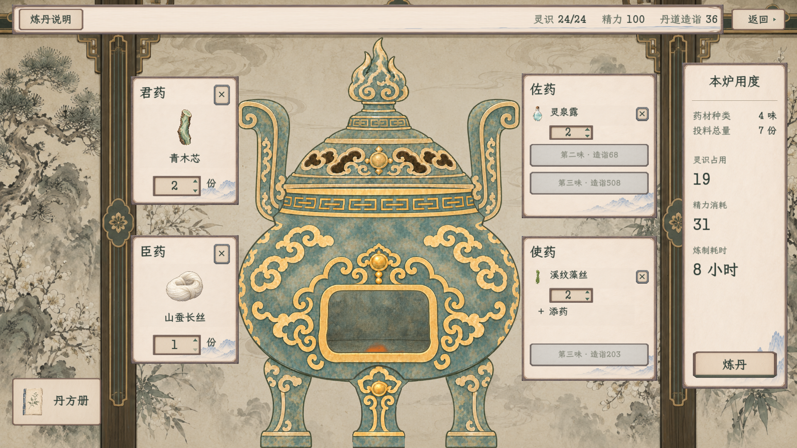
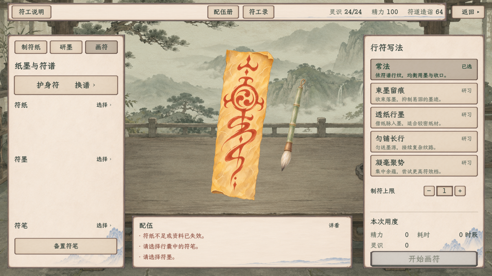

# 资源等距、符工模式下移与人物同款暖纸色

最新控件修订：本页图片已替换为暖纸色及暗色选中的原生实拍；可操作按钮与输入采用暖色，禁用保持灰冷，普通选中整纸压暗。此前等距检查记录保留作为布局验证；本次三工艺两档复验分别为炼丹152项、符工182项、炼器样稿297项。人物七页和静室侧栏1280原生回归分别216项与58项通过。

2026-11-09，当前。[现行主案](../../../plans/界面与美术/工艺顶栏与炼丹控件修订_20261109.md)。

纸色按用户最后提供的人物概览图统一：三工艺采用人物页同源原纸纹与原色，撤去工艺页旧压暗和去饱和，保留既有细边框、普通按钮和选中层次。此页图片和验证将以这一暖纸色最终复拍为准；之前冷色同距稿仅留在output，不当作最终图。

炼丹、炼器样稿、符工共用右对齐资源行，灵识／精力／造诣三组之间均为32设计单位，名称和值间隔8。数值按实际文字宽度排布，不因定宽空格造成一处宽、一处窄。

符工“制符纸／研墨／画符”已移到左侧纸面的最上方，位于“纸墨与符谱”或“本批材料”标题之上；三页位置一致。材料目录、符谱和纸墨笔资料重排在原边框内，原切页、选材、配伍与制作回调保持。

## 当前完整图

炼丹：

符工·画符：

| 页面／状态 | 1920×1080 | 1280×720 |
| --- | --- | --- |
| 炼丹 | [完整图](alchemy_paper_main_1920.png) | [完整图](alchemy_paper_main_1280.png) |
| 八味满配、大数值 | [完整图](alchemy_paper_full_eight_1920.png) | [完整图](alchemy_paper_full_eight_1280.png) |
| 炼器样稿 | [完整图](炼器_主界面_1920.png) | [完整图](炼器_主界面_1280.png) |
| 符工·制纸 | [完整图](talisman_header_paper_1920.png) | [完整图](talisman_header_paper_1280.png) |
| 符工·研墨 | [完整图](talisman_header_ink_1920.png) | [完整图](talisman_header_ink_1280.png) |
| 符工·画符 | [完整图](talisman_header_drawing_1920.png) | [完整图](talisman_header_drawing_1280.png) |

真实纸墨笔齐备后的排版：[制纸](选材制作与恢复/talisman_paper_ready_1280.png) · [研墨](选材制作与恢复/talisman_ink_ready_1280.png) · [画符](选材制作与恢复/talisman_drawing_ready_1280.png)。

## 实际验证

构建0警告、0错误。六次两档原生UI运行均退出0，合计1262项、36张完整图；与上一轮1248项分开记录。

| 专项 | 每档检查 | 每档图数 | 范围 |
| --- | ---: | ---: | --- |
| 炼丹 | 152 | 5 | 三组可见文字之间均为32、资源靠右、长数值、选药／剂量／筛选／丹方册／返回 |
| 符工UI | 182 | 3 | 三模式按钮在左栏顶端、宽高与间距一致、位于标题上方、真实点击切换、三资源等距、原弹窗及返回 |
| 炼器独立样稿 | 297 | 10 | 三资源等距、各分类／数量／弹窗、整纸按压和原只读炉火；未接正式人物 |

另做1280符工完整原生回归521项、16图，覆盖真实选材、纸墨笔配伍、三工艺制作、顶栏实际数值、模式行在演出中隐藏与结束恢复、忙碌保护、库存支付及人物资料。材料区和画符资料重排后，仍能走完原制作流程。

[合并验收、完整截图清单及源码SHA](本轮验收.json) · [编译](编译.log) · [制作回归逐项](选材制作与恢复/talisman_checks_1280.json) · [制作日志](选材制作与恢复/制作复验.log)。各档原生记录分别为`alchemy_checks`、`talisman_checks`、`forging_checks`对应宽度JSON，均保留全部断言及截图清单。

全部使用项目output内隔离用户目录及临时人物，未读写正式旅程；截图直接来自Viewport，没有图像加工。日志保留既有《卸力》资源UID按文本路径回退提示，最终无运行错误。炼丹、符工改正式显示；炼器仍只修独立样稿。善功堂、藏经阁、凝核、百工与见闻未在本轮调整。
