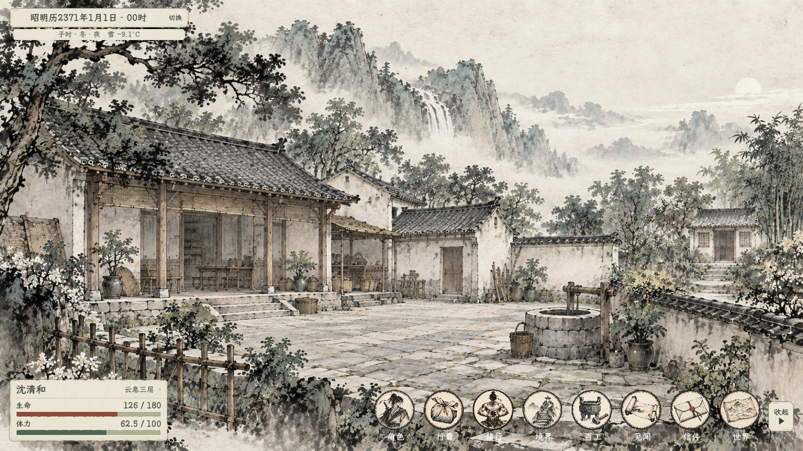

# 常驻时间与生命／精力栏：简约纸墨

2026-10-11，依据用户要求重设计并接入原控件。方向为与现有水墨界面一致、紧凑、清楚、无泛光；随后补充少量艺术感，避免花哨。

## 右侧任务栏追加修订

2026-10-11 用户否定原有参差纸边。现改为 336 宽的完整矩形纸面与细墨边，横向 16、纵向 14 留白；任务来源／状态、标题、正文分层，两项之间使用淡墨线。正文两行省略，完整描述保留悬停，双击查看详情。收起按钮改为右侧居中的 30×44 浅纸细框三角，留出屏幕边距。当前修改已落入主 HUD；下方旧图不代表本次任务栏效果。布局规范见 [UI视觉规范](../../plans/界面与美术/UI视觉规范.md)。

## 当前 v3：昭明历切换与底部入口

2026-10-11 用户追加要求：重做右下展开／收起签、重新排序入口，补入昭明历切换。纪年起点由用户授权先设定并写入[现行策划案](../../plans/世界与探索/游戏历法与纪年显示.md)：开局为昭明历 2371 年，等于入世第 1 年。

2026-10-26 用户修订：左上主行仅显示年月日，不显示数字小时或地支时辰；辅行保留季节、昼夜、天气与温度。下方 v3 图片记录此前的时辰显示，不能代表本次文字修订后的现行读数。

- 左上主签加宽到 430×46，末端按钮文字为「切换」（用户明确指定）；切换昭明历／入世年数，显示偏好保存至本机，不修改真实时间与进度存档。
- 底部顺序为：角色、行囊、修行、境界、百工、见闻、信件、世界。境界／世界沿用原解锁与可见条件。
- 展开／收起按用户最新要求改为直径 60 的浅纸圆框，距右 22，与入口图标居中对齐；按钮只显示三角符号：收起 ▶，展开 ◀，不显示文字。功能说明保留在悬停提示中。收起仅隐藏入口栏，圆框固定保留，原回调与键盘激活继续可用。下方截图为此前带文字纸签版本，待更新。
- [导航辅助实现](../../../csharp/panel/MainHUD.Navigation.cs)复用共用纸签边框；时间按钮使用标准 Godot GUI 事件，不增加全屏鼠标事件拦截。

当前控件渲染：[900p](常驻界面_v3_1600.png)、[720p](常驻界面_v3_720p.png)、[收起](收起入口_v3.png)、[切换后](换历显示_v3.png)。预览结束恢复原本机显示偏好。编译过程中顺带清除了妖兽模板中对基础数据的重复境界赋值：前面的 `cultivation_realm` 属性已写入同一生物数据，重复访问基础类型字段造成编译错误。

### 左下纸签追加状态摘要（2026-10-12；2026-10-14 更新）

- 保留原有姓名、境界、生命与行旅精力排布；存在活动中的云息闭关瓶颈或大世界状态时，在精力条下方显示相应摘要。
- 瓶颈与大世界状态分行显示，避免重伤等状态挤掉修炼信息；各类状态独立计算，不把瓶颈另写入大世界状态存档。
- 纸签按可见摘要行数向上扩展，底边位置不变。大世界状态摘要优先显示最需留意的一项；其余以“另有 N 项”概括。人物概览查看瓶颈阶段、当前吐纳效率，以及状态来源和恢复进度。
- 状态文字与边框保持间距，超长摘要在框内省略；无活动摘要时不占高度。文字字号不用于挤压原有行。

## v2：参考长签与重做状态栏

用户否定首版左下角，并提供细边时间长签参考图。当前时间主签位于左上角 `(22,20)`，尺寸 380×46，细墨边、轻切角，主行仅显示年月日和小时，字号 24；季节、地支、昼夜、天气及温度以 17 号辅行保留在下方，总占高 78。

人物状态重做为左下 380×150 的切角纸签，距左 22、下 22。首行姓名 24 号与境界 18 号分列；生命／精力各自采用「标签与右对齐数值在上、通长墨条在下」，数值 20 号、条高 12，避免首版短条与小字拥挤在同一行。移除「历」「身」印记。保持浅纸、赭红生命、灰绿精力、无泛光和原人物页入口。

底纹复用已生成的宣纸素材；[WorldHudFrame](../../../csharp/panel/WorldHudFrame.cs) 根据实际尺寸绘制一像素切角细边和两笔短角线，不依靠拉伸一张带框图片。年月日、资源和天气仍读取原服务，不修改玩法数据。

编译通过，0 错误，既有百科空引用警告仍在。当前控件渲染：[900p](常驻界面_v2_1600.png)、[720p](常驻界面_v2_720p.png)、[空条](空条展示_v2.png)。这些截图使用预览数据与项目李宅背景，不写入游戏存档。

## 首版布局（用户已否定）

以项目 1920×1080 设计坐标为准：

| 控件 | 尺寸与位置 | 内容 |
| --- | --- | --- |
| 时间纸签 | 360×84，左 18、上 16 | 首行年月日与地支／小时，次行季节、昼夜、天气、温度 |
| 人物状态纸签 | 360×118，左 18、下 22 | 姓名与境界；生命与精力各一行，标签／条／当前值与上限左右对齐 |

原时间栏高度 112 改为 84；原人物栏高度 176 改为 118。使用常规楷体，日期 19、小时 20、天气与资源数值 18。资源条高 9，生命为赭红、精力为灰绿，数值在条外，不受进度填充影响。长姓名省略，完整姓名、境界与数值保留在人物状态悬停提示中。点击与键盘激活人物状态仍打开原人物页。

共用不透明浅暖纸底、深墨字、纸纤维和自然边缘；小型「历」「身」赭红印记与一根淡墨分隔线作为克制点色。没有发光、光晕、闪烁、外阴影或文字描边。时间栏忽略鼠标事件，人物栏仅自身矩形范围接收点击。保留原 HUDLayer 层级、数据来源及刷新方式。

## 素材与实现

- 使用内置 ImageGen 生成[宣纸底纹](../../../textures/ui/world_hud_20261011/paper_panel_v1.png)，[完整提示词](../../../textures/ui/world_hud_20261011/paper_panel_v1.prompt.txt)随素材保存，未使用 CLI 回退。
- 原图保持不变，Godot AtlasTexture 读取纸面区域；进度填充使用相同纹理按墨色调制。文字、数值、印记与分隔线由游戏绘制。
- [共用纸墨样式](../../../csharp/panel/WorldHudStyle.cs)、[时间实现](../../../csharp/panel/GameTimeUI.cs)、[人物状态实现](../../../csharp/panel/MainHUD.cs)、[时间场景](../../../tscn/panel/TimePanel.tscn)。
- 本次只变更显示与排版，不改变时间推进、生命、行旅精力或战斗体力规则。

## 渲染记录

编译通过，0 错误，存在 `EncyclopediaPanel.cs:376` 的既有空引用警告。使用项目引擎实际实例化原时间与 HUD 场景，配项目山村背景查看 1600×900、1280×720 和空条显示。预览人物与资源数据仅用于展示，不写入进度存档。没有新增或运行自动测试。

进程退出仍有此前已记录的全局光标 ImageTexture 释放告警，与本次纸面资源不同。

[1600×900](常驻界面_1600.png) · [1280×720](常驻界面_720p.png) · [空条展示](空条展示.png)

