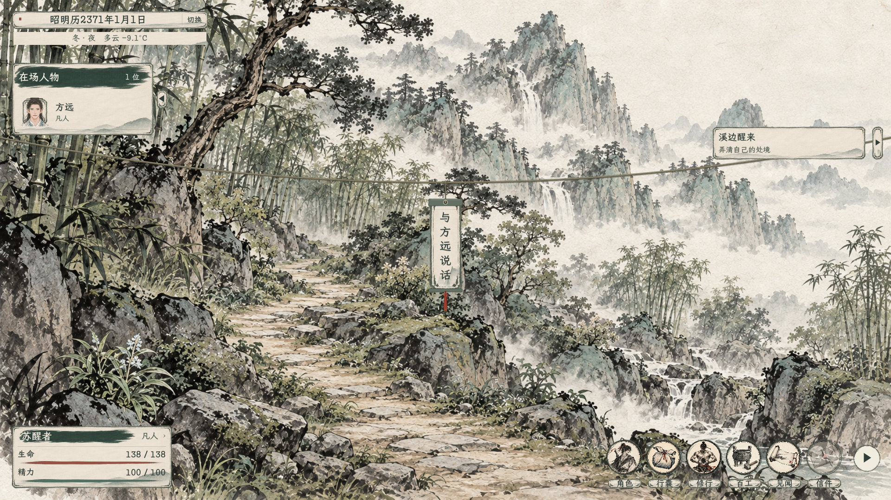
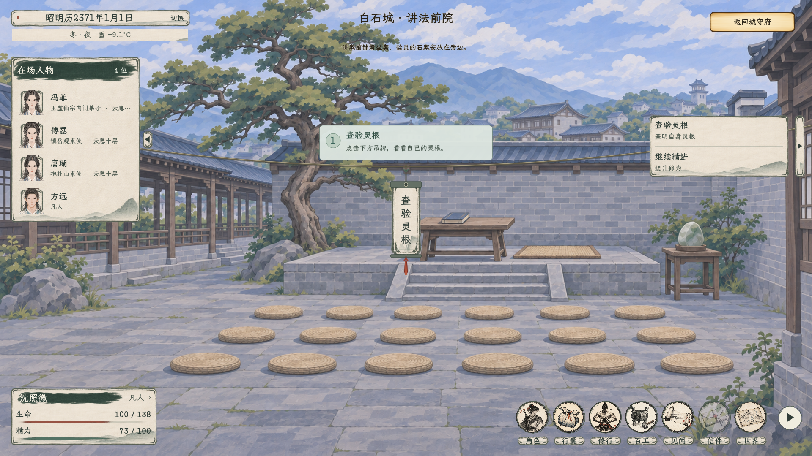
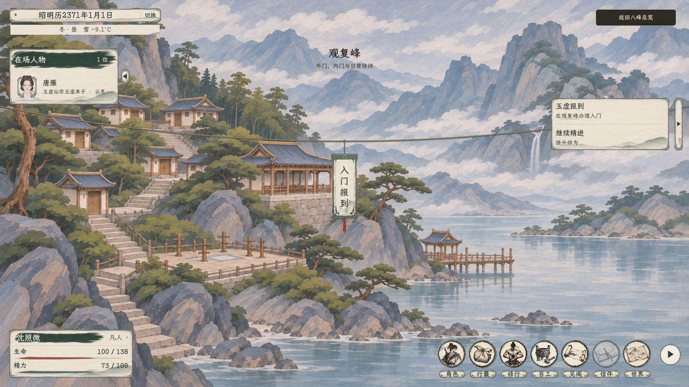

# 序章、白石讲法与玉虚报到：场景吊牌

2026-11-07 实际 Godot 场景。开场、讲法会与入宗手续沿用已有吊牌、绳索和下方对白；人物仍在场，但玩家通过场景中央吊牌推进流程，无需从人物列表找人。截图使用隔离测试存档，当期主持和接引人来自实际场景，并非固定姓名。

## 实机画面

- [前往白石](青溪野地_前往白石.png) · [讲法初入](讲法初入_中央挂牌引导.png) · [1280 × 720 引导](讲法引导_1280.png)
- [验灵后选择宗门](验灵后_选择宗门.png) · [等候本场验灵](择宗后_静候本场验灵.png) · [验灵结束后登舟](验灵结束_登舟启程.png)
- [玉虚山门迎真](玉虚山门_迎真吊牌.png) · [报到对白](观复峰_报到对白.png) · [报到后](观复峰_报到完成.png)

## 流程与边界

青溪野外醒来后，使用吊牌和方远说话、结伴去白石。白石依次旁听、验灵、选择已开放的宗门、等本场结束、登舟；无灵根者可用吊牌与方远道别并自行离开。当前仅玉虚可选，选择意向不等于入宗，方远返乡与实际接引舟承接既有角色和行旅状态。

抵达后点击山门迎真，迎真完成先保存待报到状态；观复峰点击报到吊牌，对话结束后才登记宗门身份。天灵根列预备真传，不提前拜师或启动正式真传讲席。玄览峰首本免费拓印和实体领取沿用已有功能，实际研习仍须符合秘籍门槛，首本记录不等于考核达标。旧正式真传身份不会因新流程改动。

预备期居所与正式待遇尚待确定，目前仅复用观复峰设施供测试，月例暂沿用原真传原型数值；一年考核、转正／到期转内门及考后择师已接入。没有引入新的首卷属性成长机制或修改修习要求。规则见[玄览峰现行方案](../../plans/剧情与宗门/玄览峰秘籍拓印与首本免费_20261106.md#六序章吊牌与报到2026-11-07)。

## 验证

- 完整构建：0 警告、0 错误。
- [实机流程](验证_实机.log)：72 项通过；真实鼠标点击旁听、验灵、择宗、候验、登舟、迎真和报到吊牌，确认领取、实际背包与存档。1920 × 1080 与 1280 × 720 截图如上。
- [开场](验证_开场.log)：14 项通过，检查野地吊牌、方远同行、开局不提前发功法及任务栏去重。
- [预备真传](验证_预备真传.log)和[普通弟子](验证_普通弟子.log)：各 59 项通过，含待报到状态保存、销毁并重建主场景后恢复、实际接引人立绘、身份、未提前择师及首本存档。
- [无灵根](验证_无灵根.log)：24 项通过，确认道别与自行离开不用查找人物，不会误进择宗或登舟。
- [拓印回归](验证_拓印回归.log)：63 项通过，覆盖真实属性、免费／付费拓印、放弃、满包、重进与存读。截图和验证均为项目内运行，未覆盖发行导出包。

2026-11-07 后续：入宗后凡人目标改为“引气入道：踏入云息境”；没有旧师门借读的正式真传可在玄览峰研读已有实体书，旧借读尚未汇报时的限制仍保留。项目构建 0 警告、0 错误，[预备真传流程](验证_入道引导_预备.log)及[普通弟子流程](验证_入道引导_普通.log)各 64 项通过，[藏经回归](验证_入道引导_藏经回归.log)63 项通过。随后已按用户确认方案接入[预备真传考核](../../plans/剧情与宗门/玉虚预备真传考核与择师候选_20261107.md)。
