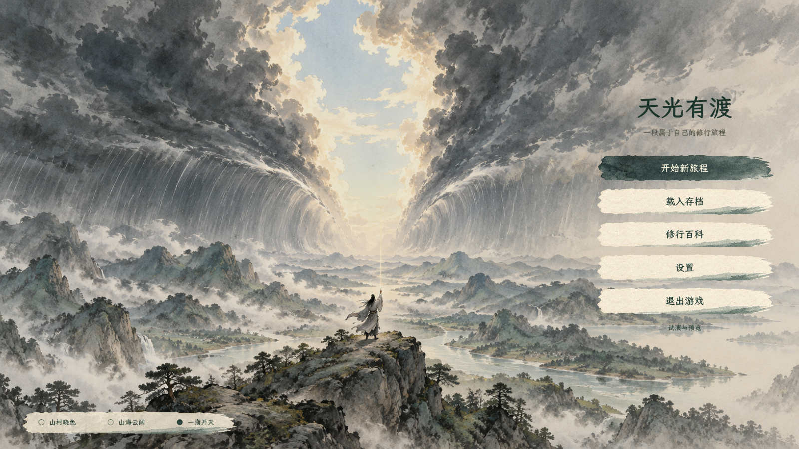
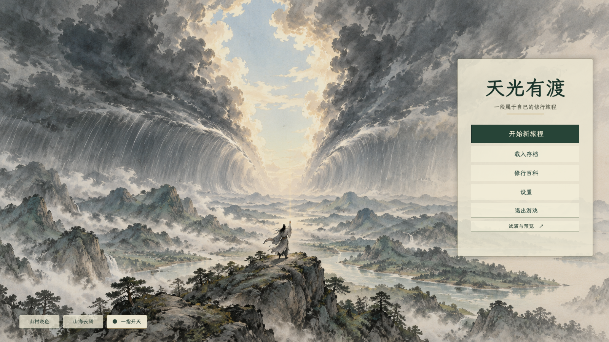
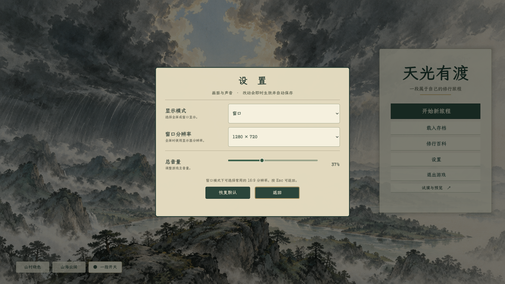

# 开始界面：三幅画卷与纸面菜单

2026-10-10 实施记录。当前采用简约纸墨 UI v3 与 v4 迎劫背景，美术仍供用户评价。首页沿用「天光有渡」题名、正式新建旅程、存档和修行百科入口。

## 最新 UI 修订：简约纸墨 v3

用户否定装饰过多、字体夸张的理想图后，重新生成了[简约理想图](理想图/理想图_v3_简约纸墨.png)和[透明按钮图集](../../../textures/start_menu/ui_paper_ink_v3/button_atlas.png)。两者均使用内置 ImageGen；提示词分别保存于[理想图提示词](理想图/prompt_v3.txt)和[按钮素材提示词](../../../textures/start_menu/ui_paper_ink_v3/prompt.txt)。

- 去掉右侧大底板、金线和装饰，五个入口各自使用淡墨或暖纸横签；按正常、悬停两种状态读取图集。
- 独立生成的题字仍偏厚，因此仅保留为候选；当前标题采用项目现有常规楷体，字号 58，不再使用粗体题字。
- 按钮统一字号 23，高 66；「试演与预览」简化为文字入口。左下三幅画卷改为一条浅纸底上的圆点选项。
- 设置面板改为浅暖纸和一像素灰绿边框，底部按钮复用生成的墨纸素材。
- 保留原鼠标视差：横向最大 14、纵向最大 8 个设计像素，沿用指数平滑速度 7。两幅轮播背景同步移动；缩放中心跟随视口尺寸，鼠标移出窗口时限制位移范围。

本轮编译通过，0 警告、0 错误；实际渲染截图：[山村](首页_v3_0.png)、[山海](首页_v3_1.png)、[迎劫](首页_v3_2.png)、[设置](设置_v3.png)。本轮仅查看排版与渲染，没有重跑下文上一轮功能验收。退出时仍出现此前已记录的全局光标释放告警。

## 本轮构图修订

用户要求修士面朝屏幕内，即背对观者，画面拉远以体现个体与天地的尺度差距。上一版 v3 的正面大人物与悬空建筑不再作为轮播素材。

v4 中修士位于中央山巅，背对观者、举手向天；人物很小，举手引出的细线向上分开两片巨大灾云，云墙及雨幕向两侧退让。山岭保持连续、落地的空间关系。背景保留暖纸、青灰、墨绿和克制淡金，右侧留有浅色雾气，供菜单叠加。人物属于本次用户明确要求的标题画面内容。

| 画卷 | 当前项目素材 | 用途 |
| --- | --- | --- |
| 山村晓色 | [dawn v2](../../../textures/start_menu/title_menu_dawn_v2.png) | 日常山村与启程 |
| 山海云阔 | [world v2](../../../textures/start_menu/title_menu_world_v2.png) | 山海与宗门的大景 |
| 一指开天 | [power v4](../../../textures/start_menu/title_menu_power_v4.png) | 小人物以伟力改变天灾 |

v4 通过内置 ImageGen 生成，完整提示词已保存至 [power v4 prompt](../../../textures/start_menu/title_menu_power_v4.prompt.txt)。未使用 CLI/API 回退。

## 首页布局与交互

- 以 1920×1080 为布局基准，菜单锚定右侧中央。各入口使用独立纸签，人物及开云区域保持可见。
- 暖纸面、深墨绿文字；「开始新旅程」使用深青灰墨纸和浅字，其他入口使用浅纸底。悬停和键盘焦点有独立反馈。
- 三幅背景各停留 16 秒，再用 1.8 秒淡入下一幅。过渡期间底图保持不透明，避免两个半透明图层叠加造成暗闪。
- 左下角提供三枚画卷切换按钮，标记当前画卷；手动切换后重新计时。设置或试演窗口打开时暂停自动轮播。
- 「试演与预览」打开独立可滚动窗口，保留皮影、立绘、特效、战斗、凝核、归元九息六项原入口；返回或 Esc 关闭窗口。

## 设置

- 支持全屏／窗口、常用 16:9 窗口分辨率和总音量。分辨率选项只列出当前显示器可容纳的尺寸；全屏时禁用窗口分辨率选择。
- 下拉框、选项弹层、音量条和按钮统一使用纸色与松绿。设置标题与提示文字按列对齐。
- 改动即时应用，并写入 `user://start_menu_settings.cfg`。游戏进度存档继续沿用正式存档设计。
- 提供「恢复默认」和「返回」。Esc 关闭设置后把键盘焦点还给首页入口。

实现：[StartMenu.cs](../../../csharp/panel/StartMenu.cs)、[界面辅助](../../../csharp/panel/StartMenu.Visual.cs)、[设置](../../../csharp/panel/StartMenu.Settings.cs)、[按钮场景](../../../tscn/scene/StartMenuMenu.tscn)。

## 上一轮功能检查与旧布局记录

- C# 编译通过，0 警告、0 错误。
- 使用项目自带的 Godot 4.7.2 .NET/Spine 引擎实际加载首页，查看三幅背景、设置、下拉框和试演窗口；查看 1600×900 与 1280×720 的设置画面。
- 检查三幅图可加载、自动轮播与不透明底图、手动切换、菜单按钮边界、窗口模式、1280×720 分辨率应用、音量 37% 配置保存、0% 静音与恢复音量、Esc 返回，以及六项试演入口窗口。检查完成后恢复原用户设置。
- 本次没有覆盖全屏多显示器行为、正式旅程流程或六项试演内部玩法。运行阶段未发现本轮界面的报错；进程退出仍有全局自定义光标纹理的释放告警，空场景同样复现，见既有 `CursorSetup.cs`。

实际截图：[山村](首页_山村.png)、[山海](首页_山海.png)、[迎劫](首页_迎劫.png)、[设置](设置.png)、[720p 设置](设置_720p.png)、[下拉选项](设置_下拉.png)、[试演](试演.png)。

