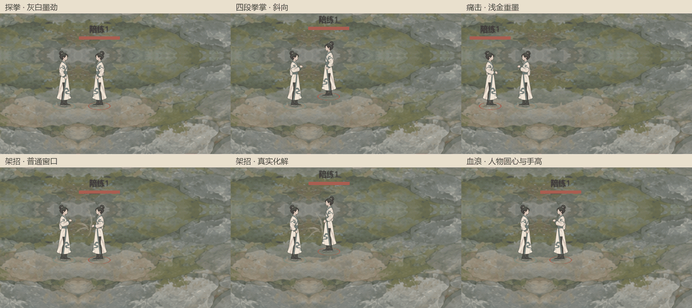
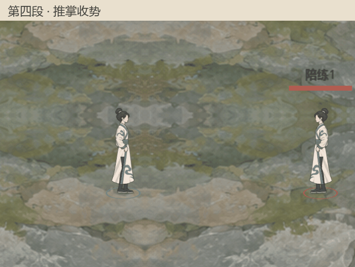
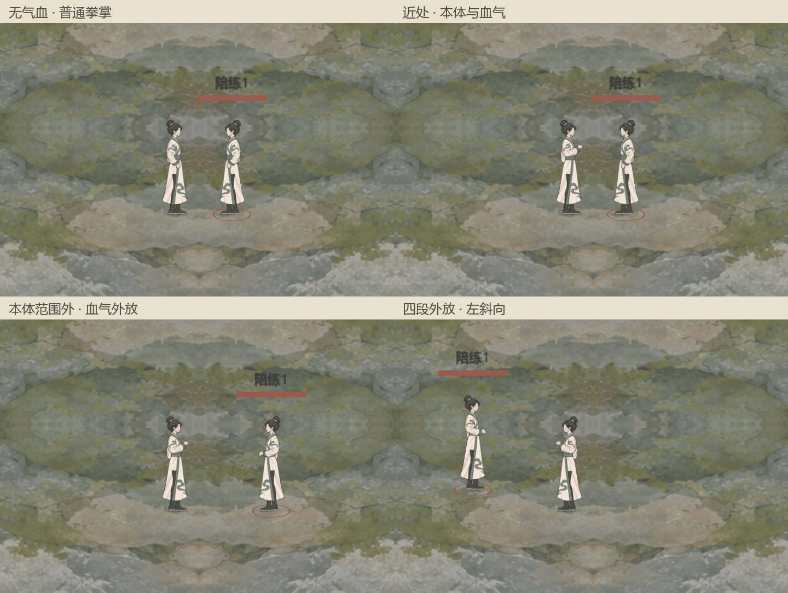

# 战斗特效水墨统一

最新用户裁定（2026-11-05）：先沿用本轮新人物试样之前的既有水墨风格，后续可再修改。人物省略肢体不要求特效同步卡通化；此前已完成的无声与受击增强继续保留。[新人物特效试样](../圆袖人物纸墨特效试样_20261105/README.md)仅留档，不接入当前战斗或新增默认入口。

2026-11-05，用户批准现有攻击特效与新版血浪统一风格。规则与当前表现入口为[四技能特效主案](../../plans/即时战斗四技能特效重制_20261104.md#2026-11-05-攻击架招与血浪的水墨统一当前)，四段沿[拳掌主案](../../plans/拳掌四段连招与贴步_20261104.md)，正式血浪判伤沿[百骸云息即时实装](../../plans/百骸云息篇即时实装与自选对练_20261104.md)。

## 本轮表现

| 对象 | 调整 | 保留 |
| --- | --- | --- |
| 拳掌 | 连续灰白墨色、飞白、柔和破边及成片渐散 | 原拳／掌轮廓、四段高宽差与0.65秒寿命 |
| 痛击 | 同一材质下更暖、更厚的浅金墨色，少量接触碎墨 | 原重击轮廓、起手与0.90秒寿命 |
| 架招 | 原图只作形状，不再直放旧彩色；普通灰金劲纹、真实化解后短促碎墨 | 0.20秒逻辑窗、普通／成功分帧、0.45／0.40秒视觉寿命 |
| 命中与尾迹 | 复用有上限的碎墨／淡雾粒子池，每次释放／真实接触只发一次 | 不扩范围、不追加判伤，不把落空画成命中 |
| 催血／聚炁 | 共用细流材质同步增加不规则干湿边与墨色浓淡 | 暗朱绕身、乳白掌间、全程跟随及原完成收益 |
| 血浪 | 浓边柔化、留大块透气缺口，减少硬描边与均匀扇片感 | 人物圆心＋手高、方向与范围、波前时钟及原判伤规则 |
| 普攻血气外放 | 复用本次实际普攻图集、动画与同一水墨材质，暗朱色向前延伸；拳劲／掌风随来源变化 | 原斜视外形、分段纵向比例、瞬时判定、横宽与延伸、0.38秒消散及独立结算 |

没有新生成位图。所有材质仅使用调用方传入的视觉年龄或运动几何，不读取独立系统时间，不使用加色发光。共用粒子使用固定独立种子；不会消耗战斗随机序列。

## 实现入口

- [攻击与架招表现、共用粒子接入](../../../tools/action_battle_test/quiet_skill_vfx.gd)
- [灰白／浅金墨色材质](../../../tools/action_battle_test/quiet_force.gdshader)
- [普攻与血气共用的图集和帧布局](../../../tools/action_battle_test/attack_ink_source.gd)
- [细流干湿边](../../../tools/action_battle_test/quiet_ribbon.gdshader)
- [血浪墨色材质](../../../shaders/blood_wave_ink.gdshader)
- [普攻血气外放表现](../../../tools/action_battle_test/manual_blood_vfx.gd)
- [原战斗层的架招视觉记录](../../../tools/action_battle_test/action_battle_feel_test.gd)
- [同场连续采集](../../../tools/capture_unified_ink_vfx.gd)、[实拍帧排版工具](../../../tools/encode_unified_ink_vfx.py)

架招只增加显示用的出手高度记录，判伤和化解继续使用现有战斗流程。已存在的正式秘籍对练与三NPC场景均使用同一套普通招式表现。

## 验证

1. **效果、费用、目标与数值**：不编辑技能资源及公式；拳掌／痛击接触时刻、伤害与0／1体力成本的专项检查通过，既有四段52项回归通过。
2. **新增规则检查**：没有增加属性、资源、关键词、射程、位移、控制、伤害段或状态。材质Alpha受原轮廓限制；血浪几何与判定代码保持。
3. **零费与联动限制**：保留原技能互斥、CD、命中和化解条件；碎墨／淡雾不触发伤害、返费、抽牌、额外行动或资源生成。重复同步不重复发射。
4. **数据与展示**：原技能数据、词典图稿、公式及正文不改。普通架招不使用成功帧或成功碎墨；真实化解才播放接触反馈。配色保留不同招式的辨识度。
5. **相称验证**：新增100项实际窗口检查、既有特效97项、四段52项均通过；覆盖暂停、到期、重开、多人及新版秘籍对练兼容。三个材质已在真实OpenGL下编译和绘制，无材质错误。

[专项100项](../../../output/unified_ink_vfx_smoke_20261104.log) · [特效97项](../../../output/unified_ink_self_regression_20261105.log) · [四段52项](../../../output/unified_ink_combo_regression_20261105.log)

## 同场对照

[六种峰值静帧](unified_ink_peak_grid.png)。六格依次为探拳、斜向四段、左向痛击、普通架招、真实化解和手高血浪。三名NPC与玩家来自同一个现有演练场景；为固定取景和比较，采集时关闭AI自动推进，以真实施放、判伤和视觉时钟逐项播放，不改伤害或属性。

同一个原生1280×720渲染视口逐项采集，每项84帧／30帧每秒，共504帧；保留相同镜头、720×440原尺寸局部，再等比排成三列两行。未重绘、增强或补画特效。普通架招与成功架招分开；成功一格由NPC真实痛击在有效窗口内触发，最终记录为实际化解6点，未伪造成功标记。

展开、峰值、后段消散与空白停顿均已检查。最终采集六项通过，无脚本或材质错误；Godot本次采集的原生静态内存峰值约243.1MB，各项结束约218—220MB，此数字不等同于进程总内存或显存。

[采集日志](../../../output/unified_ink_vfx_final_20261105.log) · [逐项来源、方向、化解及资源记录](../../../output/unified_ink_vfx_final_20261105/manifest.json)

## 血气与左键普攻同型（当前）

用户先要求血气有斜视、随左键形态变化且拳掌圆润，随后明确“和拳掌普攻特效一个类型”。当前直接共用本次普攻已经采用的轮廓、动画帧与水墨材质：近身仍为灰白拳掌，外放以暗朱血墨向前延伸；拳段沿拳劲、掌段沿掌风，保留各段纵向比例及原图的斜视笔势。初轮平面半圆和中间独立圆体候选均转为历史。

释放时只读实际visual_key、combo_stage、visual_height和原纹理对象。血气与普攻共用图集采样、布局及帧规则，真实战斗还读取该次普攻的同一视觉年龄，避免一帧内释放顺序导致动画领先。只延长出手轴，纵向尺寸保持原段；左右镜像、斜向旋转与原普攻完全一致。新增材质血墨配色参数默认关闭，原拳掌、痛击和架招配色保持。

人物圆心与手高在释放时记录，之后原地淡散；暂停冻结，重开、死亡和退出清理，32个可复用显示槽及96个散墨粒子上限保持。血气仍0.38秒消散，不将这段寿命当作新旅行或判伤时钟。其他已接入左键只要提供自身实际轮廓，即沿同一来源接口显示；本轮没有增加新的左键招式或猜测未实现的武器效果。

逐项验收沿现行百骸主案：伤害、目标、费用、范围与近身双判保持；未新增属性、资源、关键词、位移或状态；原0费动作、CD和联动限制保持，无返费、抽牌、额外行动或资源生成；规则数据、图谱及玩家效果正文不改，词典仅同步表现入口。

相称验证：最终同型专项434项、原秘籍机制85项、原水墨统一100项均通过。专项覆盖真实纹理对象一致、同图集区域和帧、同材质仅血墨配色不同、64组帧／方向样本、只前伸且纵向尺寸保持、八向镜像和手高纯平移、只读元数据、暂停／清理／池上限、真实四段转发，以及实际处理顺序下与原普攻帧严格同步；最大变换误差约0.000063单位。四段4例、八向8例和单次完整连招1例实际窗口捕获均通过，无脚本或材质错误。

[同型专项434项](../../../output/blood_qi_matching_smoke_20261105.log) · [原秘籍85项](../../../output/blood_qi_matching_manual_regression_20261105.log) · [原水墨统一100项](../../../output/blood_qi_matching_unified_regression_20261105.log) · [专项工具](../../../tools/smoke_blood_qi_ink.gd)

[拳／掌／拳／掌四段静帧](blood_qi_matching/blood_qi_matching_stages_peak_grid.png) · [八方向同源轮廓对照](blood_qi_matching/blood_qi_matching_directions_peak_grid.png)。全部通过真实秘籍对练入口播放，保留现有人类NPC、原属性与资源；NPC置于200单位外仅作尺度参照，固定镜头并冻结自主AI，不修改命中或伤害，也不制作虚假接触。每项按真实2.2秒连招推进，未手动指定当前段。

四段各取完整连招的对应峰值；八方向各释放同一探拳。连续图为单次完整四段，84帧、30帧每秒、2.8秒，原生1280×720视口取720×500同一局部并加标题，无补画或画质增强。四段记录为拳／掌／拳／掌，原高度比例0.78／0.92／0.88／1.10保持；八方向均单次外放，气血2保持，连招气血4保持，均无赤潮强化或血浪。

[四段捕获](../../../output/blood_qi_matching_peaks_20261105.log) · [四段元数据](../../../output/blood_qi_matching_peaks_20261105/manifest.json) · [八向捕获](../../../output/blood_qi_matching_directions_20261105.log) · [八向元数据](../../../output/blood_qi_matching_directions_20261105/manifest.json) · [连续捕获](../../../output/blood_qi_matching_combo_20261105.log) · [连续元数据](../../../output/blood_qi_matching_combo_20261105/manifest.json)

## 普攻血气外放补充（首轮存档）

以下为首次半圆墨带的采集与验收记录，当前表现以上方同型方案为准。

用户追问血气后，将心法每段普攻附带的血气纳入本次统一。原三道细红弧改为同族暗朱水墨：外缘保持该段原横宽与前向延伸，薄墨向轮廓内侧铺开，短促出现后浓淡渐散；复用碎墨／淡雾池。血气仍是即时附加段，0.38秒只表示残墨寿命，不使用血浪0.78秒的波前旅行或新增伤害时机。

绘制先记录人物圆心与攻击层高度，再旋转出手方向；高度只作屏幕竖直平移，不随朝向旋转。正式战场使用实际地面XY，不额外压缩纵深。释放后的墨迹和粒子固定在当时世界位置，人物后续移动、转身或父节点变换不牵走旧迹。连续绘制不额外发射粒子，暂停冻结，重开与退出清理。

补充验收：

1. **效果、费用、目标与数值**：心法装备及气血条件、每段血气伤害、主修延伸、近身双判和独立命中结算沿百骸现行主案；只替换显示层，外放不另耗气血。
2. **新增规则检查**：墨带顶点均位于原外放轮廓内；没有增加属性、资源、关键词、射程、位移、状态或伤害段，残墨不参与判定。
3. **零费与联动限制**：不改变普攻动作、费用与CD，不增加返费、抽牌、行动或资源生成。原第三卷增伤、末段血浪和化法沿正式机制，特效不触发衍生结算。
4. **数据与展示**：原规则、图谱和玩家效果正文保持；词典只补充表现链接。近身的本体与血气仍可分别命中或闪避，散墨属于外放释放反馈，不冒充命中反馈。
5. **相称验证**：139项专项与85项原秘籍机制回归通过；八方向、4160个墨带顶点均在边界内，检查手高纯平移、世界锚定、暂停、0.38秒结束、清场、32个复用槽上限及真实资源隔离。最终OpenGL实拍四例均通过，无脚本或材质错误。

[血气专项139项](../../../output/blood_qi_ink_smoke_final_20261105.log) · [秘籍机制85项](../../../output/blood_qi_ink_manual_regression_20261105.log) · [专项工具](../../../tools/smoke_blood_qi_ink.gd)

[四组峰值静帧](blood_qi/blood_qi_ink_peak_grid.png)。按无气血、近处本体与血气、本体范围外血气、左斜四段排列；全部来自真实秘籍对练与现有人类NPC。每组84帧、30帧每秒，单个1280×720原生视口逐项采集，取同一720×500区域排版；未补画或增强特效。仅冻结NPC自主推进以固定取景，不修改命中率、防御、生命或伤害，也不强制命中。

最终记录：无气血0次外放；近处1次本体判定与1次血气判定，本体实际闪避、血气命中10点；距离88的外放例本体0次、血气1次判定，血气实际闪避；左斜四段4次外放、4次血气判定，实际两次命中、两次闪避。本体与血气的独立结果全部保留。四组气血分别保持0→0、2→2、2→2、4→4；均未启用赤潮强化或血浪。

[最终采集日志](../../../output/blood_qi_ink_final_20261105.log) · [逐项资源、范围与真实判伤](../../../output/blood_qi_ink_final_20261105/manifest.json) · [原生采集工具](../../../tools/capture_blood_qi_ink.gd) · [帧排版工具](../../../tools/encode_blood_qi_ink.py)
