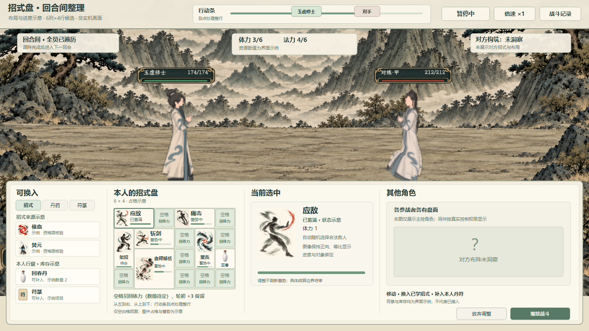
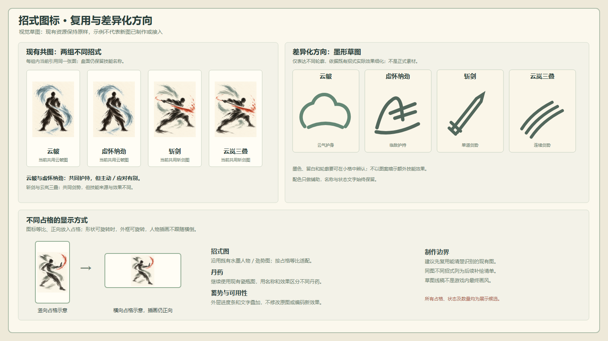

# 招式盘与自动回合战斗：界面概念

> **历史视觉草稿，已被用户要求重做**：本稿的 6×4 盘面、纸底人物卡图和界面布局均不再用于新版。用户改为初始九格、前期招式 1～2 格、单格定向化法及行囊物件式新图标；新版方向见[九格招式盘重构提案](../../plans/战斗与构筑/九格招式盘与自动战斗重构提案_20261106.md)。旧图仅保留讨论记录，不覆盖正式战斗。

2026-11-06。**两张图均为策划审阅用静态概念，不是实机画面，未接入正式战斗。**这是对既有战斗截图和现有招式图标的界面编排；有色线条为图标设计方向草稿，不是新绘并已接入的正式技能图。





两图的[可编辑 SVG：战斗整理](战斗整理界面_候选.svg) · [可编辑 SVG：图标对照](招式图标对照与方向_候选.svg) · [排版源](排版生成.py)。SVG 引用项目内现有图片，需保留相对目录关系；文字由控件绘制，原贴图没有被覆盖。

## 画面表达

- **战场与状态**：中间保留现有对练截图中的人物和场景；上方示意行动条、体力、法力及回合间状态。条上的人物标记只是视觉示例；按旧行动速度推进，轮到某人时处理其一整行，速度快者可能连续处理多行。
- **本人盘面**：仅供比较的 6 列×4 行候选。下图每个同名连块是一个招式实例，不是一格一个副本。各行所示格数、具体招式、蓄势和资源值均为示意，不代表已确认配置或该角色真实技能。

  ```text
  应敌  应敌  空格  痛击  痛击  空格
  架招  斩剑  斩剑  空格  聚炁  空格
  架招  血臂  血臂  空格  聚炁  回春
  空格  血臂  血臂  空格  空格  空格
  ```

- **空格**：只有完全未放置对象的空格可额外回复体力；每格回复量待定，原每回合 +3 保留。空格属于本行处理，不单独要求行动条再次走满。此图不规定空格回复发生于该行的哪个具体步骤。
- **来源与调整**：左栏只演示已允许的“换入已学招式／补入本人真实丹药符箓”交互；所列来源、数量、技能资格、库存均为示例，符箓战备尚未因此接入。所有参战者遍历结束后才可整理，是否预约、收费及具体交互仍需确认。未洞察的对方盘面用问号遮蔽，不展示招式或格位。
- **图标**：引用实际《应敌》《架招》《聚炁》《痛击》《斩剑》《血臂撼岳》等图。现行资源中，云帔／虚怀纳劲共享云帔图，斩剑／云岚三叠共享斩剑图，故以名称区分并提出差异化轮廓方向；具体逐招绘制另见技能图标设计。丹药复用既有瓷瓶图。现有技能图为带纸底的 3:4 图片，建议等比、正向显示，不能为填满不同比例占格拉伸图片；若未来允许旋转，外框旋转而人物插画继续保持正向仅为设计建议。

## 检查范围

两张 PNG 按 1600×900 导出并已人工检查文字、可见区域与叠层。SVG 经 XML 解析，图中 `6×4` 和每一招占格均标为候选；图中敌方没有展示未洞察的具体招式。未读取玩家存档，未改现有运行代码、正式技能图标、物品或数值。
