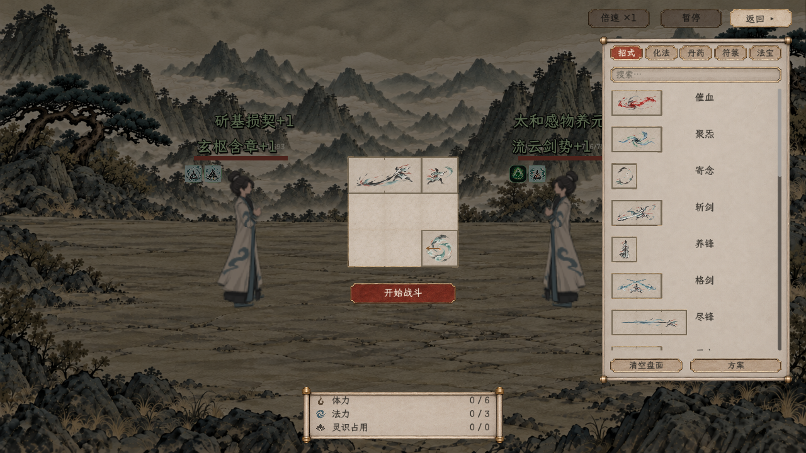
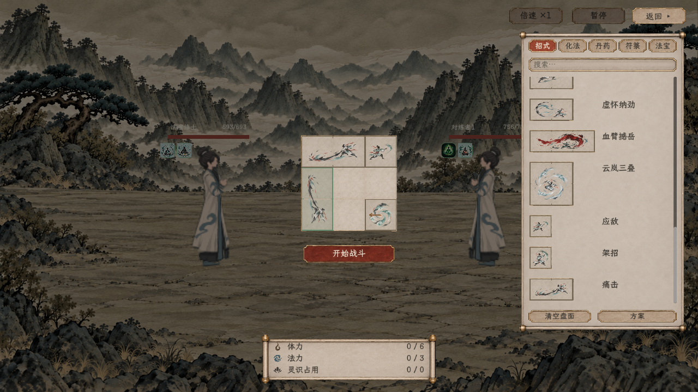
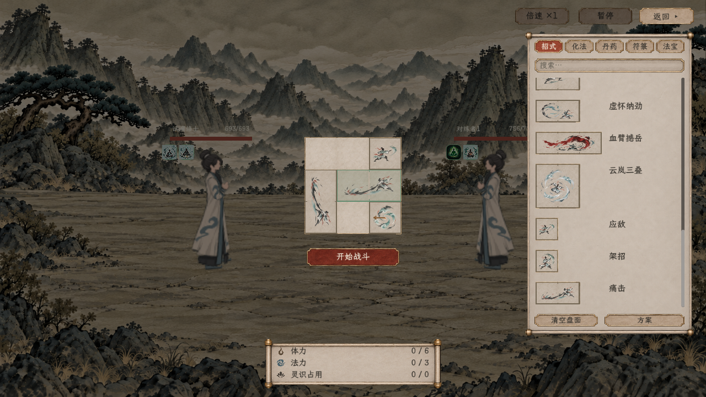
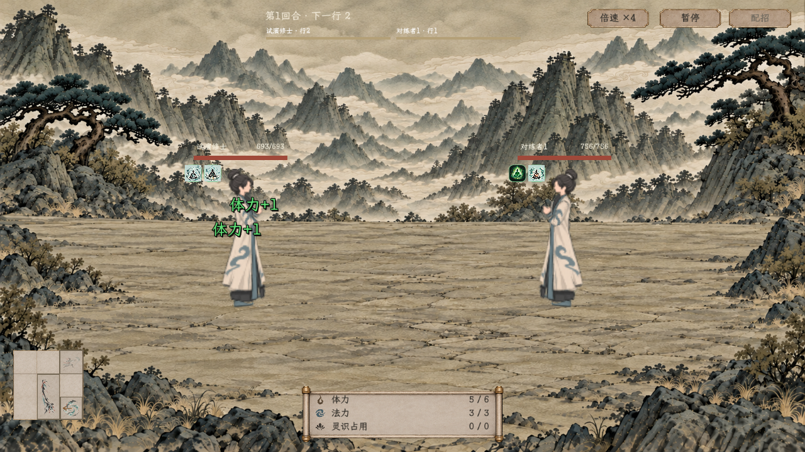

# 招式盘拖放与遍历反馈：原生界面与验收

2026-11-08。这里保存本轮游戏原生画面与交互验收，不是新生成的理想图。两档Windows窗口均完成真实拖放、读取演出及退出，最终结果见[验收汇总](验收汇总.json)。

[当前交互主案](../../plans/界面与美术/招式盘拖放与遍历反馈_20261108.md) · [全局只读信息栏规则](../../plans/界面与美术/全局悬停穿透与拖拽抑制规则_20261108.md) · [独立试演入口](../../../tools/run_combat_board_test.cmd)

已另外打开1440×810实际试演供用户操作：[打开时的原生配招画面](11_打开后的实际配招.png)。该图是默认入场配置，以下验收图则使用专门的拖放样本，两者不混用。

## 画面

| 交互 | 原生画面 |
| --- | --- |
| 第二占格抓起后右键转向 | [1280](1280x720/04_右键转向后的落点.png) |
| 盘内冲突的不可放预览 | [1280](1280x720/05_非法落点预览.png) |
| 拖出卸下仅影响该份 | [1280](1280x720/06_拖出卸下后的有效布局.png) |
| 真空格提示，不同时放大对象 | [1280](1280x720/08_仅空格的遍历反馈.png) |
| 共同回合结束后自动整理 | [1280](1280x720/09_回合末整理.png) |
| 同种丹药直接拖到空瓶补入 | [1280](1280x720/10_拖放同种丹药补空瓶.png) |

## 本轮结果

| 项目 | 结果 |
| --- | --- |
| C#全项目构建 | 0警告、0错误，不使用排除项 |
| 1280×720原生交互 | [84项通过](1280x720/验收.json)，含10张原生截图及原位图标隐去的像素检查 |
| 1920×1080原生交互 | [84项通过](1920x1080/验收.json)，含10张原生截图及原位图标隐去的像素检查 |
| 无窗口相同交互 | [73项通过](验收_无窗口交互.json)，没有将截图检查计入 |
| 共用信息栏 | [28项通过](全局悬停交互验收.json)：实际点击／滚轮穿透、拖拽期间抑制、离开来源后不续显、结束恢复和F1独立阅读页 |
| 旧滚轮与世界导航 | 通过：列表与地图隔离、只读栏穿透、裁切来源、右键返回、地物排序及地形语义 |
| 入口与共同回合 | [44项通过](入口复验/验收_无窗口.json)，新报告与前轮分开保存 |
| 状态／迁移 | 125项通过 |
| 真实人类战斗效果 | 392项通过 |

交互场景使用真实战前入口、人物库存、草稿校验及战斗管理器。覆盖R／右键转向、第二占格抓取锚点、合法提交、盘内无效回位、锁定对象拖出回位、普通对象拖出卸下、来源取消无残留、空瓶直接补药、库存预留不提前扣除、共享导航、普通暂停不能编辑、真实扫描与显示反馈互斥。不会为了截图手工调用提交方法绕过拖放路径。

画面复核发现旧自定义提示工厂即使收到空文字也会生成纸框，已从盘面与来源撤去；拖拽专项另外检查两处旧原生提示框完全不出现，故最终比前次82项多两项，不能用早先82项结果替代本次84项。

本轮最终运行日志未发现ERROR、Fatal、泄漏或退出资源残留诊断；两个原生进程退出码0、标准错误为空。基础状态、效果、入口、全局信息栏与滚轮导航日志随汇总保存在本目录；开发排查时的失败日志不混作通过记录。此前本机外观备份扫描告警不计为本任务功能失败，最终运行已不再出现。

配招所用体力、法力和灵识读取实际人物，资源栏的20×20图符及三列对齐保留。整物反馈约0.20秒、峰值1.07倍，格子底线不穿过整幅图标；这不增加任何招式检查、成功发动、次数恢复、资源生成或额外回合。

## 实现与参考范围

正常拖放由Godot原生流程命中和结束，临时候选只在合法松手后提交。预览、转向、提交与拖出使用同一条指针事件中的盘内位置，不再每帧用系统鼠标另采一遍后覆盖。原生验收同步系统指针进入测试窗口，待窗口进入事件落定后再注入同类鼠标和按键事件；这是原生窗口命中的验收前置，不是手工绕过落格。截图来自实际Windows渲染。

只读参考本机`D:/SteamLibrary/steamapps/common/Backpack Battles/BackpackBattles.pck`中公开的`res://Items/Item.tscn`动画轨道，安装build为25352124。该物品场景包含整件放大、放入和快照恢复的回弹；放入约1.05倍／0.3秒。本项目独立采用更轻的读取反馈，没有解密其脚本、复制其素材或重做其战斗规则，也未宣称已通过实际对局对照验证手感。

五张UI透明源PNG继续使用[首批素材清单](../../../textures/ui/combat_board_20261107_v1/skin_manifest.json)，逐张SHA256与清单一致；19个区域引用保持。招式图标沿用既有新版，本轮没有重生成或改源像素。

## 验收边界

本次不修改招式资源、学习奖励、费用、伤害公式、随机合法目标、应对选择、首次检查及共享账本。数据与词典的数值口径保持；新增的状态记录仅用于读取演出。丹药实际服用与消耗仍由原有规则负责，补药专项只构造隔离空瓶验证拖放预留，真实服药由人类效果回归覆盖。

共用组件的28项专项不等于全游戏全部旧控件已逐个人工验收。器物与符箓新规则、后期成长盘、妖兽和正式旅程保存沿各自专题；本页不将九格试演当成这些系统完成。前轮入口43／52项及早期截图保留在[旧图集](../新版战斗测试入口_20261108/README.md)，不与本轮计数混用。
