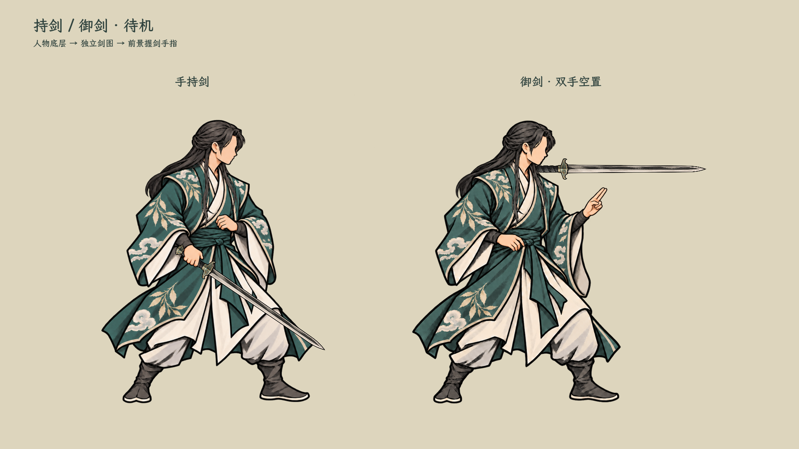
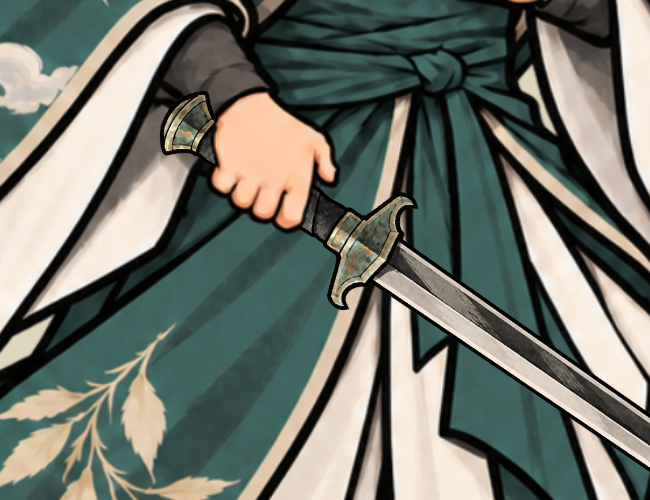

# 持剑与御剑待机

**2026-10-25：手持剑待机现已随四招接入正式战斗，按装备的炼成剑外形选择剑图，详见[正式接入记录](../剑招正式接入_20261025/README.md)。御剑悬停仍保留独立预览，本轮未新增正式御器机制。下方为原样片记录。**

**2026-10-24最新：全部剑招统一右手。**用户以原右手四招为准，只修改旧待机的持剑手。手持剑现采用`textures/characters/side_ink_sword_idle_right_20261024_v3/`的右手版；人物、服饰、站位和御剑空手待机保持原方向。四招恢复v5右手姿势，撤回v6迁就旧待机的改法。

2026-10-23，当前男修“碧岚云叶袍”两种待机评审样片。用户要求先完善待机，四招攻击草稿暂不采用，已撤下其动作替换和专用入口。技能费用、目标、剑意与化解结算保持原样。本样片不决定装备、御用、在场或灵识规则，相关机制仍按[器物现行主案](../../plans/物品与装备/器物系统现行主案_20261023.md)。

[当前右手待机与四招连播](../剑招序列帧特效_20261024/preview_motion.gif)。原`two_idles_motion.gif`保留为旧版过程记录，不代表当前持剑手。

## 持剑的两个角色图层

2026-10-24握手拆层：右手本身分前后两部分，身体、手腕和远侧手部随人物底层；近侧指节、弯曲四指和可见拇指位于独立剑柄上。当前采用两张2048²透明PNG，不用整手矩形遮盖剑柄。

绘制时先生成带剑参考以确定握法，再获得同角色去剑稿。右手版以完整去剑稿注册画布，避免局部修补留下旧剑刃或衣褶拼接；前后手均从这张母版取样。实际显示为**人物底层→独立剑图→前景手部**；前景按真实手部轮廓取样，剑不烘焙进人物层。

剑图仍可换细剑／阔剑／脊剑。右手版握点为人物画布约(909.70,1198.24)，剑尖右下约34.6度，握点至剑尖780单位；覆盖旧左手版(1327,1210)／45度。前景手指、剑和人物围绕同一原点镜像，切换武器不移动人物。

## 御剑待机

2026-10-24层级修订：御剑悬停的剑固定在人物下层，重叠处由人物遮挡。手持剑仍使用剑夹在人物底层和前景握剑手之间的既定顺序。

2026-10-24位置与节奏再修订：剑中心向人物收回310原图单位（局内显示约80像素），水平中心改为人物原点前方410单位。取消高频抖动，改为水平方向6秒、竖直方向4.8秒一周期的小幅平滑浮动，剑尖仍保持水平。

2026-10-24按用户修订：双手空置，前手小剑诀；**一柄剑悬在身侧，剑尖始终水平指向敌人**。取消绕行、转向、前后层级轮换和运动尾迹，仅保留极轻微的上下浮动及抖动，不改变剑角度或尺寸。剑挂在人物自身表现节点，随人物移动与镜像；暂停时冻结浮动，恢复后继续。

## 查看

启动菜单 → 水墨特效实验室 → **待机·手持剑 / 待机·御剑悬停**。可换三种剑图、切换交手方向、重播；御剑另有暂停／继续浮动。

- [持剑游戏截图](held_game.png)、[御剑游戏截图](orbit_game.png)、[左向阔剑御剑](orbit_mirrored_broad.png)、[深色背景](two_idles_dark.png)。
- 右手持剑素材与[内置编辑提示词](../../../textures/characters/side_ink_sword_idle_right_20261024_v3/generation_prompt.txt)保留在v3目录，布局见`layer_layout.json`；御剑仍使用[v2生成记录](../../../textures/characters/side_ink_sword_idles_20261023_v2/generation_prompts.json)。
- 角色层均2048×2048 RGBA，共用地面原点(1024,1900)、参考高度1375。右手持剑从原画按固定比例注册，御剑保持原有注册；无运行时自动裁边或居中。
- 已编译并实际渲染查看两种待机、握柄前景、御剑前后遮挡、镜像和暂停／恢复。未新增或运行自动化测试。当前先覆盖男修此衣装，未接正式装备自动选择，也未制作正式御剑技能。
