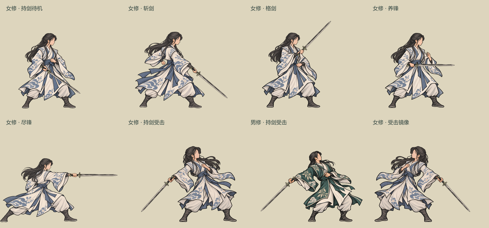

# 持剑受击与女修剑招补齐

2026-10-25，接续[剑招正式接入](../剑招正式接入_20261025/README.md)。新增素材已用于正式战斗与原水墨特效实验室；男修原版斩剑保持不变。

## 本轮素材与表现

女修沿用青瓷云梅袍、长披发、无五官的右向侧脸与既有简化水墨笔触。补齐右手持剑待机、斩剑、格剑、养锋、尽锋和持剑受击。男修沿用碧岚云叶袍，新增持剑受击。

受击时上身后仰、近侧右手握剑随身体退让，剑锋自然向身后下方偏转；沿用既有命中停顿和小幅后撤，动作结束回到持剑待机。受击不会切回空手图或把剑留在原处。格剑成功应对仍只播放一次交锋效果，不叠第二次受击。

[深色背景检查](review_dark.png)。总览使用同一缩放值；人物姿势均围绕自己的统一地面原点显示。

## 素材与分层

- [女修素材包](../../../textures/characters/side_ink_sword_female_20261025_v1/)：六个姿势，各有`body_back`、`hand_front`两层，共12张运行PNG。
- [男修受击包](../../../textures/characters/side_ink_sword_hurt_20261025_v1/)：受击底图与前景手部，共2张运行PNG。
- 全部运行人物图为2048×2048 RGBA，地面原点(1024,1900)，标准高度1375；每个性别／动作的源图握点、脚底、导出比例人工登记在包内`source/registration.json`，固定导出到共同画布。运行时不按姿势的包围盒裁边、居中或重新缩放。
- 绘制顺序为人物及后侧掌部→独立剑图→近侧弯曲手指与拇指。前景并非整只手；握柄后侧与掌根仍随人物底图。剑图继续选择细剑、阔剑、脊剑，使用原有装备快照映射。
- 剑及前景手部共用同一镜像原点，受击、摇动与暂停一起变化。缺少某一动作时保持自己的待机，持剑受击缺图时仍保留自己的持剑待机并播放后撤。
- 四招继续使用原有120帧透明特效，不新增爆光或改变颜色、接触时点。女修御剑悬停预览采用自身空手待机，保留水平朝敌与慢浮动；未新增御器规则或器体生命周期。

## 游戏内查看

启动菜单→水墨特效实验室。新增「剑招·持剑受击」，并开放剑招／持剑待机的「切换男女角色」。原来的四个剑招入口保留，剑图、交手方向及动作暂停继续可用。

| 女修四招 | 持剑受击 |
| --- | --- |
| [斩剑](lab_female_cut.png)、[格剑](lab_female_parry.png)、[养锋](lab_female_nurture.png)、[尽锋](lab_female_finish.png) | [女修与阔剑镜像](lab_female_hurt.png)、[男修与脊剑](lab_male_hurt.png) |

正式战斗中，现有剑招及装备持剑状态会按性别选择素材，受击经`BattlePaperDoll.play_hit`进入对应持剑受击。普通空手、兽类及其他姿势仍使用各自既有路径。

## 验证与边界

- 最终编译0警告、0错误。
- 真实`SkillExecutor`专项79项通过：男女四招、自动格剑应对、持剑受击、原剑意／费用行为、暂停恢复、准确回位、三种装备剑图、缺图回退、角色移除清理及同一节点切换男女后缓存正确。测试中的女修快照是隔离展示样本，不写人物存档。
- 实验室入口10项通过：女修四招、男女持剑受击、换剑、镜像、暂停和回待机；实验室加载仍有原有技能资源UID按文本路径回退警告，未修改那些技能资源。
- 14张运行PNG逐张检查2048²、RGBA、四边Alpha全透明与有效手部层。男修原斩剑三张图与恢复备份逐字节一致。
- 既有近战／远程、应对、暂停、闪避与兽类演出回归结果见[验证输出](verification.txt)。
- 首次扩展运行在再次读取角色技能快照时遇到`GCHandle`句柄初始化／回收错误。专项复用初始化时已取得的隔离快照后，完整79项通过；不据此认定引擎加载问题已消除，保留[失败摘要](load_failure_excerpt.txt)供后续定位。

本轮仅补充美术与表现选择，不修改技能资源、伤害、费用、目标、状态、剑意规则、装备资格或存档字段；不代表所有衣装已完成动作拆层。

## 来源与复现

人物使用内置`image_gen.imagegen`，以现有男女角色与男修已确认姿势为参考，逐张生成。源PNG均保存于相应包的`source/`；[完整首轮提示集](../../../textures/characters/side_ink_sword_female_20261025_v1/generation_prompts.json)及[女修受击手部修订提示](../../../textures/characters/side_ink_sword_female_20261025_v1/source/hurt_revision_prompt.txt)同时保留。女修受击初稿保存在`hurt_first.png`，运行采用修订图。

原生Godot导出与检查入口：`tools/export_sword_completion.gd`、`tools/review_sword_completion.gd`、`tools/capture_sword_completion_lab.gd`、`tools/SwordBattlePresentationSmoke.tscn`。导出只按登记坐标处理透明画布、手部分层和拼合预览，不使用程序绘制替代人物美术。
