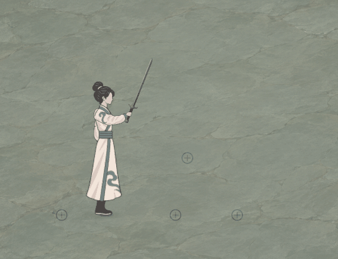
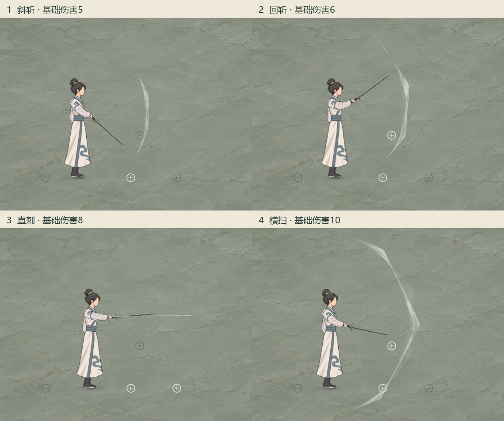

# 剑式四段：持剑普攻演练

2026-11-05，按[本轮试作规格](../../plans/战斗与构筑/持剑普攻剑式四段与特效试作_20261105.md)完成独立Godot预览。四段为斜斩、回斩、直刺、横扫；共用稳定技能身份“剑式”。预览复用当前批准的常服、右手握柄、独立剑图与水墨材质，数值、时钟和几何取同一份规则数据。

后续当前表现：[剑式水墨质感与圆润月牙修订](../剑式水墨质感修订_20261105/README.md)。用户先要求更有水墨质感，随后要求圆润；当前采用平滑月牙、连片墨腹和顺弧纹理，本页原图与日志保留为首版记录，规则及独立入口继续沿用。

## 查看与操作

直接运行[剑式演练启动器](../../../tools/run_sword_combo_preview.cmd)。原生场景：[sword_combo_preview.tscn](../../../tools/action_battle_test/sword_combo_preview.tscn)，属于独立动作试验项目。

| 操作 | 行为 |
| --- | --- |
| 左键连点／按住 | 逐段接续，最多缓存下一段一次 |
| 完整连招按钮 | 只播放完整一套，随后收势并等待CD |
| 1—4或对应按钮 | 单段观察 |
| L | 开／关连续演示；关闭后清除持续输入 |
| 鼠标、F | 瞄准；F切换左右 |
| WASD | 在演示范围内移动 |
| P、R | 暂停／继续；重开 |
| G | 显示真实扇面／胶囊与手高投影对照 |
| 空格、Esc | 中断剩余连招；退出 |

## 原生画面

[完整窗口连续画面](combo_full.gif) · [四段原尺寸对照](stages_grid.png) · [几何对照](stages_geometry_grid.png)

单张：[斜斩](stage_1.png) · [回斩](stage_2.png) · [直刺](stage_3.png) · [横扫](stage_4.png)。方向：[左向直刺](direction_left.png) · [右上直刺](direction_up_right.png) · [左下直刺](direction_down_left.png)。

以上均来自同一个1280×720原生Godot窗口。连续录制102帧、30帧每秒、3.4秒；近景为同一固定区域原尺寸裁切，完整窗口等比缩放。四段对照只裁切和排版，未补画、增强或重新生成特效。[原始帧与采集记录](capture_manifest.json) · [编码尺寸与时长](encoding_manifest.json)。

## 实际参数与表现

默认体魄8、神魂8、剑道造诣6：伤害5／6／8／10；距离84／89／124／104.8；完整动作约1.849秒，结束后CD约0.816秒。第二、三段分别前压6／14单位，第四段在当前位置收势。

斜斩80°、回斩120°、横扫170°，第三段为宽20的窄胶囊。前方箭路以实际释放方向确定；每段可调整鼠标，释放后的墨痕固定在世界坐标。攻击层高度取释放瞬间真实握柄手高，地面判定和抬高显示只差这一次投影。

特效以一道灰白主锋为主，贴近主锋的副痕较淡、不等距。运行时生成灰阶、软Alpha与飞白笔刷，继续使用原`quiet_force`材质；没有加色发光或修改共享材质默认表现。斜斩较短，回斩反向展开，直刺沿剑尖成细长墨锋，横扫为正面宽月弧。剑身与握柄清楚可见，第四段完整范围处于默认取景内。

人物四段分别覆盖右臂旋转和腕部剑路，保持批准骨长与右手握柄挂点。每次采样先恢复并重算基准姿态，持续采样和暂停都不会累加躯干倾斜。原PNG、服装和跑姿源码保持。

圆圈为本次攻击层内的几何采样点，亮起代表真实范围接触；本演示不显示NPC生命或伪造承伤。正式剑器来源、人物命中／防御及《舒卷天章》心法迁移继续按对应主案接入。

## 验收

- **效果、数值、费用与目标**：0体力、0法力、不占灵识，按主案四段伤害、几何、前压、q时长和结束后CD执行；每段对同一采样目标去重。
- **属性、资源与范围**：读取体魄、神魂、剑道造诣，仅使用本案80°／120°／20宽胶囊／170°和6／14前压；没有添加新属性、资源、控制或无敌。
- **0费与派生边界**：动作、互斥、缓存与CD共同限速；1000次连点只能缓存下一段一次；无返费、额外行动或资源生成，剩余前压和未出手段被中断后不补发。
- **数据、身份与展示**：共用规则保留`basic_sword_combo`、剑式、剑关键词和近身方式；动作名另存`stage_name`。末段带整段防御前基础值，保留未来秘籍所需的普攻末段协议，当前不启用剑意或追斩。
- **相称验证**：规则与原生交互203项、0失败；最终实际窗口捕获128项、0失败。八向扇面／胶囊边缘、身后排除、属性取整／上下限、整套CD、暂停、中断、转向与前压预算、边界、去重、单次按钮、L循环、GUI释放、G/F切换、实际挂点与躯干重复采样均通过。最终日志无脚本／引擎错误或警告。

[规则与交互日志](../../../output/sword_combo_rules_20261105.log) · [最终原生捕获日志](../../../output/sword_combo_capture_20261105.log)

实现：[共用规则](../../../tools/action_battle_test/sword_combo_rules.gd) · [连段时钟](../../../tools/action_battle_test/sword_combo_runtime.gd) · [独立姿态](../../../tools/action_battle_test/sword_combo_pose.gd) · [水墨剑痕](../../../tools/action_battle_test/sword_combo_vfx.gd) · [交互预览](../../../tools/action_battle_test/sword_combo_preview.gd)。
