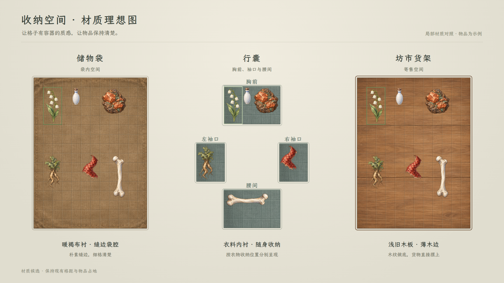

# 收纳格子：储物袋、衣物收纳与坊市货架

**2026-11-08储物袋已接入：**正式名称、2×2四格本体、256×256透明袋图、暖褐内腔及运行资源命名均已迁移，用户明确不处理旧档；见[当前实机、生成记录与7组验收](../储物袋迁移与四格图标_20261108/README.md)。下方储物袋“未实施”描述仅对应2026-11-07理想图阶段；坊市材质仍未接入。

**行囊当前视觉：**用户反馈深灰青块面与纸墨页面不融合，经浅绢v4及淡纹v5预览后，已明确认可并要求接入。当前[浅绢淡纹v5正式实机与验证](../行囊原面积200格扩容_20261107/README.md)已完成，保留200格、36格距与五区位置。本页旧衣料底面仅为来源记录，储物袋和坊市材质方向保持。

**当前：**用户已认可v3材质与格线方向，并选择普通行囊在原边界内扩至200格。新版全五区见[200格效果图与实机验证](../行囊原面积200格扩容_20261107/README.md)及[容量主案](../../plans/物品与装备/行囊恢复原面积与200格扩容_20261107.md)；本页四区对照保留为扩容前的材质参考，旧120格说明不再代表当前容量。

2026-11-07，以下为v3格线优化理想图，尚未替换正式游戏。用户反馈格子边缘不清，本轮稍加深格线，用相邻的深浅细线显示格界，并加强区域内缘与选中框；保持材质、格距、物品大小和摆放。用户此前明确“行囊”是袖口等随身收纳位置，暖褐缝边布料归储物袋。原“储物戒指”改名为“储物袋”已确认，正式显示名、旧外形与资源／存档替换未实施。

[原尺寸预览](材质对照_v3_20261107.html) · [1280窗口](收纳材质_格线优化_v3_1280.png) · [上一版对照](收纳材质_理想图_v2_1920.png) · [当前命名与材质方案](../../plans/物品与装备/收纳空间材质与储物袋命名_20261107.md) · [原始材质图](../../../textures/ui/inventory_material_20261107/storage_surface_materials_v1.png) · [生成提示词](材质底面_v1_生成提示词.txt) · [本轮记录](格线优化与验收_v3_20261107.json)。

- **储物袋**：采用暖褐布衬和朴素缝边，表现袋腔；明暗细线分清格子，保留薄外缘。
- **行囊**：采用灰青衣料内衬，分开呈现胸前、左袖口、右袖口与腰间；小区宽高取现有规则，不画整体包体。图中兽骨按真实占地旋转后放入腰间。完整120格及未展示的背囊区保持，不从本图删除或重定容量。
- **坊市**：浅旧木货架底板，少量木纹、板缝与薄木边，不加遮挡格子的立体小隔间。

三组同用现有六件物品图标与36设计单位格距，格线和选中框由控件叠加，选中框留在实际占格内；局部视窗只用于比较材质，不代表任意容器的正式尺寸、品质容量或真实库存。储物袋与货架使用同组摆放，行囊按衣物小区适配，不压缩物品宽高。

原始无字三材质图由内置图片生成工具新生成；后续v2只通过页面材质映射与控件布局，将暖褐布料分配给储物袋、灰青衣料分配给行囊，没有编辑原位图。旧[整块行囊初稿](材质对照_20261107.html)仅留作过程记录，不代表现行理解。

v3只修改[格线样式](格线清晰_v3_20261107.css)，没有重新生成或编辑材质图。每格仍36设计单位，内侧深浅细线不改变格子坐标；区域内缘和选中框均留在原范围内。文字、布局、物品及其朝向沿v2。

检查：1920×1080与1280×720截图核对；对应单格36／24屏幕像素，18张物品图加载正常，浏览器无警告或错误。四个衣物区按现有尺寸核对逐件摆放、旋转和边界。此轮未改运行代码、物品资源、容量、交易或存档，未接入游戏新材质；旧36格显示实装状态沿原方案。
