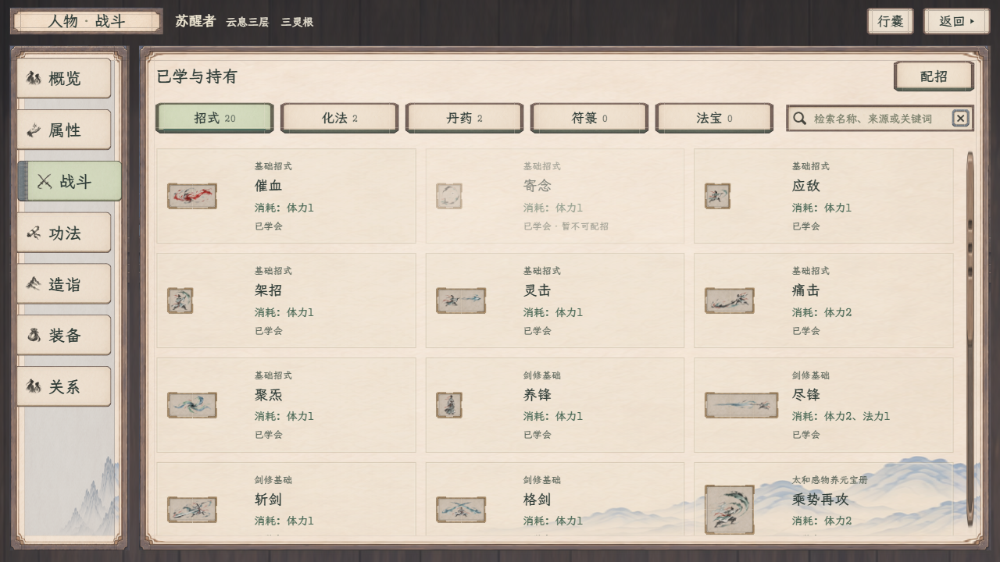
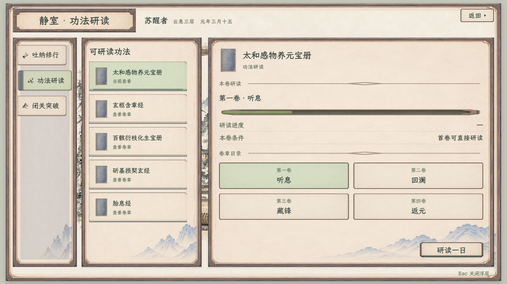

# 整纸选中全页复核

最新效果已按用户要求取消额外细线，纸面染色更柔和、文字稍加深，见[无细线修订](无细线修订/README.md)。下方图片和原生134项记录属于上一版；本次只调整网页选中样式并另做两档实拍。

2026-11-09。用户要求继续排查招式分类及其他页面文字背后的中央色块。现行口径沿[全局按钮规范](../../plans/界面与美术/全局界面统一风格规范_20261108.md)：选中作用于整张原纸面，文字保持深墨，原边线、纸签滑出及灰蓝装订边保持。

网页人物七页、静室三页、休息、炼丹及见闻／任务／记录共15种状态，在1920×1080与1280×720分别实拍，共30次；核对52个选中控件，中央分区均未单独染色，文字承托层透明，无脚本错误或缺失资源。静室研读曾以`is-selected-true`标记选中，见闻分类用`aria-selected`，本轮一并纳入共用规则。

| 其他页面 | 1280×720 | 1920×1080 |
| --- | --- | --- |
| 休息 | [查看](休息_1280.png) | [查看](休息_1920.png) |
| 炼丹 | [查看](炼丹_1280.png) | [查看](炼丹_1920.png) |
| 见闻 | [查看](见闻_1280.png) | [查看](见闻_1920.png) |
| 任务 | [查看](任务_1280.png) | [查看](任务_1920.png) |
| 记录 | [查看](记录_1280.png) | [查看](记录_1920.png) |

网页共用[整纸选择样式](../全局界面风格母板_20261108/paper-button-selection.css)，清除角色／静室、休息、炼丹和见闻各自遗留的中央分区染色；保留各页面的基础明暗、悬停和按住反馈。查看入口更新样式版本，避免旧页面继续命中缓存。首次排查因同文档跳转沿用旧CSS而命中一处旧卷章状态，后续强制重新载入并完成上述实拍；未将旧页计为最终通过。

原生另查到`CraftingPaperStyle`的共用选中纹理仍只处理中央区域，本轮将同一染色作用到整份原纸，包括边缘；`PaperButtonFeedback`已采用的整纸方案继续保持，避免重复染色。人物、静室、休息、炼器和信件采用该反馈组件的来源已核对；未重跑其各自历史原生验收，也未批量改动正式数据或界面布局。

全项目构建0警告、0错误；实际Owner绑定的原生炼丹1280流程134项通过、4图，未开炉、未扣料、未推进旅程。[拣药画面](原生炼丹/alchemy_paper_picker_1280.png) · [原生报告](原生炼丹/alchemy_paper_checks_1280.json) · [完整复核记录与来源指纹](复核记录.json)。运行日志有2条既有资源UID回退提示，无运行错误；不将其写成标准错误为空。

本次仅修选中显示，PNG源材质、玩法、资格、库存、保存及网页／原生接入边界保持。人物战斗页仍为独立样稿；原生共用按钮修正不表示人物配招与存档互通已经接入。
