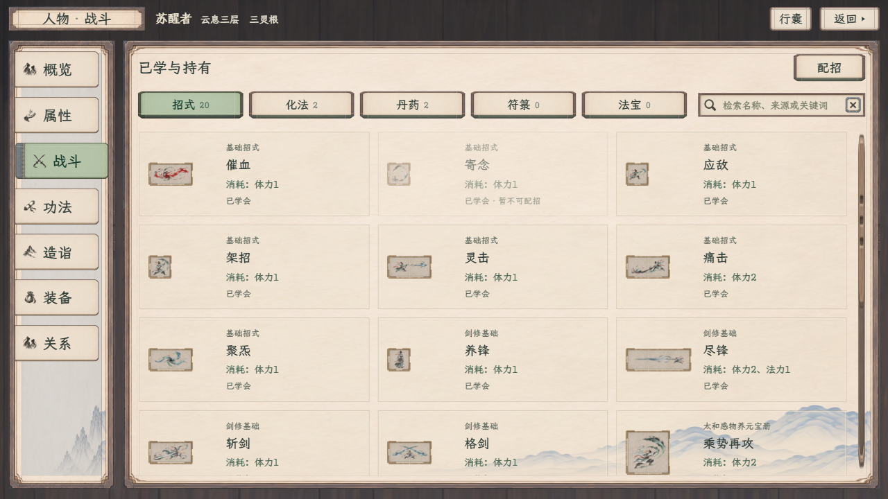

# 选中效果：无细线与对比增强

2026-11-09 · 用户要求取消选中细线，随后反馈上一版过浅、不明显。当前选中纸面加深为中灰绿色，与未选中米白纸面拉开明暗，文字保持深墨绿，原纸纹与边框保留；不添加底线、侧线、外描边或中央矩形。导航原有滑出与灰蓝装订边保持，悬停和按住沿原反馈；材质明暗过渡160毫秒，减少动态效果时直接切换。

| 未选中 | 选中 |
| --- | --- |
|  |  |

[1920人物战斗页](增强_人物战斗_1920.png) · [静室研读](增强_静室研读_1280.png) · [休息](增强_休息_1280.png) · [炼丹](增强_炼丹_1280.png) · [任务](增强_任务_1280.png)

对比增强后，人物七页、静室三页、休息、炼丹、见闻／任务／记录共15种状态再次完成两档30次实拍、52个选中控件复核；无中央染色残留、脚本错误或缺失资源。四组样稿的额外选中细线规则保持清理，炼丹材料勾选标记保留。[当前记录与样式指纹](对比增强复核记录.json)；[之前浅色版记录](复核记录.json)单独保留。本次只调整网页样式，PNG、布局、玩法与原生代码保持，原生上一轮134项验收不重计。
