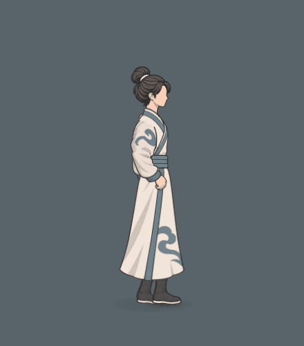

# 斗法跑动：倾身、交替摆臂与扩大腿幅

本页保留v3跑姿与腿幅验收。用户随后要求衣摆持续后飘、松键自然回落，衣摆现已单独修订；当前5秒原生动态见[衣摆后飘与停步回落](../跑动衣摆后飘与停步回落_20261104/README.md)。本页跑姿继续沿用，旧衣摆不作为当前完成标准。

当前版本使用明显前倾的跑动姿态，双臂自然屈肘、随同侧腿反向交换前后；腿部跨步与屈膝回收已依用户追加要求扩大。原衣服、骨长和技能动作保持，普通移动只有原有单一移速，不扣体力。

先看新版独立短片：

- [新版近景，2秒，440×500](新版倾身跑动_单独近景2秒.gif)
- [实际局内，2秒，880×600](新版倾身跑动_实际局内2秒.gif)
- [新版后退近景，2秒](新版后退_单独近景2秒.gif)／[实际局内后退](新版后退_实际局内2秒.gif)

本次原生短录采用首页试玩基准114：前进2秒、后退2秒，再记录停步1.5秒。敌人初始距离650，AI与共同镜头正常推进，没有为展示改变战斗或镜头规则；165帧诊断中气血100、体力6保持。235仅用于兼容检查，不是另一种可切换移动模式。

[六相位](正常交替摆臂_六相位.png)包含最大前伸、后推、最高回收采样和回收前送；另有[实际游戏尺寸裁切](实际游戏尺寸_未缩放六相位.png)、[停步衣摆延续与回落](衣摆停步延续与回落_六相位.png)。人物画面均来自原生渲染，没有重绘；实际尺寸裁切未缩放。

[同输入对照2秒](上一版与新版_同输入对照2秒.gif)左侧为上一版固定持手的完整 `reference_walk` 源码快照，右侧为本次新版；左侧没有替换成更早的cape方案。两版同时包含姿态、腿部与衣摆差异，不作为只改变上身单项的实验。上轮v2短片与记录另存于[历史_v2下身扩幅前](历史_v2下身扩幅前)。

与v2同段骨记录相比，114样例的踝点相对髋部前后跨度由33.17增至46.05，脚回收峰值由7.23增至9.56骨架单位；步频与位移速度保持，已通过的双臂幅度没有随腿幅继续放大。本次实测两手都经过肩部前后区，双臂持续交换，肩髋轴前倾约15.4–18.7°。这些是本项目记录，不是参考视频骨骼数据。最终前伸／后推／回收与局内画面已目视检查，未见膝反折、脚穿层或肩颈腰连接断开。

后摆继续响应移动、加减速与弹簧阻尼，并由真实髋挂点的有限差分加速度小幅驱动中末段；没有新增固定正弦摆动。最新专项稳态尾端相对髋变化约0.334，停步4秒后驱动趋零、末段角约0.00000275弧度，暂停与转向／重开／瞬移／专用动作切换检查通过。[物理专项](髋挂点驱动与衣摆物理检查.json)、[真实腿长与鞋底接触](真实腿长与鞋底接触检查.json)、[双臂腿相位](双臂腿相位检查.json)、[静止及专用姿态优先](专用姿态与惯性检查.json)均保留本轮最终报告。主试玩入口与大世界共享接口也已由根代理复验通过。

参考由根代理实际重播视频51.5–55.39秒及78–82.12秒，观察整体重心、脚步回收与衣摆拖后；低清人物及特效不支持精确量角，没有提取或复用视频骨骼。当前参数属于本项目的视觉拟合。

最终捕捉来源为 `tools/action_battle_test/output/running_swing_short_final_v3/`。当前源码SHA256：`1DABA5359212C43277861C2C8E5ECCCE2A068E3AE5A8949D9C2D716EBB0D735A`；上一版快照SHA256：`9ADF1A6809422DABA08AE273653B70AE833272A382732A84928EDF6E34525BBC`。完整骨向量、相位、来源和文件大小见[动作记录](实际骨向量与动作记录.json)，原始逐帧数据见[同输入记录](同输入短录逐帧记录.jsonl)。
