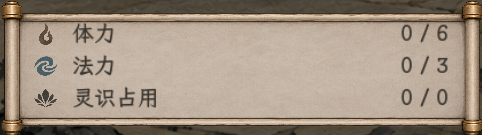
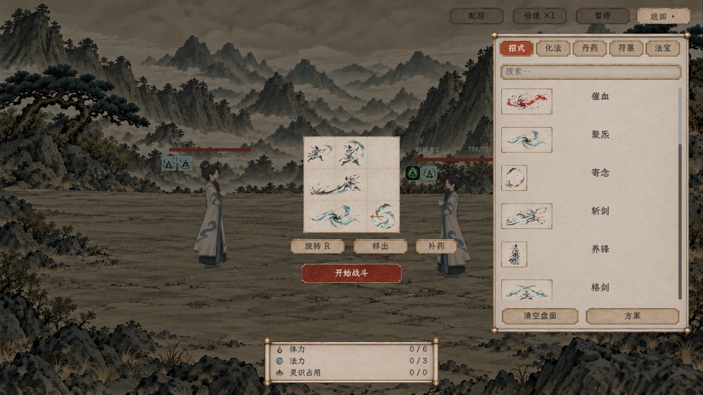
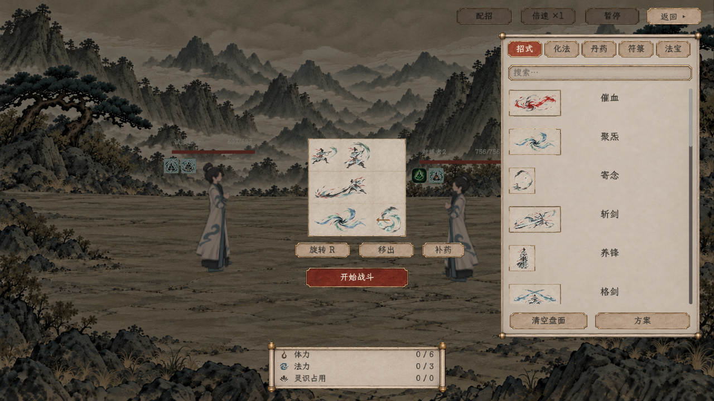
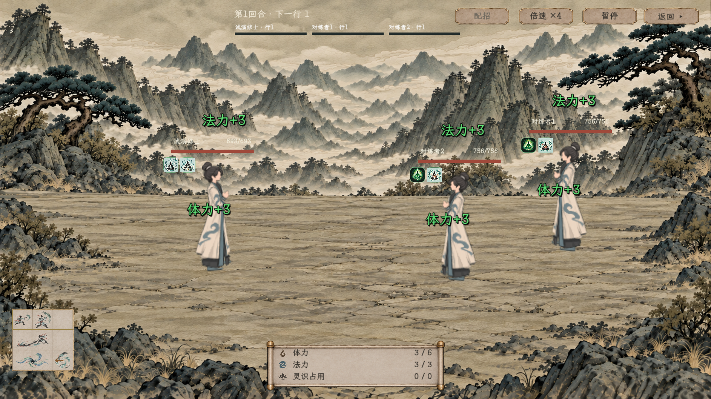

# 新版战斗试演：原生界面与验证

后续当前交互：[拖放、共享返回／配招及遍历反馈](../招式盘拖放与遍历反馈_20261108/README.md)。以下保留资源栏修正与前轮入口证据；按钮、来源格距和悬停以新记录为准。

> 2026-11-08。38／39已选素材现在用于真实人类招式盘；新增独立试演入口，并按用户反馈修正底部资源图符与三列对齐。以下均为游戏原生截图，不是重新生成的理想图。

[完整接入记录与边界](../../plans/界面与美术/新版战斗测试入口与界面接入_20261108.md) · [直接启动试演](../../../tools/run_combat_board_test.cmd) · [最终验收汇总](验收汇总.json)

首页入口：**试演与预览 → 战斗与特效 → 新版战斗 · 招式盘试演**。先选双方心法及人数，再进入真实战场配招；自动战斗与共同回合整理均调用现有战斗管理器。试演使用独立学习与物品样本，不读写正式旅程。

## 用户反馈修正：资源栏

先固定显示策略，再赋纹理与尺寸，避免源图把控件撑大。图符20×20显示，名称与数值分列，统一行距和数值右边界；没有用空格凑对齐。数字均为实际人物当前值，0不替换成缺数据占位。此图由原生画面截取局部，未重绘素材。

## 配招与开战

## 入口与子页

| 画面 | 查看 |
| --- | --- |
| 双方心法与敌人数 | [独立试演配置](01_试演配置_1920.png) |
| 暗幕临时收起，场景仍未开战 | [完整战场](04_查看战场_1920.png) |
| 所选主辅修提供的定向化法 | [化法来源](05_化法来源_1920.png) |
| 右栏内切换，不另弹系统窗口 | [方案子页](09_方案子页_1920.png) |

## 验证与材料来源

- [无窗口入口验收](验收_无窗口.json)：43项通过，覆盖真实菜单进入、临时来源、暗幕保留、控件释放不误关闭、搜索、方案覆盖、资源读取、共同回合及退出。
- [原生Windows验收](验收_原生画面.json)：52项通过，同一流程加实际截图，1920×1080与1280×720，含资源栏局部。进程退出码0，标准错误为空。
- [基础状态／迁移日志](验收_基础状态.log)：125项；[人类效果日志](验收_核心效果.log)：392项。新入口及图集最终计数、日志诊断与文件哈希见[汇总](验收汇总.json)。
- [素材来源及透明原图](../局内战斗布阵与开战理想图_20261107/39_首批素材与验证.md)；当前逐招图标来自[既有二十招新版](../人类招式图标新版_20261107/README.md)。本批未重生成或修改这些源图像素。

首轮旧效果脚本在392项功能断言完成后，进程退出发生访问异常；已调整脚本场景退出顺序，完成清理后再结束进程，最终复跑392项通过。本轮不以功能标记掩盖退出诊断，最终汇总同时检查ERROR、Fatal及泄漏记录。

符箓、法宝和妖兽新规则、外围手持的实际参战及后期成长盘仍未纳入本入口；局外正式角色配招页由独立任务衔接。此处不将两种样本盘或九格渲染验收当成这些玩法已完成。
