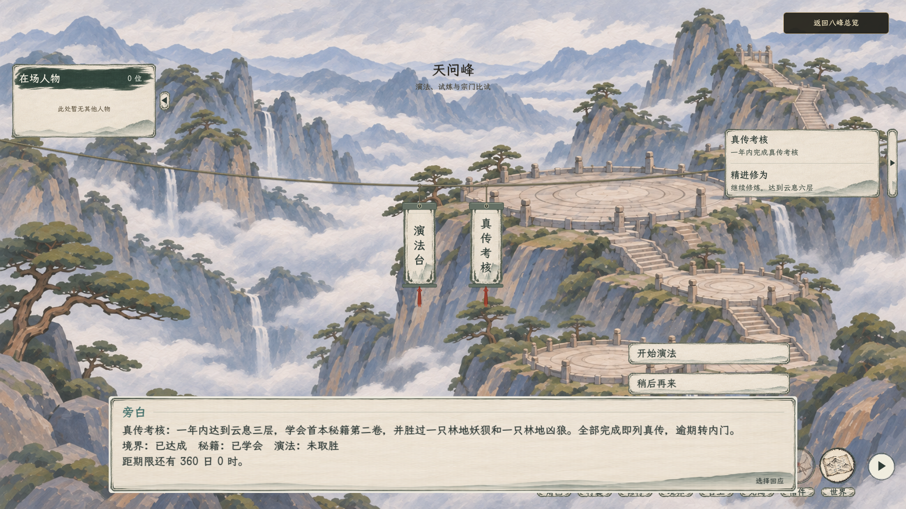

# 对话栏：旁白与事项标题

2026-11-07，姓名位置只显示实际说话者。没有具体人物发言的事项说明使用“旁白”，需要标题时在正文开头写“事项：内容”；普通旁白可以直接写正文。人物发言显示人物姓名，玩家发言和心声显示玩家姓名。

天问峰考核说明已按“旁白 / 真传考核：……”显示；白石择宗说明按同一格式显示“旁白 / 择定去向：……”。人物探查的无标题旁白仍直接显示正文，人物发言仍使用实际姓名。

[1280×720 实机画面](考核选项_1280.png)。截图使用隔离测试存档，考核进度为测试样本。

验证：C# 构建 0 警告、0 错误；考核对白图形检查 21 项通过，覆盖标题、底边贴合、正文长短变化及鼠标点击；白石至玉虚普通与预备弟子流程各 66 项通过；人物探查流程 110 项通过，覆盖无标题旁白与人物姓名。
