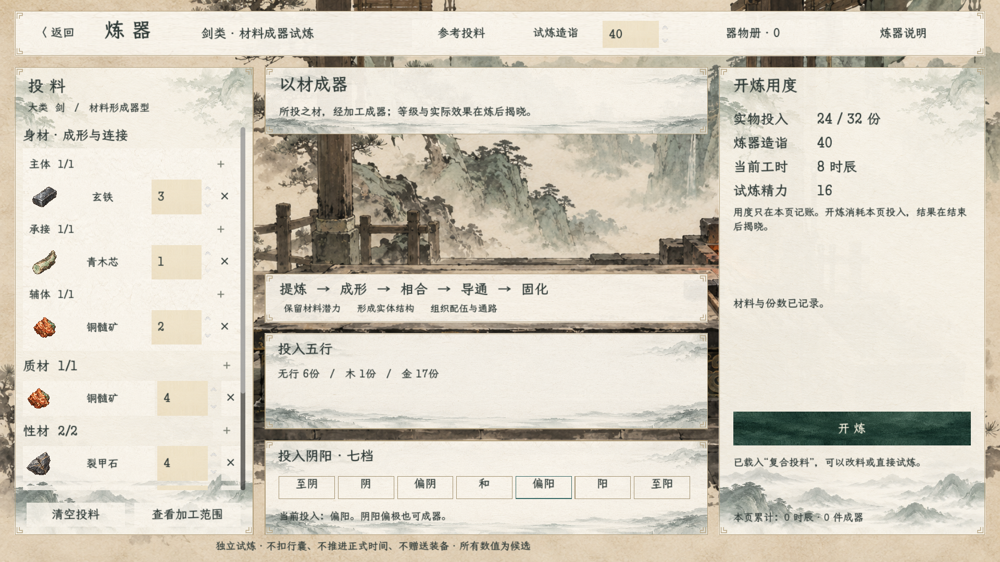
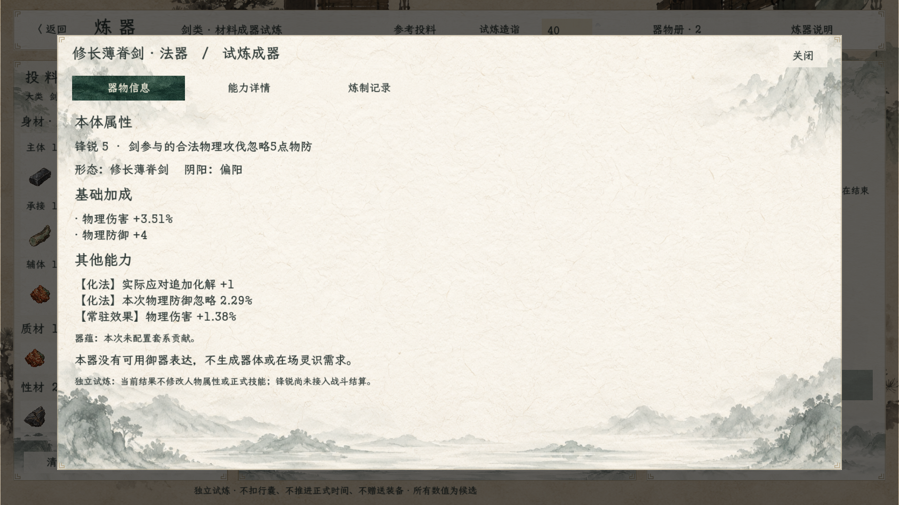
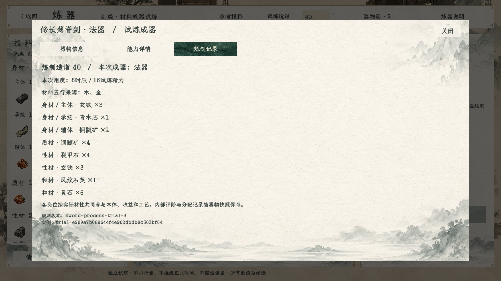

# 无燃料炼器试炼 v3：画面与验收

2026-10-22，当前试炼。变更依据：[取消燃料与五行展示修订](../../plans/炼器取消燃料与五行展示修订_20261022.md)。沿用现有齐边宣纸、水墨锻造工坊和玉色按钮。

入口：首页“试演与预览→炼器工坊·剑类试炼”，或“百工→法宝→进入炼器工坊·试炼”。四套参考投料均已去掉燃料；每页独立库存，不影响人物、正式时间、装备或存档。

## 当前画面

其他画面：[选材](02_选材.png)、[凡器](03_凡器.png)、[能力详情](05_能力详情.png)、[缺主体拒绝](07_非法投料.png)、[多材成器](08_多材成器.png)。

## 验证范围

此前运行编译零警告、零错误；Godot实机驱动通过1459项断言、退出码0。四套参考投料全部正常成器，已检查投料、成器和记录页截图。追加检查：同数值/同关系替换五行不额外赠送属性、相克实际降低送达及稳定性、真实水行和材改善金根木性通关。用户最新决定暂不设置器物五行字段，[此前功用定性方案](../../plans/器物五行与无属性功用定性设计_20261022.md)已暂缓；本次仅同步文档，未改运行逻辑，未重复编译或运行。

编译 `dotnet build --no-restore -v quiet`；Godot .NET 4.7.2兼容渲染运行原炼器场景，用户参数 `--audit-process-forging`。实际断言数量、样例与退出结果以[运行记录](运行记录.md)、[引擎日志](运行验收.log)为准，不沿用v2断言数量。

验证包含四套无燃料成器、旧燃料输入拒绝、供热字段移除、预算与来源守恒、48组造诣/份数网格、法器评阶、真实五行通关、快照重放、库存、重复提交、实机按钮和五行展示。没有新增成器失败概率。

本轮未改战斗卡；效果、锋锐仍为试炼描述，器蕴及成器主五行规则未定。自动驱动按钮及截图检查不代替真人游玩。
