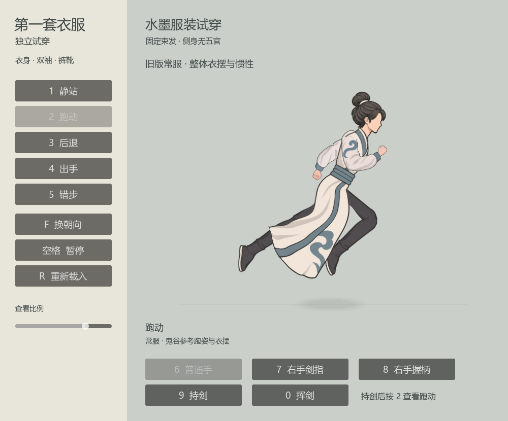
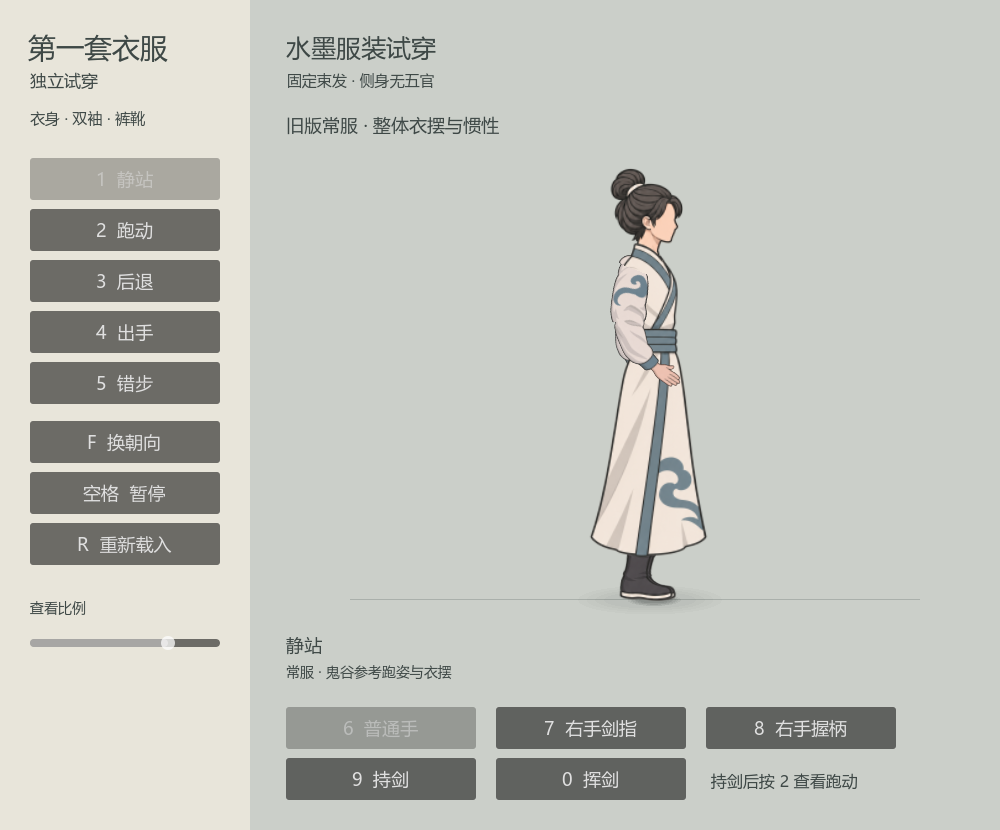
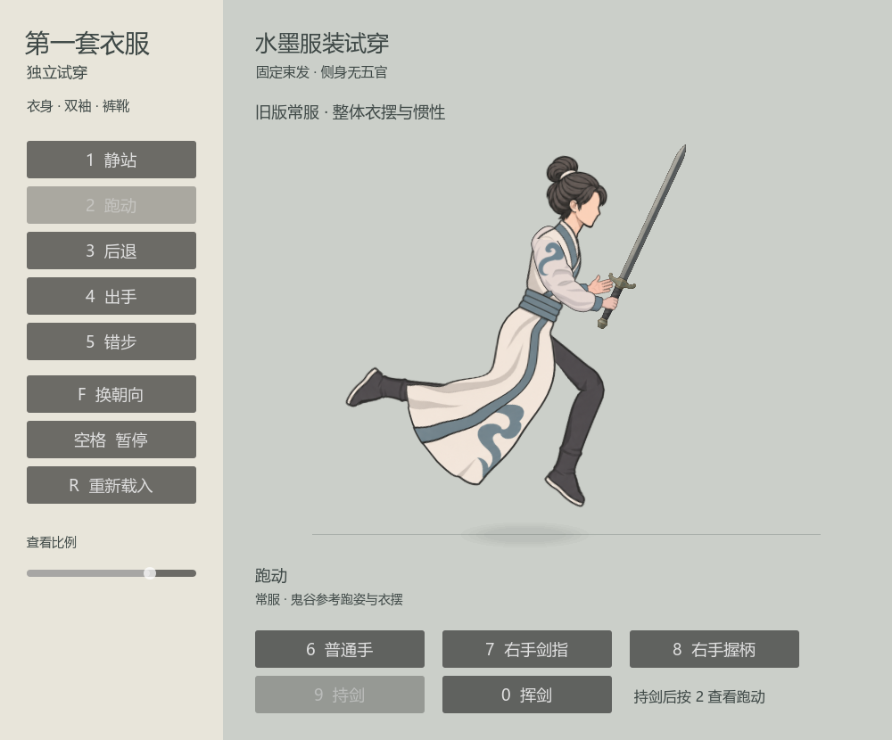
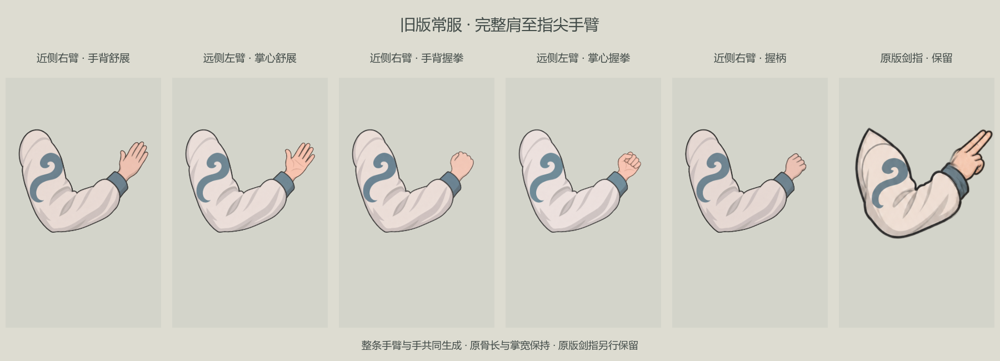
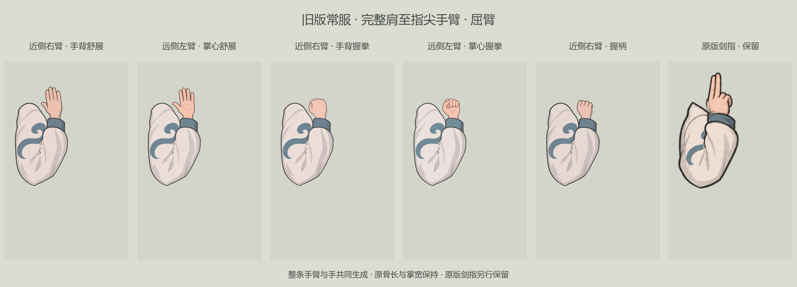
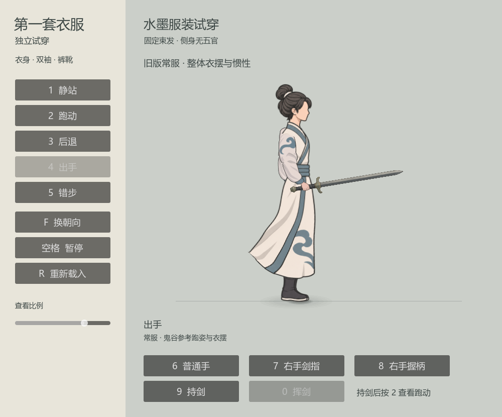

# 旧版常服整体、闭袍衣摆与持剑预览

**最新转向：本页已转阶段记录。** 用户现要求素材尺寸、骨架、物理按鬼谷原规格制作，并指定采用本项目自有朴素束发。共享默认入口已转新管线，现行规格见[鬼谷原规格首套人物](../鬼谷原规格首套人物_20261105/README.md)。以下“当前”“最终”及检查数均描述旧v15／80%整臂／放飞衣摆阶段，保留过程，不代表现行默认；此前共享接入不再继续扩写为旧版最终目标。

2026-11-05，旧版游戏接入与独立对照阶段。用户选定附图 `codex-clipboard-9b1ad0b5-5f53-492f-b6f7-84060b029a9a.png` 对应的旧版 `yuxu_fullbody_v15`：原衣身、朴素旧头、侧身无五官及裤靴沿用；以旧袖画法为参考，按用户后续要求重生成五张完整肩至指尖整臂。此前密集流云、回纹及重绘束发的高清候选转为历史。

[用户选定的旧版整体原图](用户选定旧版整体.png)

独立试穿已接入五张完整整臂（新手部缩至首稿80%、无指甲）、独立剑及放开飞摆v2；原v21整臂剑指按用户要求保留。常态及160°屈肘原生接缝复核通过，整臂15855项／1440姿态、持剑20项／1021帧、飞摆21项／732帧检查和10秒连续演示已归档。用户现已明确授权这版接入游戏，手与臂比例保持；即时场景和大世界共享人物分支已开始接入，真实游戏回归与录像尚在进行，当前不将独立试穿通过数等同于游戏整合全部通过。

鬼谷男性101实测跑姿已接入：前膝提起、后腿屈膝回收，脚掌独立转动，上身、手架与衣摆使用同一个周期。固定项目骨长和髋位保持，14457项、1200帧检查见下方“跑姿修订”。本轮新整臂的手部缩至80%及飞摆范围分别见对应小节。

用户已明确确认“起伏和层次都保留，整体更自然”，随后进一步要求“下摆直接放开了飞”。当前腰部牵动、下摆后拖与末缘回弹连贯，保留适度层次；v1克制收敛和独立裸手拼接均不再现行。下方为完整整臂与放飞衣摆的最终同场画面。

[整臂与放飞衣摆：当前连续原生演示](整臂与放飞衣摆_原生演示.mp4)：10秒、300帧、30fps、1000×830，依次展示静站、跑动、停步回落、持剑、持剑跑动和挥剑；整段已解码验证。

此前[跑姿八相位对照](鬼谷参考跑姿_八相位新旧对照.png)、[8秒源跑姿改版对照](鬼谷参考跑动_新旧连续对照.mp4)保留动作来源过程，衣摆和手臂仍是前阶段素材，不作为当前整体画面。

[上轮持剑站立、跑动与挥剑原生演示](持剑站跑与挥剑_原生演示.mp4)：6秒、30fps、1000×830，展示手剑装配与挥剑恢复。该演示保留上轮步态，当前新跑姿以本页最新整体图和下方新对照为准。

## 旧版实际游戏接入（阶段记录，后被新入口覆盖）

用户明确要求“这版先接入游戏”，跑动、持剑和衣摆一起接入，手与臂的当前比例保持。共享 `guigu_rig_runtime` 的 `yuxu_fullbody_v15` 分支现改用本套完整整臂、源跑姿及放飞衣摆；兼容根项目与独立试验场的资源路径。接入范围覆盖实际即时人物演练、凶狼、人类陪练、自选秘籍演练，以及大世界 `WorldActionTraveler` 行旅人物。旧队列战斗不在本轮迁移范围。

即时演练场增加 **9持剑／收剑**、**0单次试挥**。0仅播放动作，不产生伤害或新的命中判定；原拳掌、施法和架招动作需要空手时暂收剑，结束后恢复此前持剑状态。原技能结算、资源、移速与装备数据规则保持；另一任务仍在试作的四段剑式不因这两个外观控制而视为已接入。

持剑挥剑在既有0.72秒单次动作内微调为约30%提剑准备、22%快速斩出、48%较缓恢复，腕部稍迟完成，保持手臂、手掌、剑尺寸及握点。该动作已有20项／1021帧固定尺寸检查，以及22项／2884样本的新增节奏与安全角度检查；两朝向七相位原生图已采集，待游戏整合最终复核后归档。当前真实游戏场景检查和录像仍在进行，不提前标为全部验证通过。

## 素材来源与保留范围

基础素材目录为 `tools/action_battle_test/art/yuxu_fullbody_v15/`。整身裁图 `cutout.png`、衣身 `body.png`、旧头所在的原图区域及 `leg.png` 继续采用原PNG；旧袖 `arm_relaxed_v19.png`／`arm_open_v19.png` 保留为造型和尺标参考，普通舒展、握拳及握柄已经改读新整臂图，原v21整臂剑指 `arm_sword_fingers_v21.png` 仍保持。旧PNG尺寸均为1024×1536，绘制原点(475,1474)、统一尺标16/186；新图按实际输出和肩肘腕注册，不按透明外框单独缩放骨长。

旧图尺寸及SHA256见[素材来源与原图哈希](素材来源与原图哈希.json)，该文件中的裸手阶段记录属于当时来源，不代表当前仍采用裸手拼接。[当前完整臂来源与哈希](完整臂来源与哈希.json)独立记录五张新图及其旧袖参考；剑另存。新完整臂位于 `art/approved_outfit_full_arms_20261105/`，不以“所有PNG均未变”概括本轮整臂重绘。

## 连续闭袍与放开飞摆（v2）

外衣身继续使用一张原 `body.png` 和一个可见连续网格 `robe_continuous`，完整源图区域为(275,310,390,1030)，长度及无开叉结构保持。旧前后分片网格仅保留来源记录并隐藏。

用户先指出腰后S形感觉不对，随后确认起伏和层次仍然需要，并进一步要求下摆放开飞。当前保留自然腰后过渡，由腰部牵动连续带到下摆后拖和末缘回弹；消除硬鼓包、突兀折点及上下脱节，不将腰后完全固定。后摆允许大幅后掀、上掠、翻卷，起停有明显甩动；匀速跑动末段仍持续弹动，不停在固定角度。

前后控制区保留适度差动和层次，但验收目标是同一件连续布料的牵带与飞摆，不强制用整体衣片交叉或夸张腰后S形证明动态。此前“轻微后拖、克制回摆”的v1转为历史阶段；连续单衣面、无开叉、固定肢长与源跑姿保持。

该方法参考本机鬼谷男性101的连续蒙皮、关节局部权重和下摆分支关系，是本项目的表现适配，未复现或冒称原作完整DynamicBone求解、状态机和地面校正。

v2衣摆[专项检查](放飞衣摆_专项检查.json)已通过21项、732帧：腰布随骨盆挂接误差0，单连续面513顶点／896三角，原衣身PNG、UV、拓扑与固定肢长保持。稳态末120帧后缘末段角约0.05559—0.57994弧度、前缘约0.03234—0.36955，确认持续活动；限角为根／中／末0.95／0.58／0.58弧度。全套已更换为新整臂并完成同场复采，当前10秒演示包含跑动与停步回落；v1克制版本只保留历史。

## 跑姿修订：已接入独立试穿

用户附件 `codex-clipboard-9640e56a` 指向当前动作偏僵的问题。本轮只调整动作和各部位的相位配合，沿用已选定的旧v15衣身、朴素旧头、新裸手及剑道具。目标是前腿明确抬膝、后腿屈膝收脚，脚掌有独立转动，保留看得见的腾空轮廓，并让上身前倾、持架和衣摆跟同一个跑动周期配合。

最新来源统一为本机鬼谷男性101 `Run_New1` 的144个原始相位，周期约0.58333秒，采用未移相的样本序号／144。来源、骨点、角度及此前僵硬原因见[男性101跑姿只读复核](鬼谷男性101跑姿来源与僵硬原因_只读复核.json)，曲线已[正式归档](鬼谷男性101跑动角度与相位_20261105.json)，运行时读取[本轮跑姿数据](../../../tools/action_battle_test/approved_guigu_run_profile_20261105.json)。该数据直接来自已提取的 `boneFrames`／`boneTransforms`，不是凭低清视频估算每段骨长。

原始采样中，腰至颈的前倾角约21.63°—27.68°；两条腿并非严格相差半个周期的同一条曲线，前后脚回收及脚轴转动也不对称。上轮的固定44%支撑窗口、近似对称踝部弧线和支撑脚强制可达约束，会延长伸膝阶段；旧女例10002的手臂／躯干相位与男性101下肢原始相位也未统一。这些是本轮要修正的动作原因，不归因于素材清晰度。

普通正向 `Run_New1` 已改用男性101分侧大腿、小腿、脚轴角度，经本项目固定骨长前向求解，配合统一地面基准及低脚接触带的有限校正；上身、手架和衣摆读取同一男性101零相位。两侧髋挂点仍保持本项目固定位置，只借男性骨盆均值起伏，避免把源侧髋高度差直接搬来后露出腿根。原作动画含关节局部位移及变化骨长，本项目只借其角度、时间关系与轮廓节奏，不复制会拉长身体的源位移或骨长。

该正向跑姿周期采用源0.58333秒，移动速度仍为114；后退和其他动作的既有分支不因本轮改为新的玩法。旧v15长靴在原作接近180°回收角时会水平翻底，本轮对正向脚角75°以上使用 `75+65×tanh((原角度−75)/65)` 的软限幅，渐近140°；保留分侧回收时序及独立脚掌转动。这是本项目鞋型适配，并非声称原作脚轴测量错误，也不把原曲线的幅度改写为140°。

只读报告中的“双脚离固定投影线75%”是原始二维投影在一条常量基线下的采样结果，未包含原游戏状态机、地面校正和碰撞，不能写成鬼谷真实腾空率，也不作为本项目必须达到的数值目标。当前以姿势自然、固定比例和脚底适配的实际结果验收。

本轮专项检查14457项、1200帧通过：固定腿长最大误差约0.00000763、臂长约0.00001240、地面穿透约0.00001335，见[最新跑姿检查](鬼谷参考跑姿_专项检查.json)。本项目右向样本258／360帧、左向170／240帧为双脚离开自身脚底基准，同时都保留实际接触帧；该统计仅说明本预览有明显腾空和落地，不据此推定原游戏腾空率。衣摆16项、裸手8363项、持剑20项也在新动作逻辑下复验通过。

## 腿形与髋根遮挡（当前）

沿用旧版完整大腿、小腿、脚掌骨链与原肢长尺标，当前正向跑姿详见上节。转向、起停、后退和暂停均不按动作相位拉长骨段；静态衣料厚度和髋根覆盖另按下述局部规则处理。

裤腿在绑定前做静态横向厚度适配：可见大腿前侧约1.24、小腿约1.18、靴筒约1.10，完整脚掌恢复1.0。大腿后侧入袍根在原图760—900行只保留约0.20横向宽度，900—1040行平滑回到1.24，1045行以后膝部与脚部规则保持。这是源图腿轴后侧的局部入袍轮廓修正，非整条大腿缩细、逐帧骨缩放或改图。近远腿使用同一长度与宽度规则。

当前髋帽Alpha裁切过渡为原图744—750行，750行起完全保留，髋点位于760行，保留10绘制像素的不透明入袍搭接；此前720—726行／40像素方案转为阶段记录。膝盖1080行、踝部1417行不进入该裁切，不通过隐藏抬膝、靴子或整条腿消除穿模。

## 当前整臂制作规范与手部缩至80%

用户明确要求手与臂一起生成，并确认本套立即按整臂重做。当前五张图均为从圆润肩根到指尖的完整长袖手臂，按近侧右手舒展／握拳／握柄及远侧左手舒展／握拳成套制作；近侧显示手背，远侧显示掌心。今后短袖或其他服装也以完整肩—肘—腕—掌关系注册，不再将独立裸手拼接流程当作通用素材制作标准。原v21整臂剑指沿用，不重新画手指。

新图保存于 `tools/action_battle_test/art/approved_outfit_full_arms_20261105/`，五个PNG为 `near_open`、`near_fist`、`near_grip`、`far_open`、`far_fist`，实际画布均为1254×1254。直接采样完整整臂图，不把旧袖与新裸手拼起来。肩／肘／腕按图实测，母图约为(270,510)／(411,947)／(922,553)，握柄变体按自己的腕点注册；本项目既定上、下臂长度与比例保持。

用户随后要求手部缩至首张整臂原稿的80%，臂长保持，并去掉指甲。此80%只作用于皮肤手部的掌与手指，不将整臂或骨段缩至80%；五种新手势无指甲、用概括指形和必要分隔线。屈伸手指改变轮廓长度，掌腕尺标仍统一。

当前共同掌尺约3.81277745人物单位，是实测注册结果：首张有甲原稿掌宽212.25像素、前臂长约645.2573像素，换算到项目小臂14.48894再乘用户0.8。无甲缩手编辑稿实测掌宽177.5像素，装配再作约0.95662校准，不重复乘0.8。此前裸手3.7及放大试装4.5均为阶段参数，不能写成用户要求固定为4.5。

逐图掌宽、腕点、握点、源SHA和80%基准见[当前整臂注册归档](完整臂锚点与80%尺标.json)；完整内置 `image_gen` 提示词含首次母图、缩手去甲编辑及变体制作，见[整臂生成记录](完整臂生成提示词.json)。整臂[专项检查](完整臂_专项检查.json)15855项、1440姿态通过，固定臂长最大误差约0.00000954、掌宽误差约0.00000769、刚性手部形状误差约0.00001661，腕点与握点误差为0。

极端屈肘接缝已仅用同源衣料的局部轮廓采样余量修复；不编辑原PNG、不改骨长，常态轮廓保持。常态及160°屈肘各六栏的[原生背景缝复核](完整臂_原生屈肘接缝复核.json)均为0背景缝像素；原v21剑指单独保留。图片来自引擎实际渲染，非后期补缝。

### 历史：独立裸手阶段

前阶段曾使用 `art/approved_outfit_hands_20261105/` 五张独立裸手和原袖图拼接。其[注册记录](裸手锚点与尺标.json)、[生成提示词](裸手生成提示词.json)及8363项检查保留历史；共同掌宽3.7属于当时的装配值，当前已改为上文完整整臂路线。

[历史普通舒展／握拳近景](普通舒展与握拳_原生近景.png)、[历史屈臂接腕近景](屈臂手型与接腕_原生近景.png)及[历史剑指／握柄近景](近侧剑指与握柄_原生近景.png)仅作过程对照，不代表当前新整臂。原v21剑指图仍是保留来源。

## 独立剑道具与持剑预览

剑外形以项目现有[修长剑图标](../../../textures/items/inventory_density_20261029/slender_sword_2x6.png)及其[高清原稿](../../../textures/items/inventory_density_20261029/raw_unified_final/slender_sword_2x6.png)为依据：灰铁双刃直身、克制刃缘、青灰铜饰护手、黑色缠柄与小型剑首。该图标由素行剑和清和剑共用；本预览不据此宣称当前角色已装备其中某一把。

新剑为独立1024×1536透明图，保存于 `tools/action_battle_test/art/approved_outfit_sword_20261105/sword.png`。实际剑尖(512,50)、握点(512,1303)、剑首(512,1496)，以握点到剑尖55人物单位统一等比装配，全长约63.47；详见[剑道具握点与尺标](剑道具握点与尺标.json)。剑在近侧四指后一层，不把握柄或剑刃烘进手图。

持剑站立、持剑跑动及挥剑表现已接入独立试穿，并随本轮游戏人物分支迁移。挥剑仅改变上臂、小臂及腕角，采用准备、快斩、缓收三阶段，腕部稍迟完成；安全屈肘角避免反向折叠，单次结束回到持剑。原有尺寸／握点与循环／暂停检查保持，本轮0键试挥不新增伤害、射程、费用、技能效果、装备收益或正式武器绑定规则。

当前完整臂与剑均使用内置 `image_gen`；整臂生成记录见上节，剑的完整提示词为[剑道具生成提示词](剑道具生成提示词.json)。未使用CLI或外部API。运行时Alpha与接缝适配独立于原生成PNG，提示词和逐图注册保存在各自素材目录。

## 检查与范围

| 检查范围 | 已有记录 | 通过内容及边界 |
| --- | --- | --- |
| 当前完整整臂 | [专项记录](完整臂_专项检查.json) | 15855项、1440姿态；五张完整源图、固定肩肘腕与臂长、共同掌尺和刚性手型、握点及原v21剑指保护分支。 |
| 当前屈肘接缝 | [原生复核](完整臂_原生屈肘接缝复核.json) | 常态和160°屈肘各六栏，肘部轮廓内背景色缝像素均为0；原PNG未被后期补图。 |
| 当前放飞衣摆v2 | [专项记录](放飞衣摆_专项检查.json) | 21项、732帧；连续面513顶点／896三角、腰随骨盆挂接误差0，稳态持续弹动，原衣身PNG／UV／拓扑与固定肢长保持。 |
| 当前男性101参考跑姿 | [专项记录](鬼谷参考跑姿_专项检查.json) | 14457项、1200帧；固定骨长及比例、分侧时序、脚底／脚掌转动、方向与起停／重启／暂停；实际新跑姿采集与下方对照对应。 |
| 原图步态与固定肢长 | [阶段记录](步态与固定肢长检查_阶段记录.json) | 13014项、1080帧；固定骨长、骨缩放、步态接触及转向／起停／后退。最大肢长误差约0.00000763；不包含本轮新裸手与剑道具验收。 |
| 连续闭袍控制惯性 | [阶段记录](闭袍惯性检查_阶段记录.json) | 16项；单张连续外衣、隐藏旧分片、前后不同负载、起停／转向／暂停。 |
| 连续表面与真实材质 | [阶段记录](闭袍表面与髋遮挡检查_阶段记录.json) | 29项、495帧；一个可见外衣、513顶点／896三角、一个连通面和一条外边界，无内部拓扑洞。原图像素与UV保持；实际GPU验证髋帽被裁，髋下、膝盖、踝部Alpha保持。 |
| 历史裸手及固定接腕 | [阶段记录](裸手与接腕检查.json) | 8363项、1440姿态；属于独立裸手管线，现由完整整臂替换，原v21剑指校验保持。 |
| 持剑及挥剑 | [专项记录](持剑专项检查.json) | 20项、1021帧；双朝向及2／5／6倍查看比例、站跑、单次／循环挥剑、暂停与普通手型恢复。握点最大误差约0.00003397人物单位，剑长误差约0.00001901，臂长误差约0.00000563；层序、手型、非有限值错误均为0。 |

阶段原生跑动／转向／停步采集位于 `tools/action_battle_test/output/approved_outfit_closed_surface_review/`，含10张全身图及原生髋根材质检查。记录中的局部投影折叠是连续衣面交叠采样，不作为外衣开衩证据；这些检查也不能代替用户对最终外观的评价。

新增裸手的原生采集位于 `output/approved_outfit_hands_normal/`、`approved_outfit_hands_optional/` 和 `approved_outfit_hands_bent/`。整套新手剑采集位于 `output/approved_outfit_hand_sword_final/`，最终挥剑角度修正后重新采集于 `output/approved_outfit_sword_safe_elbow/`；本目录挥剑整体图取自后者。连续演示源帧位于 `output/approved_outfit_sword_demo_180/`，本目录MP4为其30fps导出。

当前完整整臂与放飞衣摆全身采集为 `output/approved_outfit_full_arm_flying_final/`，常态／160°屈肘六栏来自 `output/approved_outfit_full_arms_gallery/` 和 `approved_outfit_full_arms_bent/`。10秒、300帧连续原生演示来自 `output/approved_outfit_full_arm_demo_final/`；静站0—29帧、跑动30—149帧、停步150—209帧、持剑210—239帧、持剑跑动240—269帧、挥剑270—299帧。见[本轮最终验收汇总](本轮最终验收.json)。旧6秒手剑、8秒跑姿对照和更早裸手图保留历史，当前整体以本页10秒演示和新整臂图为准。

独立对照入口为 `tools/action_battle_test/approved_outfit_fitting_room.tscn`：9持剑、2跑动、0挥剑、F换朝向、6恢复普通手；空格暂停，R重载。本轮另将同套表现接入上文游戏场景，游戏内9／0控制按演练场约定；最终实际场景录像和整合报告待完成后补入。旧 `ink_outfit_*` 和更早分片试装只供历史对照。
