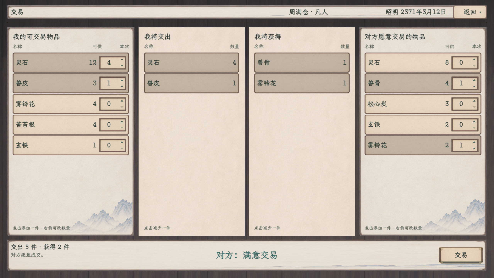
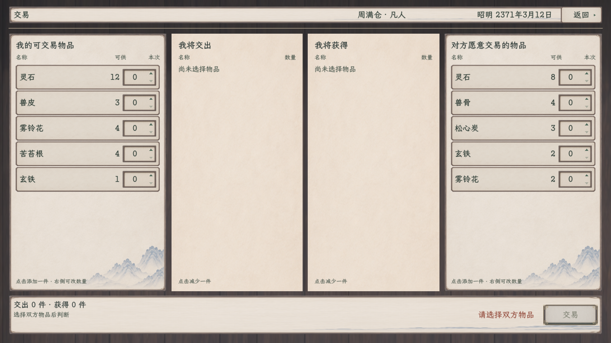

# 普通交易与数量选择 · 正式接入与样稿

2026-11-09。[本轮范围](../../plans/界面与美术/普通交易纸墨木石样稿_20261109.md) · [原四列交易规则](../../plans/界面与美术/交易与善功堂布局修订_20261029.md#2026-10-31-正式游戏实装)。

用户已于2026-11-10批准实装。正式世界人物交易入口改用`TradePaperPanel`，保留双方来源和交出／获得四列文字目录、原交易事务与共享悬停资料；预览场景仍使用独立内存夹具，不读写正式旅程。

[打开可操作样稿](../../../tools/open_trade_paper_preview.cmd) · [独立场景](../../../tscn/scene/TradePaperPreview.tscn)。点击来源加一，数量槽支持输入及裸三角增减，点击中间清单减一；成交沿原规则，只操作本次样稿库存。右上返回或Esc关闭。

2026-11-10版式更新：选中行使用暖纸整面压暗，不额外染绿；态度等级显示为“对方：满意交易”，放大并移至页脚中间，左侧说明仅保留“对方愿意成交”等结果文案。日期读取当前游戏历法且不显示时辰。下方14张旧静态截图仍是修订前画面，当前页脚构图见本轮预览图。

页眉“交易”已补12设计单位左内边距，标题起点为（36，18）；右上返回仍为（1534，18）、114×46，日期与返回仍22字／46高同一行。只调整交易预览的页眉容器，不改变四列内容、数量回调或成交逻辑。

## 完整原生图

### 态度居中版

| 状态 | 1920×1080 | 1280×720 |
| --- | --- | --- |
| 初开目录 | [完整图](普通交易_初开目录_1920.png) | [完整图](普通交易_初开目录_1280.png) |
| 数量编辑 | [完整图](普通交易_数量编辑_1920.png) | [完整图](普通交易_数量编辑_1280.png) |
| 双方交换清单 | [完整图](普通交易_交换清单_1920.png) | [完整图](普通交易_交换清单_1280.png) |
| 整纸按下 | [完整图](普通交易_按钮按下_1920.png) | [完整图](普通交易_按钮按下_1280.png) |
| 不可成交 | [完整图](普通交易_不可成交_1920.png) | [完整图](普通交易_不可成交_1280.png) |
| 交易完成 | [完整图](普通交易_交易完成_1920.png) | [完整图](普通交易_交易完成_1280.png) |
| 空目录 | [完整图](普通交易_空目录_1920.png) | [完整图](普通交易_空目录_1280.png) |

以上14张均为本次页眉修订后重新获取的Godot完整原生图，已逐张目视核对。标题留白正确，日期和返回未移位；四列内容、数量槽、底栏及不可成交／成交后提示均完整，无越界或裁切。未对截图重画或加工。

## 验证

主线统一构建通过，0警告、0错误。1280与1920两档原生运行均退出0，每档43项、7张完整图通过，共86项、14图。原41项基础上新增“标题12设计单位左内边距”和“返回坐标不变”两项；本轮以43项记录为准，不沿用修订前计数。

真实鼠标事件送入固定GPU子视口，覆盖来源加一、裸三角增减、核对清单减一、未提交输入保留、整数提交、库存上限、双方清单、整纸选中与按压、不可成交及提示、隔离夹具中的一次成交与精力、空目录和返回。未打开正式存档槽，样稿未推进历法。两次运行的APPDATA分别隔离在项目output内，进程已正常退出，日志未见运行错误或警告。

[页眉收尾合并验收与源文件哈希](页眉收尾验收.json) · [1280逐项](验收记录_1280.json) · [1920逐项](验收记录_1920.json) · [1280日志](原生验收_页眉收尾_1280.log) · [1920日志](原生验收_页眉收尾_1920.log) · [统一构建日志](编译_页眉收尾.log)。

## 接入范围与构建状态

正式入口由`MainScene`创建`TradePaperPanel`，它继承`TradePanel`并复用原估值、库存、精力、关系、空间复核与成交提交；善功堂、坊市和休息相关交易窗口不在本次范围。接入后项目构建通过，0警告、0错误；正式旅程未另行启动核对。

正式入口接入后项目构建通过，0警告、0错误；本轮未启动正式旅程做运行核对。此前独立样稿的两档交互记录仅覆盖预览场景，不作为正式入口验收。

预览夹具仍不打开正式存档或推进旅程历法。百科、百工、见闻与新战斗配招的既定边界保持，不以本页通过推定其他页面已验收或已接入。
