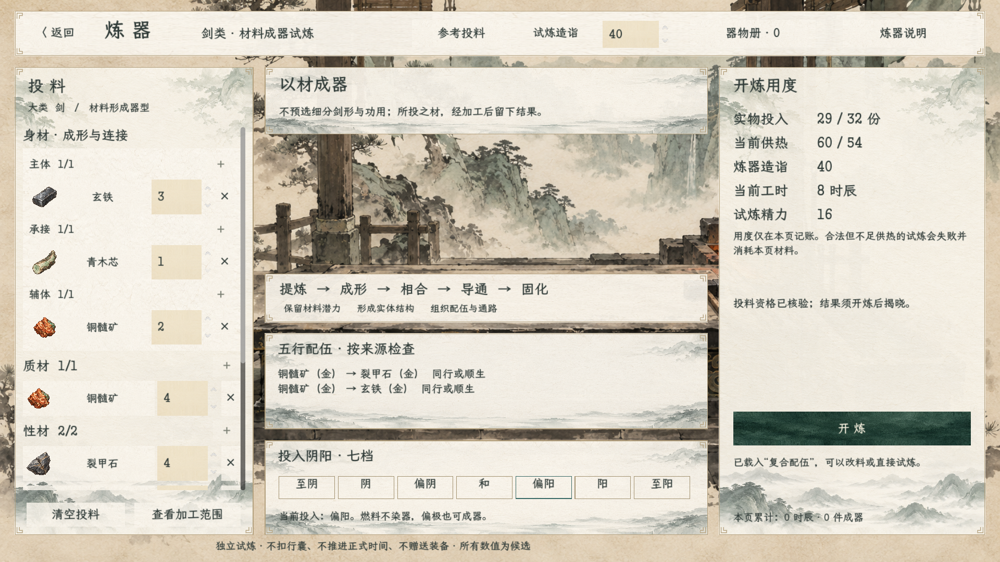
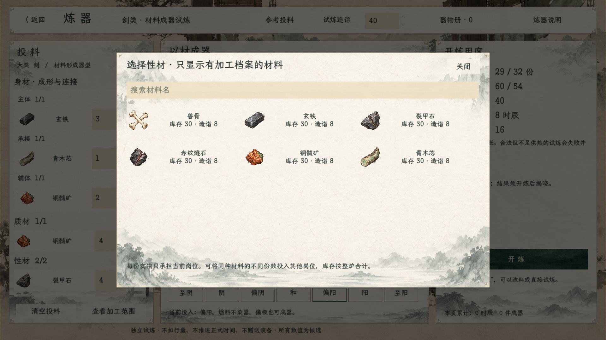
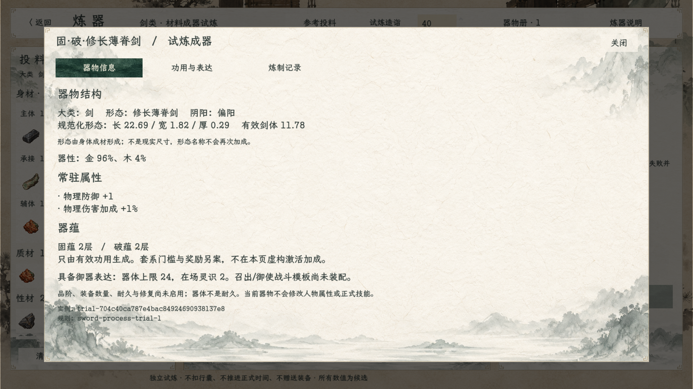
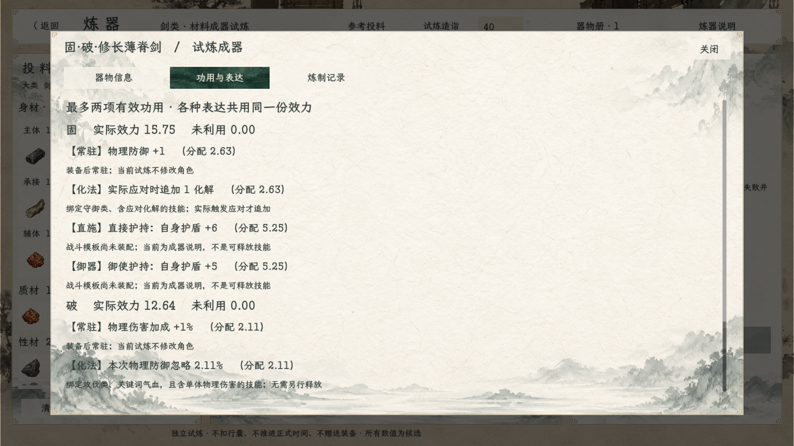
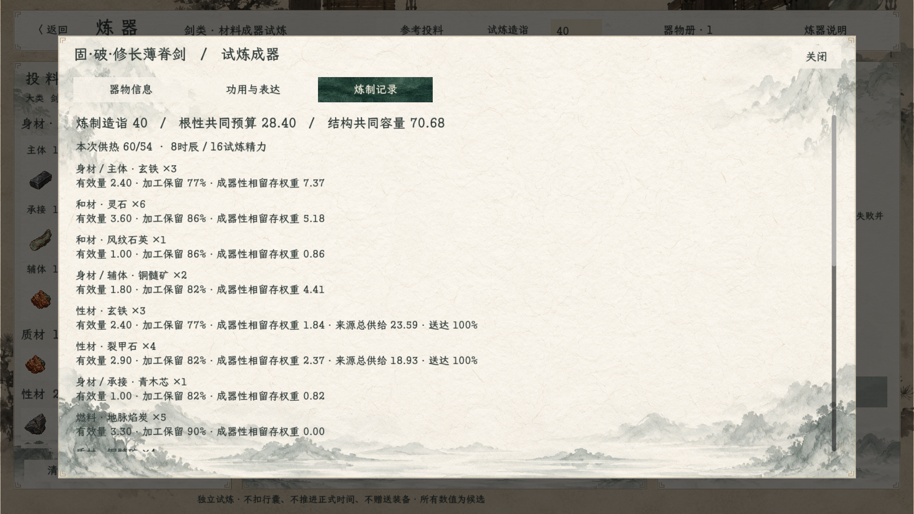
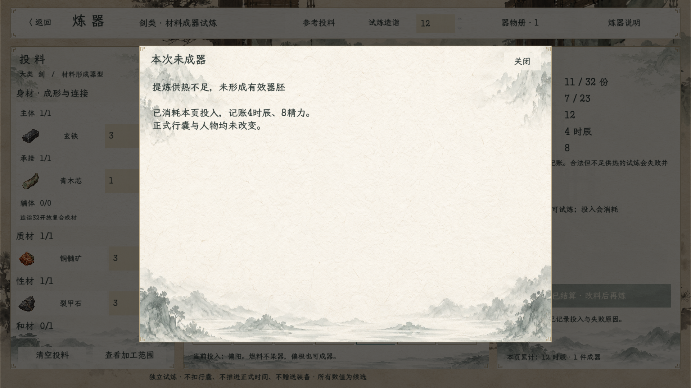

# 材料过程炼器试炼：实机与验收

2026-10-22，当前炼器测试入口。策划：[候选规则与器物信息](../../plans/百工技艺/炼器/炼器新模型试炼与器物信息设计_20261022.md)。

进入方式：首页「试演与预览 → 炼器工坊·剑类试炼」，或游戏内「百工 → 法宝 → 进入炼器工坊·试炼」。两处均加载 `ProcessForgingScene`。旧 `SwordCraftingScene` 保留归档，不再作为这两处默认入口。

## 实机界面

沿用已确认的齐边矩形宣纸、青绿按钮、淡墨山水与锻造台素材；没有预选细分剑形或成品功用。左栏实际材料图标，中央分工/配伍/七档阴阳，右栏实际用度，开炼后揭晓。

岗位层级已按用户意见调整：身材是一级分组，主体、承接、辅体置于同一内嵌纸面，标题字号和缩进区分父子层级；选材与结果记录同时显示归属路径。本轮不改变加工数值。

## 验证范围

本次验证：整项目编译通过，0警告、0错误；新模型与场景923项断言通过，3套样方中2套成器、1套按供热不足失败。六张实际截图已逐页复核，搜索占位文字的对比度及未填齐投料的用度显示已修正。

运行命令：Godot .NET 4.7.2，以 `res://tscn/scene/ProcessForgingScene.tscn` 启动，用户参数 `--audit-process-forging`。运行会驱动场景实际按钮的信号，截图并生成[运行记录](运行记录.md)与[日志](运行验收.log)。这是自动场景检查和人工截图复核，不冒充人工鼠标全流程验收。

检查含：三套实际材料样方、守恒及确定性、多岗位库存合计、拆槽/顺序不刷收益、造诣与加工位置、燃料不赠效果、七档/旧阴阳解码/局部冲突、五行通关独占投入、极阴极阳合成快照测试、器物材料/参数快照独立复算、成败记录、重复提交、器物册重看、选择材料及结果页。

未改战斗卡，未用旧模型或旧战斗底座检查冒充新炼制验收。主动技能当前只是候选成器说明；装备/存档/耐久/器蕴套系激活尚未接入。
