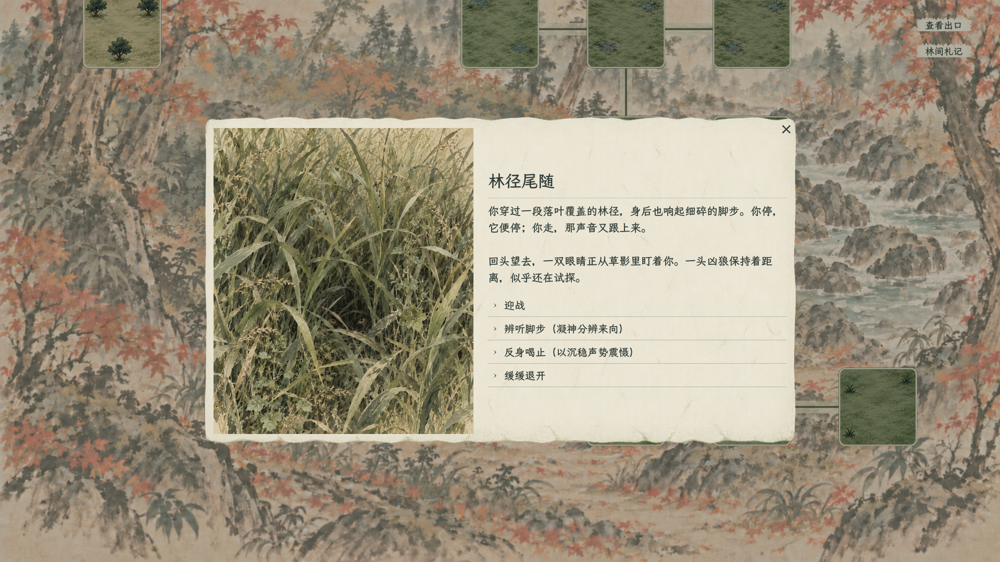
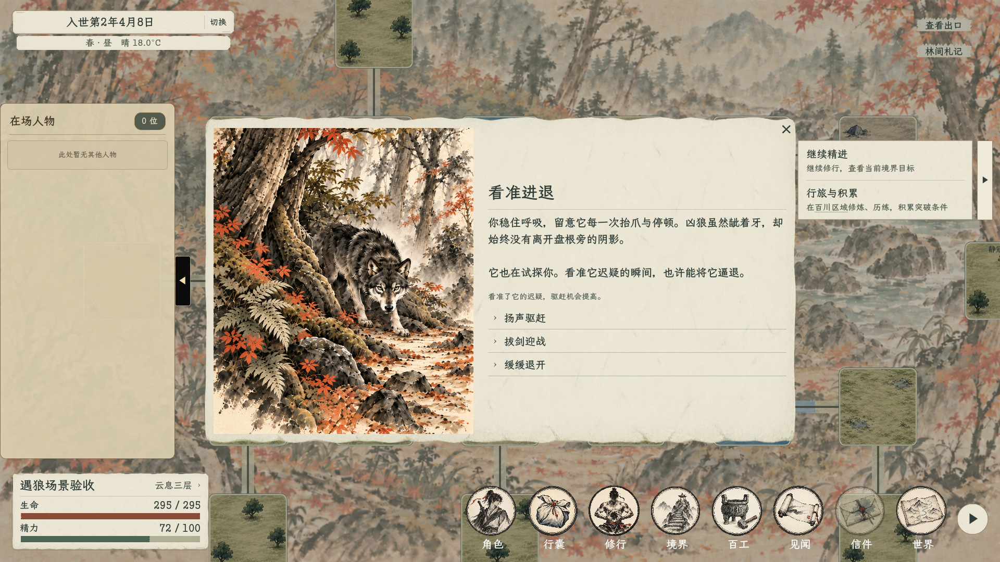

# 林中遇狼首期实装与验收

日期：2026-10-27。首期按[完整事件方案](../../plans/世界与探索/林中遇狼首个完整事件设计_20261026.md)实装；随后按用户要求扩展为[三处遭遇与判定属性提示](../../plans/世界与探索/东林地三处遭遇与判定属性提示_20261027.md)。当前覆盖 `root_hollow`、`outer_08_08`、`outer_13_06` 及这些点的后续刷新个体。

## 本轮扩充

新增“林径尾随”“草间对峙”两组完整遭遇旁白与后续页，沿用既有判定与消耗。玩家选择时看见“辨听脚步（神魂、灵慧）”“踏步逼退（体魄、神魂）”等选项及括号属性提示，多个依据使用顿号；悬停提供白话说明与代价，详细模式补充概率和属性公式。前一处实际退开、驱离或战斗结果为下一处补充开场衔接，记录随首次接触保存，不附带额外数值增益。窗口外框与居中位置保持固定。

[草间对峙与前序衔接](12_草间对峙_属性提示.png)。两张为本轮实际运行截图。

验证：编译0警告／0错误；事件专项无界面、实机均67项通过，包含新增两点的独立个体／记录、真实观察消耗、战前取消、驱离生态、战斗结果回调定位、存档快照、前序旁白及外框稳定。生态和动态副本回归通过。新增两点的战斗返回本轮使用正式回调验证，完整实际战场往返仍以前述首个样板测试为依据；不将回调检查写成新增两点完整战斗通关。日志为 `tmp/ThreeForestEvents_20261027.log`、`tmp/ThreeForestEventsVisual_20261027.log`、`tmp/ThreeForestEcology_20261027.log`、`tmp/ThreeForestDynamic_20261027.log`。

## 已接入体验

- 抵达后弹出左图右文的事件窗口，首次提供迎战、屏息观察、扬声驱赶、缓缓退开四项应对。观察、驱赶直接按属性计算概率，不设属性门槛；精力与执行状态仍校验。
- 观察／驱赶各投入0.5游戏小时、1精力，同一个体各一次；成功与失败更新同一窗口。观察影响本次驱赶概率，不提供战斗增益。结果和凶狼资料随正式存档保留，重开不重抽。
- 迎战进入现有战前页，确认才进入真实战场；取消战前页返回原事件进度。
- 缓缓退开结束战前接触，不判定、不额外花费，角色留在实际地图格。战斗内撤退仍走现有行动队列与逃跑判定；成功后接回事件后续页，凶狼未被清除。
- 驱赶成功单独记为驱离，不计击杀、不给掉落；按现有14日兽群规则补充，玩家仍占据该格时延后。战斗胜利沿用原奖励与完成结算。

## 布局与素材

纸面居中，最大1160×640，随可用画面缩放；左侧约43%为插画，右侧标题、旁白及紧凑选择列表。省去地点副标题。长旁白与多选项独立滚动，窗口不会因内容变长而撑出屏幕。选项悬停查看概率、属性、代价和可能结果，详细说明模式补充公式。

2026-10-27用户要求提升复用程度，当前改用草丛藏眼插画：不露出具体生灵的头脸、耳朵或身体，适用于多种林野生灵遭遇。离场图为同一片草丛去除眼睛。两图使用内置 imagegen 生成／编辑，完整提示词见[通用草丛素材提示词](通用草丛素材提示词.txt)。早期具象狼图留存，旧提示词见[prompts.txt](prompts.txt)。

本次换图后素材导入、编译（0警告、0错误）及事件专项42项复验通过；日志为 `tmp/GrassEyesImport_20261027.log`、`tmp/GrassEyesEventSmoke_20261027.log`。

- 在场图：`res://textures/ui/wildlife_encounter_20261027/grass_eyes.png`
- 离场图：`res://textures/ui/wildlife_encounter_20261027/grass_quiet.png`

### 实机截图

以下为首次实装时的布局和战斗往返截图，其中的具象狼图已被上方通用草丛素材替换。

[首次四选项（1080）](01_首次遭遇_1080.png) · [观察后续](02_观察后续_1080.png) · [驱离结局](03_驱离结局_1080.png) · [驱赶失败](04_驱赶失败_1080.png) · [四选项（720）](05_四选项_720.png)

[实际撤退结算](07_战斗撤退结算.png) · [撤退返回后续](08_战斗撤退后续.png) · [胜利后续](09_胜利后续.png) · [长文与六选项压力页（720）](10_长文与六选项布局测试_720.png)。压力页仅用于布局检查，不是新增剧情选项。

## 验证与边界

- `dotnet build --no-restore --nologo -v quiet`：通过，0警告、0错误。
- `ForestWolfEventSmoke`：无界面及实机均42项通过；涵盖抵达开窗、四项应对、属性概率及上下限、实际时间精力、重复点击、存读档、驱离生态、战前取消、结局续接、720／1080及长文多选项布局。
- `ForestWolfBattleRoundtripSmoke`：无界面及实机通过；实机23项检查，包括完整游戏原生存读档恢复、真实战前确认、实际战场、真实行动队列撤退成功、返回事件、角色身份／精力／历法／观察结果保留、胜利回传与一次性消费。检查数量随随机撤退尝试次数变化。测试不写入玩家存档槽。
- 胜利回传检查用测试代码将敌人生命置零后调用正式结算；验证的是实际结算与场景往返，未把完整攻击操作通关列为本轮验收。
- `EastWoodsEcologySmoke`、`WorldDungeonNavigationSmoke`、`DynamicDungeonExpeditionSmoke`、`DungeonRefreshPerformanceSmoke`、`TianwenReturnSmoke`均通过。性能样本包含5005条历史与64个地图节点。
- 测试日志保存在项目 `tmp/` 中，以 `ForestWolfEvent`、`ForestWolfBattleRoundtrip` 或 `ForestEvent` 开头。引擎退出时仍出现资源／纹理释放警告，另有既存的卸力资源UID回退提示；其他战斗往返检查也出现同类退出警告。本轮断言通过，不将这些提示写成已修复。

本轮覆盖现有三处固定狼源，未新增战斗卡、怪物强度或单线爬塔玩法。下方首期记录及截图用于保存原有验收依据，当前范围以上方本轮扩充为准。
