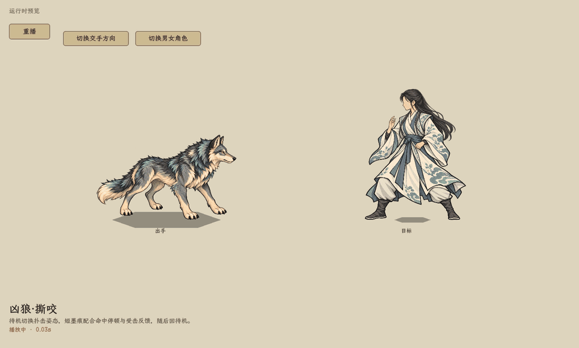
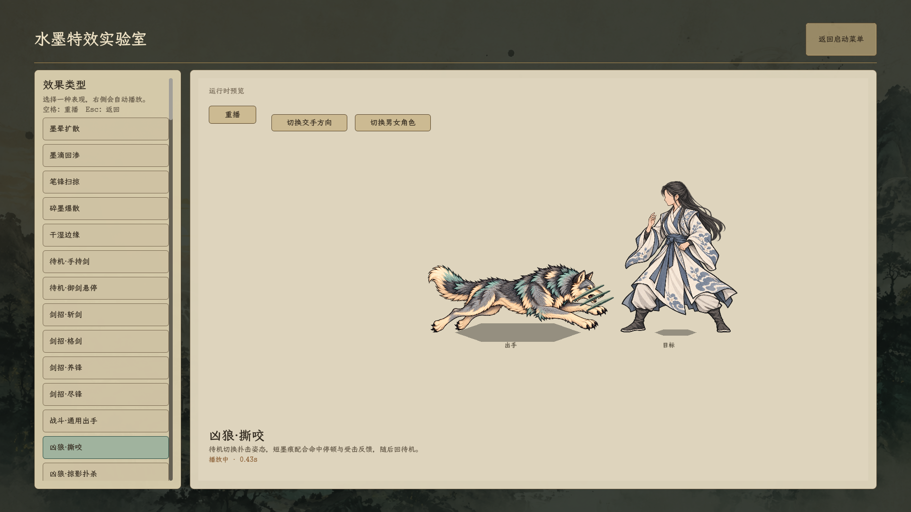

# 林地凶狼扑击与专属墨痕

2026-10-24，现行。用户最新明确：参考人物动作展示，狼从待机到攻击只需两张图，辅以特效表现打击感。当前直接在待机图与扑击图之间切换，取消此前增加的低伏／落地中间姿态、身体升降和独立扑跃轨迹。静态待机保持固定，不做循环浮动。

## 当前画面与查看

启动菜单 → 水墨特效实验室 → **凶狼·撕咬／凶狼·掠影扑杀**。技能目录中的林地凶狼招式也使用狼形预览，切换方向会整体镜像角色与特效。正式战斗共用同一套姿态、特效路由及暂停机制。

- 待机：百科和战斗仍用原透明待机立绘；静态主体不做正弦上下浮动，不添加循环摇晃、旋转或缩放。
- 出手：沿人物现有出招流程，在出手时直接把待机图切成前爪前探的扑击图；命中短停期间保持这一张图。
- 接触：用定向墨痕、短停、局部取景和目标受击动作强调冲击，不给狼本体添加额外升降、旋转或缩放。
- 收尾：攻击图直接恢复待机图，沿既有流程贴地回位；不再插入蓄势图或落地图。受击图仅在狼自身生命受击时使用，与待机到攻击的两图切换独立。
- 特效：沿用现有淡彩水墨、干笔与克制的接触范围。炭墨主笔、灰青边缘和窄幅象牙白锋随扑势前推；撕咬／裂喉接触为短促相向墨痕，掠影扑杀为三道错开的撕痕。短停后笔触断开，少量不对称余屑漂移淡出。特效按狼的显示高度调整，不遮住整颗狼头，不叠加通用受击墨花；受击身体动作保留。

[撕咬接触](bite_game.png) · [扑杀接触](pounce_game.png) · [反向扑击](bite_left_pounce.png)。图片与动图来自原水墨实验室的实际 Godot 渲染，不是合成战斗示意。

## 资源与接入

- 攻击只使用两张图：`textures/bestiary/static/forest_wolf.png` 待机、`textures/bestiary/static/forest_wolf_pounce.png` 扑击。扑击图为1536×1024 RGBA，完整四足与尾巴，头身同向朝左，仅露近侧眼。旧 `forest_wolf_attack.png` 留作历史素材，当前攻击不加载；`forest_wolf_hurt.png` 继续用于狼自身生命受击。
- 内置 ImageGen 编辑生成扑击姿态；参考输入为现有 `forest_wolf_attack.png`。提示要点：保留同一只狼、炭灰／象牙白／克制灰青配色与描线画法；严格左侧面；后腿蹬出、躯干伸展、两前爪向左前探、后腿向右后伸，尾巴平衡；透明底，四足和尾巴完整；不包含特效、地面、影子或文字。生成源图保留在本次 ImageGen 输出目录，项目使用图已复制到上述正式资源路径。
- 特效为项目原生着色器 `shaders/battle_forest_wolf.gdshader`，不是图像生成素材；形态、干笔、接触和消散均由现有演出时钟推进。
- `BattleInkCombatVfx.ForestWolf.cs`：只为当前林地凶狼外观的撕咬、裂喉和掠影扑杀路由专属效果。其他角色与技能沿用各自效果。
- `BattlePaperDoll.cs`：静态主体固定、待机／攻击两图切换与接触保持；`SkillExecutor.cs` 与原实验室共用表现流程，接触墨痕替代此次通用受击墨花。
- `tools/capture_forest_wolf_effects.gd`：原实验室录制，检查攻击期间只出现待机／扑击两张图、暂停时进度固定、待机时位置固定。

## 边界与验证

只调整姿态、表现轨迹与特效，不编辑技能资源，不新增费用、资源、射程、目标、伤害、状态、准备／收招属性或存档字段。准备、前冲、接触与回位的既有时间保持；战斗中的表现位移不改变逻辑地格。队首应对、暂停、接触短停及行动收尾仍使用现有流程。

本轮 C# 编译通过，0警告、0错误。D3D12 实际渲染完成撕咬、掠影扑杀与反向撕咬，共81张录制帧；三组攻击均只使用待机／扑击两张图，暂停期间特效进度不变，动作结束后的12帧静态立绘位置完全不变。[录制与检查日志](capture.log)。

完整 `BattleAttackStagingSmoke` 尝试在创建原 BattleSandbox、加载原有功法资源阶段触发 Godot 托管对象回收异常，未运行到凶狼检查，不记作通过；[检查尝试日志](staging_attempt.log)。实验室已完成视觉查看，不据此声称完整战斗链路回归通过。部分现有技能资源仍有 UID 文本路径回退警告；最新录制在81帧及全部检查完成后，退出时触发 `godotsharp_array_destroy` 托管数组回收异常，进程退出码1。此前退出也出现纹理释放／RID 泄漏警告，这些退出问题未在本次表现任务中处理。
