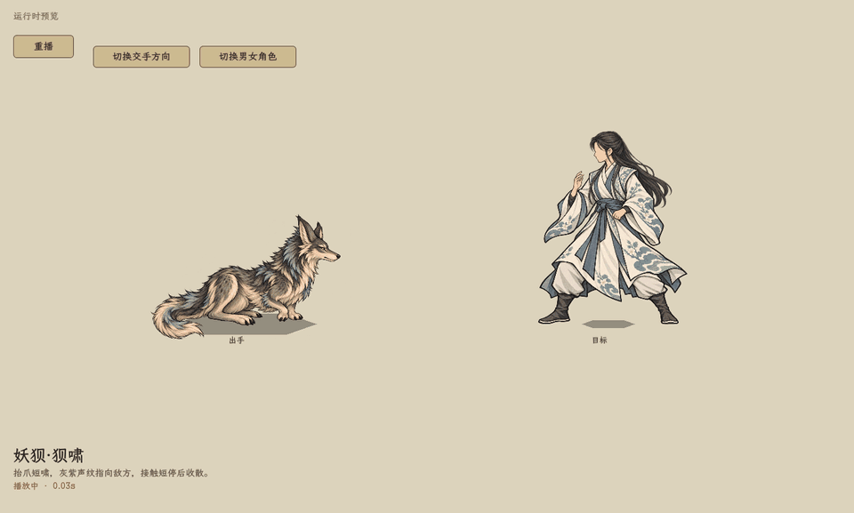

# 林地妖狈技能、属性与两图动作

2026-10-25，已接入首版。用户确认属性与狈啸参数，并将唤猎明确改为全体友方狼。主案见[林地妖狈与狈首机制设计](../../plans/林地妖狈与狈首机制设计_20261025.md)，技能图与文字见[卡牌词典](../../卡牌词典/妖兽/林地妖狈/README.md)。

## 游戏内查看

- 启动菜单 → 水墨特效实验室 → **妖狈·狈啸／妖狈·唤猎／妖狈·受击**；可切换交手方向。
- 启动菜单 → 战斗测试 → 敌方单位选 **林地妖狈** 或 **狼狈组合（1狈＋狼）**。组合至少两只，首只为狈，其余为狼；保持原测试资源上限设置。
- 百科 → 妖兽 → **林地妖狈**：固定待机、三项属性、派生面板与狈首说明。

[狈啸](cry_game.png) · [唤猎](call_game.png) · [受击](hurt_game.png) · [反向](cry_left_game.png)。实验室唤猎画面以一只友狼展示反馈，实际技能筛选全体存活的友方林地凶狼，机制检查包含两只友狼、敌方狼和其他兽种。

## 技能与属性

| 项目 | 当前内容 |
| --- | --- |
| 属性范围 | 体魄6～8（均值7）、灵慧7～9（均值8）、神魂8～10（均值9） |
| 均值基础生命 | 176，沿用现行妖兽公式；物理防御0 |
| 狈啸 | 1体力，对指定1名敌方造成远程神魂伤害：round(4＋灵慧×0.6＋神魂×0.8)；均值基础值16，实际伤害仍走原有对抗与结算 |
| 唤猎 | 1体力，全体存活的友方林地凶狼各获得1层逐猎，最多3层，含同物种变种；不作用于敌方狼、狈或其他兽种 |
| 狈首 | 自身存活时，友狼触发群猎也补给发动者自身1层逐猎；多个狈首不重复生效；狈离场停止后续补给，已有层数保留 |

两招不消耗法力、不占灵识，正常占用行动槽；无0费、返费、抽牌、额外行动或新资源。只使用既有逐猎状态，不提高上限，不改变原群猎的其他触发边界。唤猎不造成攻击，不触发群猎／狈首。AI根据未满层的合法友狼选择唤猎，避免没有受益对象时偏好空放。

## 素材与表现

- 待机：`textures/bestiary/static/forest_bei_v1.png`。
- 攻击／指挥：`textures/bestiary/static/forest_bei_attack_v1.png`。
- 受击：`textures/bestiary/static/forest_bei_hurt_v1.png`。

三图均1536×1024 RGBA透明底。头与身体朝左，仅露近侧眼；战斗中整体镜像面向对手，不单独转头。保留短前肢、强后肢、窄脸大耳和灰褐／象牙白／灰青毛色。攻击是抬爪短啸；受击是收肩伏耳。攻击从固定待机直接切一张出招图，受击单独切一张图，结束后恢复待机；不增加蓄势、落地图或上下浮动。地面锚点取足部参考线，避免尾尖拖低导致脚掌悬空。

两张新图均使用**内置 ImageGen**，以现有狈待机图为编辑输入。攻击提示：同一只成年狈、朝左严格侧脸、抬起短前爪、横向短啸、后肢支撑落地、无特效与背景。受击提示：同一物种、头仍朝左、收肩回缩、伏耳、短前爪收近胸口、后肢支撑、无伤口血迹。输出保留生成透明通道并复制到上述项目路径，未覆盖待机图。

特效为原生 `shaders/battle_forest_bei.gdshader`：狈啸使用灰紫／象牙白短声纹，向目标收束；唤猎与真实逐猎增量使用局部灰青反馈。接触短停、暂停、取景和动作收尾沿用当前战斗时钟。角色本体保持比例，受击保留既有短促后缩，独立通用受击墨花不会盖住本次声纹接触效果。

## 接入与验证

`BattlePaperDoll` 复用静态兽类姿态配准；狼与狈保留各自资源身份和特效。`BattleManager.ForestBei.cs` 负责同阵营存活狈首与友狼筛选；`SkillExecutor` 的唤猎效果一次分发到全体合法狼，不按狼数量重复支付或触发。目标说明、技能详情、词典与测试选项都明确写出全体友狼。

- 编译成功，0警告、0错误。
- [机制检查日志](smoke.log)：`tools/ForestBeiSmoke.tscn` 使用真实妖兽、状态资源与辅助效果分发，检查均值属性、公式、费用、目标文案、原群猎不变、多狈不叠加、狈死亡、全体狼、阵营／物种过滤、3层上限与零增量。进程退出码0。
- [动作录制日志](capture.log)：`tools/capture_forest_bei_actions.gd` 在原实验室录制90帧；三项动作及镜像仅出现对应待机／动作两张图，待机位置固定，声纹暂停时进度固定。进程退出码0，退出清理仍报告原有ImageTexture／RID释放警告，运行中没有新增脚本或着色器错误。
- 两份 `.drawio` 已通过XML解析；词典图／文字与资源采用同一费用、公式、目标与状态上限。

验收：效果／数值／费用／目标与已确认主案一致；未新增未定义的基础属性、资源、状态、射程或战斗位移；无0费循环、返费、抽牌与额外行动；数据、词典和显示文案已同步。本轮验证覆盖机制与原生渲染预览，尚未做完整实战长流程、野外掉落或遭遇刷新验收，未新增野外遭遇。
