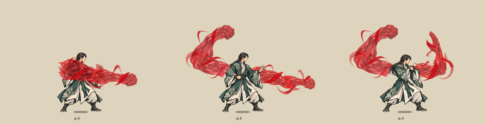
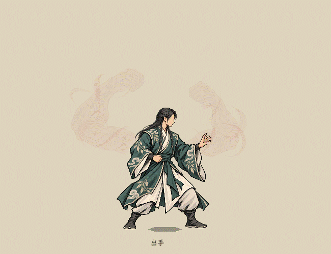

# 气血法相：选定主体与实时环绕血气

状态：2026-10-20，已替换水墨特效实验室的血臂表现，供画面评审。此页是当前血臂表现入口，前版纯轮廓材质、投影肌肉网格均为历史候选。

## 用户确定的制作方式

沿用用户选定参考的血手主体，外围血气由游戏实时绘制。以[双臂V4](../气血悬臂实时材质_20261020/法相构图参考_20261020/two_arms_v4.png)为造型依据，单臂采用右向人物画面左侧的一只；第二只在另一侧显化，略小但体量接近。掌心朝自身，悬浮在肩背高度附近，与角色整体转向。

**最新层级修订**：用户指出右臂压住人物不合适，现两臂整体均放到人物身后，保留左右臂彼此的远近次序。各臂的前景血气仍低于人物层，不能压住衣服。此修订取代此前“一臂在人物前”的方案。

**攻击遮挡补充**：血手出拳时，受击者必须在血手下面；“人物在上”特指血手的施法者。当前顺序为受方＜血手及环绕血气＜施法者；动作期间将施法者和所属血臂作为一组提到受方上方，组内仍保持血臂低于自身衣服。动作结束、取消或退出树时恢复原始层级。化解接触也沿用此排序，不能把血手同时压到敌我双方下面。

**2026-10-21 单臂追击例外（现行）**：单臂出拳动作帧的血臂主体、前后环绕血气整体高于施法者，遮挡顺序为受方＜施法者＜单臂追击血手。切回待机图立即恢复到本人身后；双臂追击、双臂应对仍按上一段排序。镜像、暂停及命中停顿共用这条层级选择。

本轮用内置图像编辑工具分离既有左右透明图，移除外围静止飘带、飞点，保留拳势、肌肉、半透明红色折面。后续补充三张动作关键帧。当前素材在`textures/vfx/blood_qi_avatar_20261020_v4/`，共五张2048×2048 RGBA；源图、提示词和透明统计保存在该目录。外围环绕效果不烘焙进主体图，V3作为此前常驻素材留档。

资产：[左臂待机](../../../textures/vfx/blood_qi_avatar_20261020_v4/left_idle.png)、[右臂待机](../../../textures/vfx/blood_qi_avatar_20261020_v4/right_idle.png)、[单臂追加帧](../../../textures/vfx/blood_qi_avatar_20261020_v4/left_punch.png)、[双臂追加右臂帧](../../../textures/vfx/blood_qi_avatar_20261020_v4/right_punch.png)、[双臂应对右臂帧](../../../textures/vfx/blood_qi_avatar_20261020_v4/right_guard.png)、[内置图像编辑提示词](../../../textures/vfx/blood_qi_avatar_20261020_v4/generation_prompts.json)、[画布与透明统计](../../../textures/vfx/blood_qi_avatar_20261020_v4/asset_manifest.json)。

## 三个动作关键帧与人物衔接

| 场合 | 行动血臂 | 人物姿势 | 血臂回位 |
| --- | --- | --- | --- |
| 单臂追加攻击 | 左臂伸肘出拳 | 自己攻击命中后，收回待机，再由血臂追加 | 收回左臂悬浮姿势 |
| 双臂追加攻击 | 只动右臂，左臂持续悬浮 | 同上，血臂追加时人物待机 | 收回右臂悬浮姿势 |
| 双臂应对攻击 | 右臂竖掌拦截，左臂持续悬浮 | 采用现有防御姿势，应对结束回待机 | 竖掌帧切回右臂悬浮姿势 |

左右以右向人物基准图为准，反向时整组镜像。双臂追加只演示一次接触，不再把两条血臂依次出拳。上述动作选择仅改表现，不定义次数、伤害、自动应对概率等战斗规则。

人物完成自己的攻击后先收招，再用短距离移步对准动作图中拳头的落点；这只是实验室演出站位，避免通过拉长手臂来追目标。所有姿势的图层显示比例保持一致。

[最新双臂追加接触实录：受方在血手下](follow_double_closeup.gif)。动作记录见[录制日志](capture_actions.log)，三帧定格记录见[定格录制日志](capture_keys.log)。

源图均以1.25的相同倍率注册，只平移到固定肩端锚点，不按每张可见边框独立缩放。左臂画布锚点为(720,1184)，右臂为(900,1178)，所有姿势使用同一显示比例。动作伸展通过肘、腕和拳的重画完成，运行时不拉长或放大血臂。

按肩端→肘→腕→拳／指端人工标定的中心线折线估算（原图像素）：

| 对照 | 待机近似长度 | 动作近似长度 | 差异 |
| --- | ---: | ---: | ---: |
| 左臂出拳 | 1268 | 1204 | -5.0% |
| 右臂出拳 | 1087 | 1051 | -3.4% |
| 右臂拦截 | 1087 | 1099 | +1.1% |

这是形体中心线长度，不是拳头与人物的直线距离；肘部展开后，拳头自然伸得更远。第一版偏短的右臂出拳已重画，未用整图放大补偿。标定点与透明边界见素材清单及制作脚本。

## 实时表现

- 沿每条手臂的肩端、肘、前臂、腕和拳头布置曲线路径，两股宽窄交替的血红飘带围绕该路径绕行。笔锋随时间展开、变窄、断开，避免不变的细线圈。
- 环绕路径有前后深度。跨越深度零点时准确分段，背面段绘制在手臂下，正面段绘制在手臂上。透明膜允许少量透见背面，保留通透感。
- 少量细碎血光沿外围漂移、收细淡出。主体表面浮光沿肩端到指端行进；采用深红、血红和少量红亮部，不增加全屏泛光或白雾。
- 主体和环绕层共用变换，追随人物实际位移、朝向、姿势站位和局部取景。暂停和命中停顿冻结同一个本地时间，恢复后连续播放。
- 沿用显臂起点T至T+16层的视觉增长，最大后封顶。滑杆只驱动样片大小，不定义气血上限或秘籍门槛。

## 查看

启动菜单 → **水墨特效实验室** → 左侧列表下方的**血臂·单臂显化／双臂显化**。顶部可改当前气血、显臂起点、男女角色与交手方向。追加出拳、自动化解、透明消散入口沿用。

[单臂实录](single.gif)、[双臂实录](double.gif)、[单臂追加](follow_single.gif)、[双臂追加](follow_double.gif)、[女修镜像化解](guard.gif)、[消散](fade.gif)、[增长封顶](growth.gif)。动图来自Godot实际画面；局部版只裁去周围界面，未重新绘制画面。

## 范围与记录

本轮为特效样片，秘籍的追加伤害、化解概率、层数消耗和正式触发仍由后续规则实现负责。未修改卡牌、技能、存档或结算数据。常驻图沿用选定拳势，追击和化解切换本轮新增出拳／竖掌关键帧，外围血气按各帧的手臂曲线同步绕行；缺少动作图时回退到同一只血臂的待机图。

实现：`BattleBloodQiArms.cs`管理常驻、动作和人物跟随；`BattleBloodQiOrbit.cs`绘制前后分层飘带与血光；`battle_blood_qi_body.gdshader`绘制主体流光，`battle_blood_qi_orbit.gdshader`绘制血气边缘与笔触。旧纯程序几何臂不再调用。

已编译并录制实际画面，录制未发现脚本或材质错误。透明图保留固定坐标，不自动裁边。色彩、血气形态和动态演出仍待用户评审。
