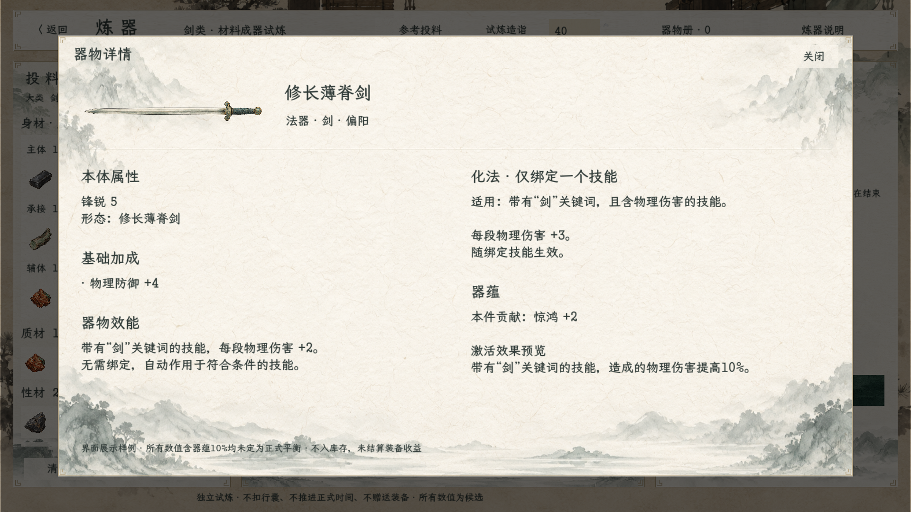

# 法器剑属性展示样例

2026-10-23。用户要求在游戏内查看一般法器剑的属性。截图由真实炼器场景运行并渲染，采用已有纸墨界面、剑图和字体；不是图片生成或后期拼接。

截图为本次范围文案修订前的历史留档；当前格式以本说明中的“适用范围／化法追加”为准。

## 样例内容

修长薄脊剑，法器，偏阳；锋锐5、物防+4；带有“剑”关键词的技能每段物理伤害+2；化法直接显示适用范围“带剑关键词且造成物理伤害的技能”及每段物理伤害+3的追加；本件贡献惊鸿+2，并展示百分比奖励预览10%。

全部数值均为界面示例，不是炼制公式产物或正式平衡。惊鸿10%没有成为正式器蕴参数，也没有结算为角色已激活收益。样本无获授主动技能，不额外生成器体/灵识面板。

## 运行边界与验证

- 在原炼器场景使用独立参数 `--preview-sword-item` 打开展示；普通入口和实际生成的成器数据保持原状。
- 展示采用独立内存样本，未写入本页库存、正式行囊、装备或存档；不声称已实现固定值生成、化法绑定或器蕴汇总。
- 复用器物图标、身份与基础属性展示适配器；双列详情为样例预览布局，尚未替换正常成器详情页。
- .NET编译0警告、0错误；真实场景运行输出 `SWORD_ITEM_PREVIEW_OK`，已查看1920×1080截图，文字无截断。未进行人工鼠标试玩。

设计依据：[固定值收益](../../plans/剑关键词与器物固定值收益设计_20261023.md)、[器蕴与词条](../../plans/器蕴与剑类词条设计_20261023.md)。
